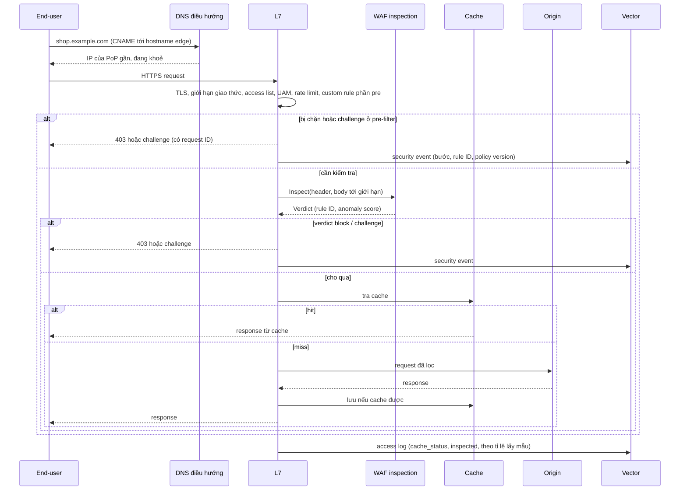
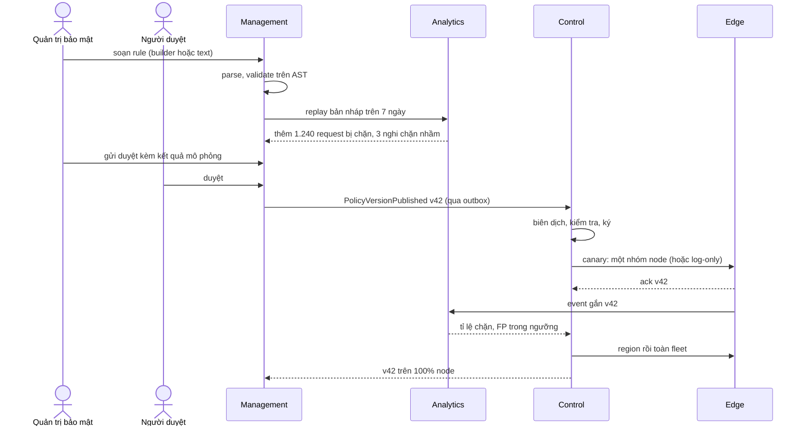
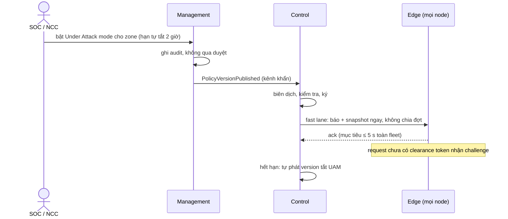
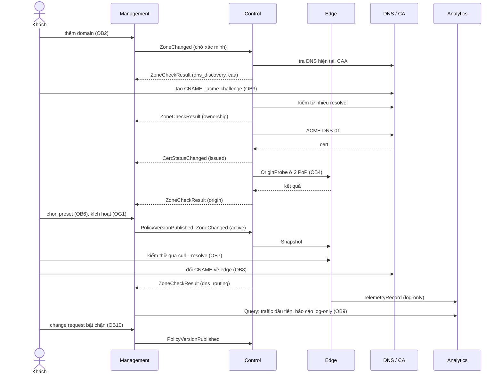
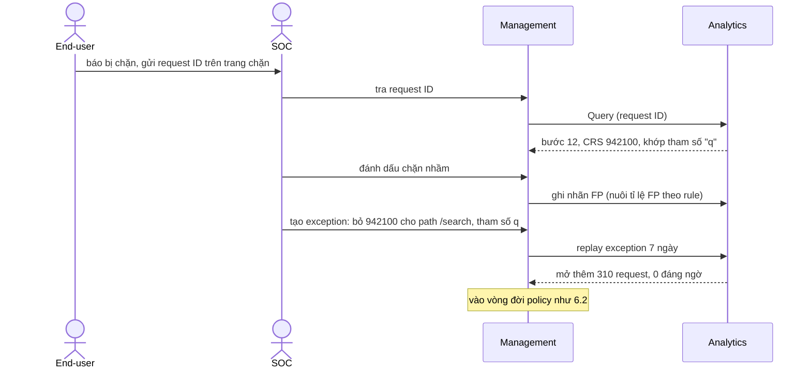
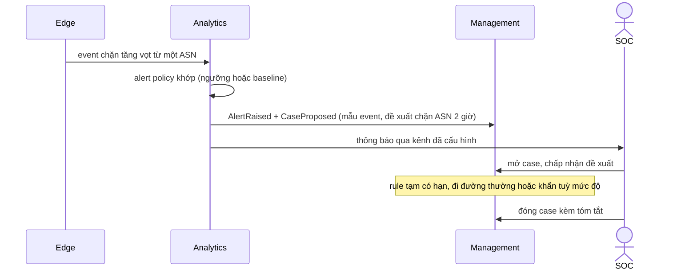

# 6. Runtime View

Các kịch bản chính, mỗi kịch bản là một luồng xuyên plane.

| # | Kịch bản |
|---|---|
| 6.1 | [Một request qua edge](#61-một-request-qua-edge) |
| 6.2 | [Thay đổi policy theo đường thường](#62-thay-đổi-policy-theo-đường-thường) |
| 6.3 | [Bật Under Attack mode, rule khẩn](#63-bật-under-attack-mode-rule-khẩn) |
| 6.4 | [Onboarding một zone](#64-onboarding-một-zone) |
| 6.5 | [Xử lý một request bị chặn nhầm](#65-xử-lý-một-request-bị-chặn-nhầm) |
| 6.6 | [Cảnh báo và case](#66-cảnh-báo-và-case) |
| 6.7 | [Phát hành CRS hoặc system ruleset mới](#67-phát-hành-crs-hoặc-system-ruleset-mới) |
| 6.8 | [Edge node khởi động, mất kết nối, phục hồi](#68-edge-node-khởi-động-mất-kết-nối-phục-hồi) |
| 6.9 | [Đổi gói subscription](#69-đổi-gói-subscription) |
| 6.10 | [Luồng Analytics](10-analytics-flows.md): đường ghi, ngân sách độ trễ, dashboard, điều tra, cảnh báo, export, replay, gate, metering, retention, lỗi theo chặng |

## 6.1 Một request qua edge



Không bước nào gọi mạng ra ngoài PoP, ngoài kết nối tới origin. Request bị chặn ở pre-filter không
tốn CPU của tầng WAF.

## 6.2 Thay đổi policy theo đường thường



Gate hỏng ở bất kỳ đợt nào: orchestrator dừng, đưa các node đã nhận về version trước, báo trạng
thái về Management.

**Biến thể theo luồng [3.2](../../requirements/03-business-analysis/02-policy-change.md) (duyệt 2026-11-17):**

| Biến thể | Khác với sequence trên |
|---|---|
| Org một người | Không có người duyệt thứ hai: người gửi tự xác nhận diff rồi phát hành, không có thời gian chờ; vẫn có diff, kiểm và rollback. 4-eyes chỉ bật được khi account có ít nhất hai người có quyền duyệt (BR-40) |
| Rollback | Về một version đã từng được duyệt thì không cần duyệt lại (BR-40) |
| Support của NCC sửa policy | Chỉ khi khách đã cấp quyền (BR-41); change request đứng tên support, cần một người của khách duyệt |
| Template ảnh hưởng nhiều zone | Một change request, duyệt một lần; Control phát theo đợt; zone biên dịch lỗi bị bỏ qua và báo ở `CompileResult`, không chặn cả nhóm |
| Khách thấy tiến độ | `RolloutProgress` hiện canary đang ở đâu và bao nhiêu % node đã áp; phát theo phần trăm traffic để Nâng cao |
| Thay đổi không ảnh hưởng traffic | Đổi tên, mô tả, tag: không qua change request, vẫn ghi audit (BR-39) |

## 6.3 Bật Under Attack mode, rule khẩn



Rule khẩn của NCC (zero-day) đi cùng đường, bắt đầu từ console NCC thay vì Management của khách,
và nằm trong bundle chung.

**Theo luồng [3.3](../../requirements/03-business-analysis/03-attack-response.md) (duyệt 2026-11-17):** NCC bật mitigation không cần hỏi khách ở mọi gói; khách được báo ngay và
tắt được, trừ khi tấn công đang ảnh hưởng khách khác (BR-41). Zone vượt khả năng: Analytics gửi `IsolationRequested`, Control chuyển zone
sang cell cách ly; nếu vẫn quá khả năng thì áp challenge cho mọi request và trần rps cứng cho zone. **Không bao giờ trả DNS về origin** (BR-42).
Rule tạm hết hạn tối đa sau 72 giờ (OQ-5); mỗi bước đều gửi thông báo cho khách.

## 6.4 Onboarding một zone

> Luồng onboarding đã duyệt 2026-11-17 ([requirements §3.1](../../requirements/03-business-analysis/01-onboarding.md), phụ lục A). Sequence dưới
> là **đường chính** (DNS đầy đủ, origin có IP public, cổng chuẩn); các biến thể ở bảng ngay sau sơ đồ.

Đường chính: xác minh và cert xong
**trước** khi khách đổi DNS, bật chặn chỉ sau giai đoạn log-only có số liệu.



**Biến thể theo luồng 3.1:**

| Biến thể | Khác với đường chính |
|---|---|
| Zone chỉ một hostname (OQ-21) | `ZoneChanged.scope = hostname`; khách chứng minh quyền với chính hostname; zone này không giữ claim của apex (BR-53) |
| Kiểm domain lúc thêm zone (OQ-150) | Control đối chiếu danh sách đen đã biết, `ZoneCheckResult(denylist)`; phần còn lại xử lý qua abuse |
| Xác minh dự phòng (OQ-147) | Thay `_acme-challenge` bằng TXT tên khác hoặc file HTTP đặt ở origin; không dùng email |
| Khách chỉ đổi được A/AAAA | Trỏ A/AAAA về dải IP dùng chung (OQ-22); xác minh bằng file HTTP; cert tải lên hoặc cấp bằng HTTP-01 sau khi traffic tới (cảnh báo khoảng lỗi HTTPS) |
| Cảnh báo traffic không phải HTTP (OQ-24) | `ZoneCheckResult(nonhttp)` từ DNS: MX, SRV, hostname khác cùng IP với apex; không quét cổng origin |
| Kiểm thử OB7 (OQ-148) | Edge gửi vài request về origin, `ZoneCheckResult(origin_problem)` báo vòng chuyển hướng, `403`/`429` từ origin, nội dung hỗn hợp |
| Challenge ACME của origin (OQ-31) | Edge chuyển `/.well-known/acme-challenge/` về origin khi token không phải của NCC |
| Hoàn tất OG4 (OQ-32) | `ZoneCheckResult(dns_routing)` theo từng họ IP (`a`, `aaaa`); còn một họ trỏ thẳng origin thì không cho hoàn tất (BR-52) |

## 6.5 Xử lý một request bị chặn nhầm



**Theo luồng [3.4](../../requirements/03-business-analysis/04-false-positive.md) (duyệt 2026-11-17):**

- Trang chặn của mọi gói có request ID và thông tin liên hệ do chủ website cấu hình. Từ gói Pro có nút "báo chặn nhầm": edge ghi một `TelemetryRecord` loại `fp_report` (chỉ request ID và mô tả ngắn, có giới hạn tần suất và challenge chống spam); Analytics chuyển thành `FalsePositiveReported` vào hộp thư zone ở Management. Edge không gọi Management trực tiếp.
- `Query` theo request ID chỉ trả payload cho người có quyền riêng "xem dữ liệu request" (mặc định security admin); mật khẩu, `Authorization`, cookie phiên, token, số thẻ luôn bị che (BR-44).
- Exception luôn qua change request như 6.2; rollback về version đã duyệt hoặc mitigation tạm khi gấp. Nhãn chéo tenant chỉ dạng thống kê gộp (BR-45).

## 6.6 Cảnh báo và case



## 6.7 Phát hành CRS hoặc system ruleset mới

1. Ruleset release kéo CRS mới (hoặc nhận bản system ruleset từ threat research).
2. Chạy regression: traffic mẫu tốt (không được chặn) và mẫu tấn công (phải chặn), đo độ trễ.
3. Gắn version, đưa vào config store.
4. Rollout trên toàn fleet ở chế độ **log-only song song**: bản cũ vẫn quyết định, bản mới chỉ
   ghi event, để so sánh tỉ lệ chặn trên traffic thật.
5. Zone chọn "tự nhận bản mới" được chuyển sau khi gate qua; zone cố định version thấy thông báo
   và danh sách rule thay đổi.

**Theo luồng [3.2](../../requirements/03-business-analysis/02-policy-change.md) (duyệt 2026-11-17, BR-54):** rule mới của release vào zone ở log-only **7 ngày** có báo cáo, rồi tự chặn.
Business trở lên chọn "duyệt thủ công": release thành change request chờ duyệt. Enterprise ghim version tối đa 90 ngày. Rule khẩn cho CVE áp ngay
ở chế độ chặn trong lớp rule khẩn chạy trước CRS; khách tắt bằng tuning rule (BR-25).

## 6.8 Edge node khởi động, mất kết nối, phục hồi

- **Khởi động:** node xác thực với Control bằng danh tính đã cấp khi enrollment, kéo bundle chung
  và mọi bundle zone được gán, kiểm chữ ký, nạp; chỉ nhận traffic sau khi nạp xong.
- **Mất Control:** chạy tiếp bằng snapshot hiện có vô thời hạn; health check của PoP vẫn xanh.
- **Mất Analytics:** log vào buffer đĩa; đầy thì bỏ access log trước, giữ security event.
- **Phục hồi:** agent so version với Control, kéo bản đầy đủ nếu lệch; log shipper xả buffer theo
  thứ tự thời gian.

## 6.9 Đổi gói subscription

1. Khách đổi gói trong Management; thanh toán xác nhận.
2. Management phát `EntitlementsChanged`.
3. Control đưa giới hạn áp ở edge (tỉ lệ lấy mẫu, số rule, giới hạn tài nguyên) vào bundle zone
   kế tiếp; Analytics áp retention và giới hạn truy vấn mới.
4. Hạ gói không xoá ngay dữ liệu cũ hơn retention mới: dữ liệu hết hạn theo lịch, khách được báo trước.

**Theo luồng [3.5](../../requirements/03-business-analysis/05-plans-billing.md) (duyệt 2026-11-17):**

- **Nâng gói:** `EntitlementsChanged` có hiệu lực ngay; Management tính phần còn lại của gói cũ vào gói mới kèm bonus 10% (BR-49).
- **Hạ gói:** hiệu lực cuối kỳ (`effectiveAt`). Nếu khi đó khách vượt giới hạn mới: cảnh báo sau 6 giờ, 12 giờ, rồi mỗi ngày trong 3 ngày ân hạn (`graceUntil`), hết hạn thì không cho tạo thêm vượt giới hạn và phần vượt (mới nhất trước) ngừng áp; không khoá tài khoản.
- **Retention mới:** báo trước 7 ngày rồi mới áp (`retentionApplyAfter`); khách xuất log trước nếu muốn giữ (BR-50).
- **Huỷ:** gói tháng không hoàn; gói năm hoàn theo tháng chưa dùng trừ chiết khấu; không có gói tạm ngừng (BR-51).

## 6.11 Gỡ zone, rời dịch vụ, chuyển zone

Theo luồng [3.7](../../requirements/03-business-analysis/07-offboarding.md) (duyệt 2026-11-17).

```mermaid
sequenceDiagram
    actor K as Khách
    participant M as Management
    participant C as Control
    participant E as Edge
    participant A as Analytics
    K->>M: gỡ zone (đã xuất cấu hình, log)
    M->>C: ZoneChanged (state = passthrough)
    C->>E: Snapshot: chuyển tiếp thẳng tới origin, không bảo vệ, không cache
    Note over E: 30 ngày, nhắc khách hằng tuần
    C->>M: hết 30 ngày
    M->>C: ZoneChanged (state = removed)
    C->>E: Snapshot: trang giải thích "zone đã gỡ"
    M->>A: DataErasureRequested (hold 30 ngày; log, audit theo retention)
```

- **Zone gỡ mà DNS còn trỏ:** `passthrough` 30 ngày, không lỗi im lặng (BR-55). Zone bỏ hoang đi theo BR-9, rồi 30 ngày tối giản và 30 ngày `passthrough`.
- **Xoá org:** huỷ được trong 30 ngày (chỉ owner); zone gỡ nhầm khôi phục cấu hình trong 30 ngày; bản sao lưu giữ tối đa 35 ngày (BR-56).
- **Chuyển zone sang org khác:** cần owner hai org xác nhận; `ZoneTransferred`: policy đi theo, log, audit, hoá đơn ở lại org cũ, bí mật bị xoá (BR-57).
- **Hết hợp đồng Enterprise:** 30 ngày chuyển tiếp giữ nguyên dịch vụ; chuyển gói tự phục vụ hoặc như zone bỏ hoang; thu hồi cell và database riêng sau 30 ngày kèm xuất dữ liệu.
- **NCC đóng PoP, rút region:** báo trước 90 ngày (Enterprise 180), kèm dải IP mới cho khách đã khoá firewall theo IP (BR-58).
