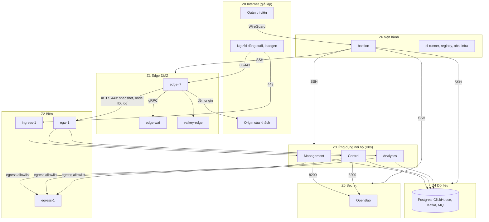
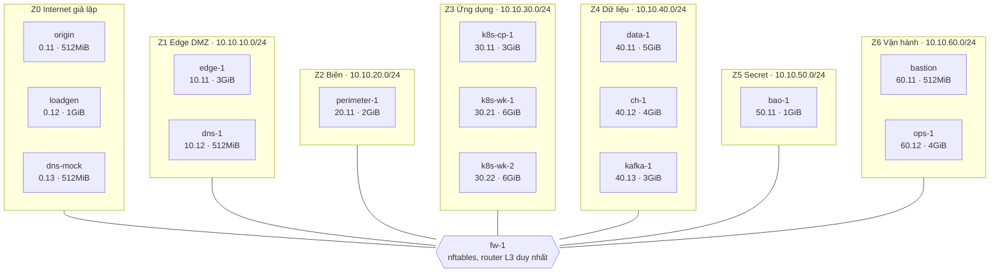
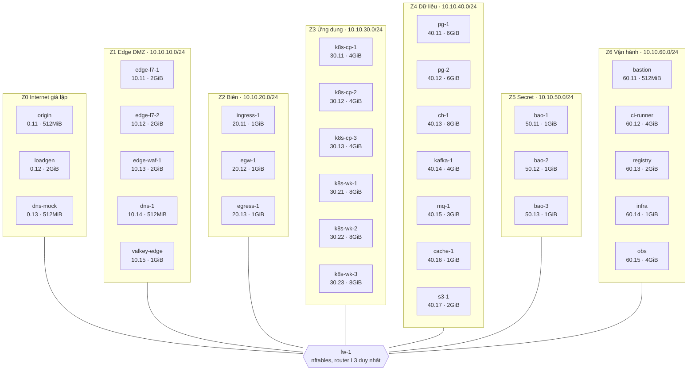

# 7.6 Mạng, vùng tin cậy và ma trận luồng

> **Trạng thái: đề xuất của Claude, chờ chủ dự án duyệt (2026-11-13).** Chủ dự án đã chốt lab chạy trên **máy ảo**
> và yêu cầu **chia vùng mạng hợp lý**; thiết kế dưới đây là câu trả lời cho yêu cầu đó, nằm trong bước 0 của
> [kế hoạch lab](../../../labs/PLAN.md). Quyết định kèm theo: [ADR-0047](../09-adr/0047-network-zones-and-default-deny.md); chuẩn node [ADR-0048](../09-adr/0048-node-baseline-and-hardening-profiles.md), GitOps [ADR-0049](../09-adr/0049-gitops-and-devsecops-per-plane.md), secret [ADR-0050](../09-adr/0050-secret-management-and-rotation.md).
> Các số (dải IP, số máy) là mặc định để dựng lab, đổi được. Các luồng giữa plane lấy từ
> [5.5](../05-building-blocks/05-contracts.md), [5.8.6](../05-building-blocks/08-components/06-rollout-distribution-fleet.md),
> [8.19](../08-cross-cutting/19-node-identity-and-mtls.md), không bịa thêm luồng nào.

## 1. Nguyên tắc

1. **Mặc định chặn tất cả.** Mỗi luồng được phép là một dòng trong [ma trận ở §4](#4-ma-trận-luồng). Không có dòng thì không có đường.
2. **Edge không với tới thứ gì ngoài cổng của nó.** Edge chỉ đi **ra** cổng edge ở vùng biên (Control, ingest). Không có đường từ edge tới
   Management, dữ liệu, secret hay vận hành ([ADR-0001](../09-adr/0001-four-planes.md); quy tắc "edge không nói chuyện trực tiếp với Management").
3. **OpenBao không lộ ra mạng edge.** Node xin cert qua node identity service ở Control, dịch vụ này mới nhờ OpenBao ký
   ([ADR-0045](../09-adr/0045-short-lived-node-certs-and-reenroll.md)).
4. **Không có đường ra Internet trực tiếp** từ vùng ứng dụng, dữ liệu, secret. Mọi egress đi qua một máy egress có allowlist (cũng là nơi áp
   SSRF guard cho webhook của khách). Ngoại lệ duy nhất: `edge-l7` đi tới origin của khách.
5. **Ba lớp chặn chồng nhau:** firewall giữa các vùng, firewall trên từng máy, NetworkPolicy trong K8s. Một lớp sai không đủ để mở đường.
6. **mTLS cho mọi liên kết nội bộ** (cert ngắn hạn, 8.19); không tin địa chỉ IP làm danh tính.
7. **Quản trị chỉ qua bastion** (WireGuard cộng MFA), có ghi phiên. Không SSH trực tiếp từ ngoài.

## 2. Vùng tin cậy

| Vùng | VLAN, dải IP đề xuất | Chứa | Mức tin |
|---|---|---|---|
| **Z0 Internet (giả lập)** | `10.10.0.0/24` | `loadgen`, `origin` giả, người dùng cuối, DNS bên ngoài (`dns-mock`) | Không tin |
| **Z1 Edge DMZ** | `10.10.10.0/24` | `edge-l7`, `edge-waf`, `dns-1`, `valkey-edge` | Thấp: nhận traffic công khai, coi như có thể bị chiếm |
| **Z2 Biên (perimeter)** | `10.10.20.0/24` | `ingress-1` (portal, API), `egw-1` (cổng edge: relay, đầu mTLS), `egress-1` (đường ra có allowlist) | Trung bình: chỉ chuyển tiếp, không chứa dữ liệu |
| **Z3 Ứng dụng nội bộ** | `10.10.30.0/24` | K8s control-plane và worker (Management, Control, Analytics) | Cao |
| **Z4 Dữ liệu** | `10.10.40.0/24` | Postgres, ClickHouse, Kafka, RabbitMQ, Valkey (trung tâm), object storage | Rất cao |
| **Z5 Secret** | `10.10.50.0/24` | OpenBao (3 node Raft) | Cao nhất |
| **Z6 Vận hành** | `10.10.60.0/24` | `bastion`, `ci-runner`, `registry`, `infra` (NTP, DNS nội bộ), `obs` (giám sát) | Cao |
| **Z7 Hypervisor** | mạng out-of-band riêng | Giao diện quản lý hypervisor, firewall | Không gắn vào VM nào khác |

Một máy ảo `fw-1` (nftables hoặc VyOS) là **bộ định tuyến L3 duy nhất** giữa các vùng; mỗi vùng là một VLAN riêng, không có card mạng thứ hai trên VM
nào để lách qua.

## 3. Sơ đồ

Hướng mũi tên là hướng khởi tạo kết nối. Mọi mũi tên nối edge đều đi **từ** edge ra; chiều ngược lại không có.

## 4. Ma trận luồng

Mỗi dòng là một luồng được phép. Cột **Khởi tạo** cho biết bên nào mở kết nối; chiều trả lời của cùng kết nối tự động được phép (stateful), không thêm dòng.
Cổng là mặc định, có thể đổi.

### 4.1 Từ Internet

| ID | Từ | Tới | Cổng, giao thức | Xác thực | Mục đích |
|---|---|---|---|---|---|
| N01 | Z0 | `ingress-1` (Z2) | 443/TCP | TLS; người dùng xác thực ở ứng dụng | Portal, public API, GraphQL |
| N02 | Z0 | `edge-l7` (Z1) | 80, 443/TCP; 443/UDP (QUIC) | TLS theo SNI | Traffic của khách (đường được bảo vệ) |
| N03 | Z0 | `dns-1` (Z1) | 53/UDP, 53/TCP | — | DNS điều hướng ([5.8.3](../05-building-blocks/08-components/03-dns-and-traffic-steering.md)) |

### 4.2 Edge đi ra

| ID | Từ | Tới | Cổng, giao thức | Xác thực | Mục đích |
|---|---|---|---|---|---|
| N10 | `edge-l7` | `edge-waf` (Z1) | 9443/TCP gRPC | mTLS | Inspection API ([5.5](../05-building-blocks/05-contracts.md)) |
| N11 | `edge-l7` | `valkey-edge` (Z1) | 6379/TCP TLS | mTLS | Đồng bộ rate limit ([ADR-0021](../09-adr/0021-valkey-for-hot-key-rate-limit-sync.md)) |
| N12 | `edge-l7` | Origin của khách (Z0) | 80, 443 và cổng khách khai | TLS + cert client của Origin CA | Proxy tới origin. **Chỉ `edge-l7` có đường ra Internet** |
| N05 | edge-* | `egw-1` (Z2) | 443/TCP | mTLS cert node | Stream Distribution (`DesiredState`, `Ack`, `NodeStatus`) |
| N06 | edge-* | `egw-1` | 443/TCP | mTLS cert node | Kéo snapshot, bundle, cert từ relay |
| N07 | edge-* | `egw-1` | 443/TCP | Bootstrap token (lần đầu) rồi mTLS | Node identity: xin và gia hạn cert 24 h |
| N08 | edge-* | `egw-1` | 443/TCP | mTLS cert node | Telemetry: Vector gửi security event, access log, usage |

Cả bốn luồng N05 đến N08 dùng chung cổng 443 và tách theo SNI hoặc đường dẫn ở `egw-1`; `egw-1` chỉ chuyển tiếp, không giữ dữ liệu.

### 4.3 Biên tới trong

| ID | Từ | Tới | Cổng, giao thức | Xác thực | Mục đích |
|---|---|---|---|---|---|
| N04 | `ingress-1` | Management (Z3) | 443/TCP | mTLS | Chuyển tiếp portal, API |
| N09 | `egw-1` | Control: distribution, node identity (Z3); Analytics: ingest gateway (Z3) | 443/TCP | mTLS | Chuyển luồng N05 đến N08 vào đúng dịch vụ |
| N21 | Z3 | `egress-1` (Z2) | 3128/TCP | mTLS | Mọi egress của ứng dụng: webhook của khách, SMTP, ACME, DoH, Git, registry công khai |
| N22 | `egress-1` | Internet (Z0) | 80, 443, 587 | Allowlist theo đích | Cho phép đích đã khai; chặn dải nội bộ và metadata cloud |

### 4.4 Ứng dụng tới dữ liệu và secret

| ID | Từ | Tới | Cổng, giao thức | Xác thực | Mục đích |
|---|---|---|---|---|---|
| N14 | Z3 | Postgres (Z4) | 5432/TCP | mTLS cộng tài khoản theo dịch vụ | Management, Control lưu trạng thái |
| N15 | Z3 | RabbitMQ (Z4) | 5671/TCP | mTLS | Sự kiện điều khiển ([ADR-0022](../09-adr/0022-rabbitmq-for-control-events-kafka-for-telemetry.md)) |
| N16 | Z3 | Kafka (Z4) | 9093/TCP | mTLS | Telemetry ([ADR-0018](../09-adr/0018-kafka-as-telemetry-bus.md)) |
| N17 | Z3 | ClickHouse (Z4) | 8443, 9440/TCP | mTLS | Analytics ([ADR-0020](../09-adr/0020-clickhouse-and-parquet-for-analytics.md)) |
| N18 | Z3 | Valkey trung tâm, object storage (Z4) | 6379, 443/TCP | mTLS | Cache, hot key, artifact, báo cáo |
| N19 | Z3 | OpenBao (Z5) | 8200/TCP | mTLS cộng xác thực K8s | Ký cert dịch vụ, khoá ký manifest, secret ứng dụng ([ADR-0017](../09-adr/0017-openbao-for-signing-keys-and-node-pki.md)) |

### 4.5 Trong cùng vùng

| ID | Từ | Tới | Cổng | Ghi chú |
|---|---|---|---|---|
| N20 | OpenBao ↔ OpenBao | 8200, 8201/TCP | Raft, mTLS |
| N23 | Postgres chính → dự phòng | 5432/TCP | Sao chép; Kafka, ClickHouse tương tự |

### 4.6 Vận hành

| ID | Từ | Tới | Cổng, giao thức | Xác thực | Mục đích |
|---|---|---|---|---|---|
| N24 | Quản trị viên (Z0) | `bastion` (Z6) | 51820/UDP WireGuard | Khoá WireGuard cộng MFA | Cửa vào quản trị duy nhất |
| N25 | `bastion` | Mọi VM (Z1 đến Z6) | 22/TCP | Cert SSH ngắn hạn do OpenBao ký, ghi phiên | Quản trị, Ansible |
| N26 | `obs` | Mọi VM, K8s | 9100, 9090 và cổng metric | mTLS | Giám sát độc lập ([ADR-0029](../09-adr/0029-independent-platform-observability.md)); `obs` kéo, không ai đẩy vào |
| N27 | Mọi VM | `infra` (Z6) | 123/UDP, 53/UDP | — | Đồng bộ giờ, DNS nội bộ |
| N28 | Z3, `ci-runner` | `registry` (Z6) | 443/TCP | mTLS | Kéo và đẩy image |
| N29 | `ci-runner`, GitOps controller | `egress-1` (Z2) | 3128/TCP | mTLS | Kéo mã từ Git, đẩy artifact ra ngoài khi cần |

### 4.7 Cấm tuyệt đối (kiểm bằng test)

| ID | Từ | Tới | Lý do |
|---|---|---|---|
| X01 | Z1 (mọi edge) | Z3, Z4, Z5, Z6, Postgres, OpenBao, Management | Edge chỉ đi ra cổng `egw-1` |
| X02 | Z0 | Z3, Z4, Z5, Z6 | Internet chỉ chạm Z1 và `ingress-1` |
| X03 | Z2 `ingress-1` | Z4, Z5 | Ingress chỉ nói với Management |
| X04 | Z4, Z5 | Internet, và Z1 | Dữ liệu và secret không có đường ra |
| X05 | Z5 OpenBao | Mọi nơi (không khởi tạo kết nối ra) | OpenBao chỉ nhận, không gọi |
| X06 | Z3, Z4, Z5 | Internet trực tiếp | Egress duy nhất là `egress-1` |
| X07 | Z6 `bastion` | Truy cập thẳng vào dữ liệu khách | Bastion chỉ để quản trị hạ tầng, không phải đường đọc dữ liệu |

## 5. Bố cục máy ảo theo vùng

Hai cấu hình, cùng một thiết kế mạng. Cấu hình **thu gọn** gộp vai trò để vừa tài nguyên, không đổi quy tắc luồng (vẫn phân biệt theo vùng và cổng).

| Vùng | Đầy đủ | Thu gọn |
|---|---|---|
| Z1 | `edge-l7-1..2`, `edge-waf-1`, `dns-1`, `valkey-edge` | `edge-1` (L7 + WAF, cgroup riêng), `dns-1`, `valkey-edge` gộp vào `edge-1` |
| Z2 | `ingress-1`, `egw-1`, `egress-1` | Một máy `perimeter-1` chạy ba vai trò, firewall máy chủ tách theo cổng |
| Z3 | `k8s-cp-1..3`, `k8s-wk-1..3` | 1 control-plane, 2 worker |
| Z4 | `pg-1..2`, `ch-1`, `kafka-1`, `mq-1`, `s3-1` | `data-1` (Postgres, RabbitMQ, Valkey, SeaweedFS), `ch-1`, `kafka-1` |
| Z5 | `bao-1..3` | `bao-1` (một node, không HA) |
| Z6 | `bastion`, `ci-runner`, `registry`, `infra`, `obs` | `bastion`, `ops-1` (CI, registry, infra, obs) |
| Z0 | `origin`, `loadgen`, `dns-mock` | Như đầy đủ |
| Khác | `fw-1` | `fw-1` |

Đầy đủ khoảng 30 máy nhỏ, thu gọn khoảng 15.

### 5.1 Lab 64 GB (profile `compact`)

Sinh tự động từ `labs/infra/profiles/compact.yaml` bằng `python3 labs/infra/tools/gen_lab.py diagram compact --inject <tệp này>`; không sửa tay giữa hai marker.

<!-- lab-diagram:start -->

| Vùng | Máy | RAM (GB) |
|---|---|---|
| Z0 | origin, loadgen, dns-mock | 2.0 |
| Z1 | edge-1, dns-1 | 3.5 |
| Z2 | perimeter-1 | 2.0 |
| Z3 | k8s-cp-1, k8s-wk-1, k8s-wk-2 | 15.0 |
| Z4 | data-1, ch-1, kafka-1 | 12.0 |
| Z5 | bao-1 | 1.0 |
| Z6 | bastion, ops-1 | 4.5 |
| (router) | fw-1 | 1.0 |
| **Tổng VM** | 16 máy | **41.0** |
| Dự trữ máy chủ | hệ điều hành, Incus, đệm đĩa | 8 (ước lượng) |
| **Cần** | | **49.0** |

Đĩa cấp phát tối đa khoảng 398 GB (thin provisioning nên dùng thực tế ít hơn). Số RAM là ước lượng thô, chưa đo.
<!-- lab-diagram:end -->

### 5.2 Lab 128 GB (profile `full`, bản nháp chờ review)

Sinh tự động từ `labs/infra/profiles/full.yaml` bằng `python3 labs/infra/tools/gen_lab.py diagram full --inject <tệp này> --marker lab-diagram-full`; không sửa tay giữa hai marker. Khác `compact`: hai PoP edge, K8s 3 server (etcd HA) và 3 worker, mã hoá lưu lượng pod bằng WireGuard, OpenBao 3 node, PostgreSQL có node thứ hai, mỗi kho dữ liệu một máy riêng, vùng biên và vùng vận hành tách vai trò. Danh sách thành phần theo máy: [`labs/PLACEMENT.full.md`](../../../labs/PLACEMENT.full.md).

<!-- lab-diagram-full:start -->

| Vùng | Máy | RAM (GB) |
|---|---|---|
| Z0 | origin, loadgen, dns-mock | 3.0 |
| Z1 | edge-l7-1, edge-l7-2, edge-waf-1, dns-1, valkey-edge | 7.5 |
| Z2 | ingress-1, egw-1, egress-1 | 3.0 |
| Z3 | k8s-cp-1, k8s-cp-2, k8s-cp-3, k8s-wk-1, k8s-wk-2, k8s-wk-3 | 36.0 |
| Z4 | pg-1, pg-2, ch-1, kafka-1, mq-1, cache-1, s3-1 | 30.0 |
| Z5 | bao-1, bao-2, bao-3 | 3.0 |
| Z6 | bastion, ci-runner, registry, infra, obs | 11.5 |
| (router) | fw-1 | 1.0 |
| **Tổng VM** | 33 máy | **95.0** |
| Dự trữ máy chủ | hệ điều hành, Incus, đệm đĩa | 8 (ước lượng) |
| **Cần** | | **103.0** |

Đĩa cấp phát tối đa khoảng 768 GB (thin provisioning nên dùng thực tế ít hơn). Số RAM là ước lượng thô, chưa đo.
<!-- lab-diagram-full:end -->

**Chọn theo RAM của máy chủ lab** (ước lượng thô, chưa đo; đề xuất, chờ chủ dự án duyệt). Mã dựng lab viết theo một biến `profile`, đổi máy chủ chỉ đổi biến, không đổi thiết kế mạng:

| RAM máy chủ | Profile | Máy | RAM lab cần (ước lượng) |
|---|---|---|---|
| 16 GB | `core` | khoảng 8 | khoảng 10 GB; bỏ Kafka và ClickHouse thật |
| 32 GB | `min` | khoảng 10 | khoảng 24 GB; bốn plane thu nhỏ, đủ các vùng mạng |
| **64 GB** | `compact` | khoảng 15 | khoảng 48 GB; HA nhẹ (K8s ba node) |
| **128 GB** | `full` | 33 | khoảng 95 GB cho VM (cần khoảng 103 GB tính cả máy chủ); hai PoP giả, K8s (3 server, etcd HA, mã hoá lưu lượng pod) và OpenBao đủ HA, dư chỗ cho chaos và dữ liệu Analytics thật |

Chủ dự án dự kiến nâng máy lên 64 đến 128 GB RAM: bắt đầu bằng profile nhỏ, chuyển lên `compact` rồi `full` khi có máy. Với máy 64 đến 128 GB nên dùng **một máy Linux riêng** làm máy chủ lab (Incus chạy trực tiếp, không lồng trong máy ảo khác): lab chạy nhanh hơn, và có card mạng thật để thử tinh chỉnh edge (RSS, IRQ affinity) mà máy ảo lồng không thử được. CPU từ 16 nhân, NVMe từ 1 TB.

Máy dự tính hiện nay là Windows 64 GB, SSD 4 TB, lab bật mới chạy: dùng profile `compact`. Đề xuất bắt đầu bằng một máy ảo Ubuntu 24.04 trên Hyper-V (bật nested virtualization) chạy Incus; nếu sau này thử edge cần card mạng thật thì chuyển sang Linux native, mã lab không đổi. Vì lab không chạy liên tục nên cần lệnh bật và tắt theo thứ tự (Secret, Data, Internal, Perimeter, Edge), snapshot trước khi tắt, và OpenBao tự unseal sau khi bật (chỉ trong lab, khóa unseal để trong tệp của lab; production giữ Shamir 5/3 theo ADR-0050). Đề xuất của Claude, chờ duyệt.

## 6. Kiểm thử mạng

Mỗi dòng ở §4.7 thành một test tự động chạy trong CI của lab (cả hai chiều: bị chặn ở firewall vùng **và** ở firewall máy chủ):

| Test | Cách kiểm |
|---|---|
| T01 | Từ `edge-l7`, thử kết nối Postgres, OpenBao, `k8s-wk`, `bastion`: phải bị từ chối hoặc hết thời gian |
| T02 | Từ `loadgen`, quét cổng toàn dải Z3 đến Z6: không cổng nào mở |
| T03 | Từ `ingress-1`, thử tới Z4 và Z5: bị chặn |
| T04 | Từ OpenBao, thử mở kết nối ra: bị chặn |
| T05 | Từ pod ứng dụng, thử `curl` thẳng Internet và địa chỉ metadata: bị chặn; qua `egress-1` tới đích đã khai thì thông, tới đích chưa khai thì bị chặn |
| T06 | Một cert node đã hết hạn hoặc bị thu hồi không dựng được kết nối ở `egw-1` |
| T07 | Ma trận §4 so với luật firewall thật: mọi luật có dòng ma trận, mọi dòng ma trận có luật (kiểm hai chiều bằng script, không so bằng mắt) |
| T08 | NetworkPolicy: pod Management không nói được với pod Analytics ngoài đường đã khai |

## 7. Điểm còn mở

- **Mâu thuẫn nội bộ bộ sinh luật tìm ra (2026-11-13), chờ chủ dự án chọn:** N27 (mọi VM dùng NTP, DNS ở `infra`) đụng X01, X05, X02; N24 (WireGuard Z0 vào `bastion`) đụng X02. Chi tiết và hai hướng giải ở [labs/infra/README.md](../../../labs/infra/README.md).

| Câu | Ghi chú |
|---|---|
| Nền ảo hoá và firewall | Chủ dự án chốt "máy ảo"; chưa chốt hypervisor (Proxmox, KVM trần, VMware) hay `fw-1` dùng nftables hay VyOS. Đề xuất: KVM/Proxmox và nftables cho dễ đưa vào mã |
| Mesh dịch vụ hay mTLS trực tiếp | Đề xuất mTLS trực tiếp bằng cert-manager (đã định ở 8.19), chưa thêm mesh |
| IPv6 | Đề xuất bỏ qua ở lab, thêm sau khi có yêu cầu |
| Mạng edge thật | PoP thật có thể ở hạ tầng đối tác: vùng Z1 thay bằng đường mTLS ra `egw-1` qua Internet; lab mô phỏng bằng VLAN |
