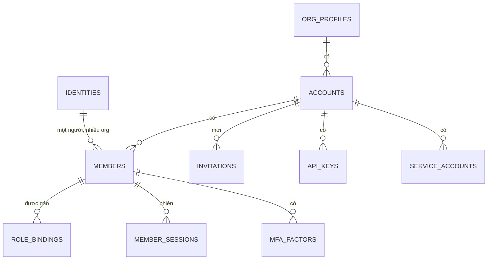
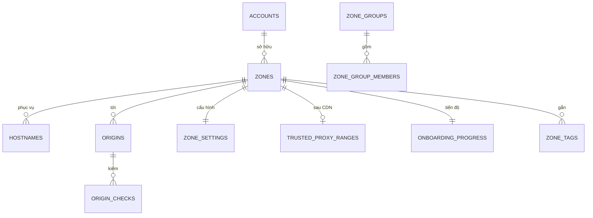
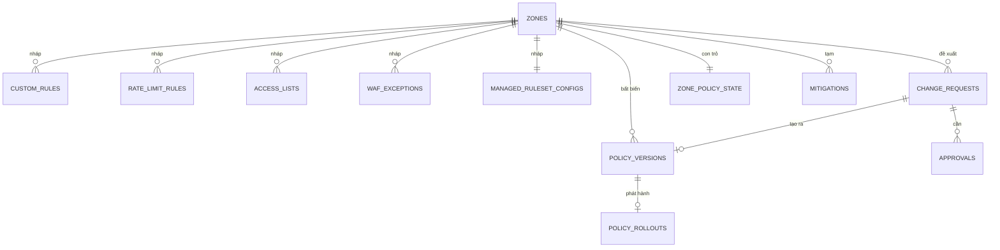

# Thiết kế database của Management, suy ra từ use case

> **Trạng thái: bản đề xuất chờ duyệt (2026-11-18).** Đây là thiết kế theo **use case** ([01-use-cases.md](01-use-cases.md)), viết sau khi bản đồ phân rã đã chốt. Nó **bổ sung và sửa**
> thiết kế v1 ([5.8.14](../../architecture/05-building-blocks/08-components/14-management-database.md), viết trước bản đồ). Giữ nguyên các quyết định nền (DB1–DB4, MG1–MG5, ADR-0046);
> chỗ khác v1 liệt kê ở [mục 6](#6-khác-biệt-so-với-v1). Tên cột là **đề xuất mức thiết kế**; kiểu và index chốt khi viết entity.

## 1. Quy ước

- **Org = tenant của `metap`** (DB1). Mọi bảng `waap.*` có `tenant_id`, `id`, `version`, `deleted`, `created_at/by`, `updated_at/by` do `metap` thêm; không viết lại ở các bảng dưới.
- Mỗi field là **cột có kiểu**; không có cột `data` (roadmap 106). Cột `jsonb` chỉ cho nội dung có cấu trúc thay đổi (nội dung `PolicyVersion`, rule dạng AST, danh sách phần tử lớn).
- `ref` = khoá ngoại tới entity cùng schema (`ON DELETE RESTRICT`); tham chiếu sang bảng ngoài schema `waap` (ví dụ user của `metap`) là `uuid` thường.
- **Trạng thái** là workflow của entity (cột `status`); chỉ ghi các trạng thái và chuyển được phép ở cột "Trạng thái".
- Schema: `waap` (entity, reconciler giữ), `waap_global` (giá trị phải duy nhất toàn nền tảng, migration SQL), `waap_ops` (bảng lớn chỉ ghi thêm, phần sau). Bảng nền tảng của `metap` (`metadata.users`, `user_roles`, `policies`, `audit_trail_entries`, `outbox_events`) dùng nguyên, không tạo lại.
- Bí mật (khoá, mật khẩu kênh, secret SSO) **không** nằm trong database: chỉ lưu tham chiếu tới secret store. API key chỉ lưu băm.

## 2. Truy vết use case → bảng

Mỗi use case ghi (G) hoặc đọc (Đ) các bảng sau. Cột này là cách kiểm: **bảng nào không có use case ghi là thừa; use case nào ghi mà không có bảng là thiếu.**

| UC | Bảng (G = ghi, Đ = đọc) |
|---|---|
| UC-01 Đăng ký org | G `org_profiles`, `accounts`, `members`, `role_bindings`; G `waap_global.identities`, `tenant_directory` |
| UC-02 Account | G `accounts`; Đ `zones` |
| UC-03 Đăng nhập | Đ `waap_global.identities`, `members`, `mfa_factors`; G `member_sessions` |
| UC-04 Phiên | Đ/G `member_sessions` |
| UC-05–06 Mời, chấp nhận | G `invitations`, `members`, `role_bindings`; Đ `plan_limits` |
| UC-07–09 Vai trò, gỡ, quyền xem request | G `role_bindings`, `members`, `member_sessions`, `api_keys` |
| UC-10–12 API key, service account | G `api_keys`, `service_accounts`; G `waap_global.api_key_prefixes` |
| UC-13 Audit | Đ `metadata.audit_trail_entries` |
| UC-20 Thêm zone | G `zones`, `waap_global.domain_claims`; Đ `waap_global.domain_denylist`, `plan_limits` |
| UC-21 Xác minh | G `waap_global.domain_claims`, `zones` |
| UC-22 Trỏ DNS | G `zones` (`connection_method`) |
| UC-23 Hostname | G `hostnames`, `waap_global.hostname_claims` |
| UC-24 Origin | G `origins`, `origin_checks` |
| UC-25 TLS, IP client | G `zone_settings`, `trusted_proxy_ranges` |
| UC-26 Preset | Đ `zone_presets`; G các bảng nháp policy (mục 3.3) |
| UC-27 Kích hoạt | Đ `domain_claims`, `origin_checks`, `zone_presets`; G `policy_versions`, `zone_policy_state`, `zones` |
| UC-28, 31 Tiến độ, hoàn tất | G `onboarding_progress` |
| UC-29 Bật chặn theo bậc | G `change_requests` (và nháp) |
| UC-30 Khoá origin | G `onboarding_progress` |
| UC-32–33 Tạm dừng, gỡ | G `zones`, `waap_global.*_claims` |
| UC-34 Tag, nhóm | G `zone_tags`, `zone_groups`, `zone_group_members` |
| UC-40–41 Soạn nháp | G `custom_rules`, `rate_limit_rules`, `access_lists`, `waf_exceptions`, `managed_ruleset_configs`, `zone_settings`; Đ `plan_limits` |
| UC-42 Kiểm | G `change_requests`.`check_result` hoặc không lưu |
| UC-43–45 Gửi, duyệt, tự xác nhận | G `change_requests`, `approvals` |
| UC-46 Phát hành | G `policy_versions`, `zone_policy_state`, `policy_rollouts`; G `metadata.outbox_events` |
| UC-47 Theo dõi | Đ/G `policy_rollouts`, `zone_policy_state` |
| UC-48–49 Version, rollback | Đ `policy_versions`; G `policy_versions`, `change_requests` |
| UC-50–51 Under Attack, rule tạm | G `zone_settings`, `mitigations` |
| UC-52 Đổi thông tin | G `zones` (tên, mô tả, tag) |
| UC-60 Xem sự kiện | Đ Analytics; Đ `role_bindings` (quyền xem request) |
| UC-61–62 Báo chặn nhầm | G `fp_reports`; G `change_requests` |
| UC-63 Alert policy | G `alert_policies`, `alert_thresholds` |
| UC-64 Kênh | G `notification_channels`, `notification_templates` |
| UC-65 Cảnh báo, mở case | G `alerts`, `cases` |
| UC-66–68 Case, mitigation | G `cases`, `case_links`, `mitigations` |
| UC-70–75 (S4) | `plans`, `subscriptions`, `entitlement_overrides`, `invoices`, `invoice_lines`, `payment_methods`, `quota_states` |
| UC-80–82 (S5) | `export_jobs`, `retention_holds`, `deletion_records`, `zone_transfers` |
| UC-90–92 (S6) | `sso_connections`, `sso_domains`, `owner_recoveries`, `support_grants` |

## 3. Bảng theo lát cắt

Lát cắt nào tạo bảng nào cũng là thứ tự migration: S0 trước, mỗi lát cắt chỉ thêm bảng, không sửa bảng của lát trước (trừ thêm cột).

### 3.1 S0 Nền: tenant và danh tính

| Bảng | Cột chính | Ràng buộc | Trạng thái | UC |
|---|---|---|---|---|
| `waap_global.identities` | `email` (chuẩn hoá), `password_hash`, `email_verified_at` | Unique toàn cục `email` | | 01, 03 |
| `waap_global.tenant_directory` | `tenant_id`, `placement` (shared/db), `data_region` | PK `tenant_id` | | 01 |
| `org_profiles` | `display_name`, `country`, `data_region`, `tier`, `require_mfa`, `require_api_key_expiry` | 1 dòng mỗi tenant | | 01 |
| `accounts` | `slug`, `name`, `data_region` | Unique tenant `slug` | `active → closed` | 01, 02 |
| `members` | `identity_id` (→ global), `account_id` ref, `display_name` | Unique `(account_id, identity_id)` | `invited → active → suspended → removed` | 01, 05–08 |
| `role_bindings` | `member_id` ref, `role`, `scope_type` (account / zone_group / zone), `scope_id`, `can_view_request_data` | Index `(member_id)` | | 07, 09 |
| `invitations` | `account_id` ref, `email`, `role`, `scope_type`, `scope_id`, `token_hash`, `expires_at`, `invited_by` | Unique `token_hash` | `sent → accepted / expired / revoked` | 05, 06 |
| `member_sessions` | `member_id` ref, `jti`, `ip`, `user_agent`, `last_seen_at` (system), `revoked_at` | Index `(member_id)` | | 03, 04, 08 |
| `mfa_factors` | `member_id` ref, `kind` (totp / webauthn), `secret_ref`, `confirmed_at` | Index `(member_id)` | | 03 |
| `api_keys` | `account_id` ref, `name`, `prefix`, `secret_hash` (argon2id), `scopes`, `expires_at`, `last_used_at` (system), `revoked_at`, `owner_member_id` | Unique toàn cục `prefix` (qua `waap_global.api_key_prefixes`) | | 10, 11 |
| `service_accounts` | `account_id` ref, `name`, `role` | Unique `(account_id, name)` | | 12 |
| `plan_limits` (NCC, tạm) | `plan_tier`, `max_zones`, `max_members`, `max_rules_per_zone`, `max_access_list_items` | Unique `plan_tier` | | 05, 20, 40 |

Audit không có bảng riêng: dùng `metadata.audit_trail_entries` (UC-13).

### 3.2 S1 Zone và onboarding

| Bảng | Cột chính | Ràng buộc | Trạng thái | UC |
|---|---|---|---|---|
| `waap_global.domain_claims` | `fqdn`, `tenant_id`, `zone_id`, `method` (cname / txt / http_file), `challenge_token`, `verified_at`, `expires_at` | Unique `fqdn` khi `state` đang active; claim chưa xác minh hết hạn 14 ngày | `pending → verified → released` / `expired` | 20, 21, 28, 33 |
| `waap_global.hostname_claims` | `fqdn`, `tenant_id`, `zone_id` | Unique `fqdn` khi active | `pending → active → released` | 23, 33 |
| `waap_global.domain_denylist` (NCC) | `pattern`, `reason` | Unique `pattern` | | 20 |
| `zones` | `account_id` ref, `name` (domain), `plan_tier`, `connection_method`, `scope_kind` (apex / hostname), `cell_id`, `bucket`, `description`, `removed_at` | Index `(account_id)`; `name` searchable | `pending → verifying → active ↔ paused → removed` | 20–22, 27, 32–34, 52 |
| `hostnames` | `zone_id` ref, `fqdn`, `ports`, `dns_routing_status` (system) | Unique `(zone_id, fqdn)`; thêm khoá toàn cục qua `hostname_claims` | | 23 |
| `origins` | `zone_id` ref, `address`, `port`, `scheme`, `sni`, `host_header`, `timeout_ms`, `retries`, `keepalive` | Index `(zone_id)` | | 24 |
| `origin_checks` | `origin_id` ref, `result`, `reason`, `latency_ms`, `checked_at`, `pop` | Index `(origin_id, checked_at)` | | 24, 27 |
| `zone_settings` | `zone_id` ref, `tls_min_version`, `hsts`, `tls_to_origin`, `fail_mode`, `under_attack` (bool), `block_page_contact`, `log_only` (bool) | Unique `zone_id` | | 25, 41, 50 |
| `trusted_proxy_ranges` | `zone_id` ref, `preset` (cloudflare / akamai / cloudfront / custom), `client_ip_header`, `cidrs` | Unique `zone_id` | | 25 |
| `zone_presets` (NCC) | `code`, `app_kind`, `content` (jsonb: nháp mặc định) | Unique `code` | | 26 |
| `onboarding_progress` | `zone_id` ref, `verified_at`, `origin_ok_at`, `preset_applied_at`, `activated_at`, `first_traffic_at`, `dns_cutover_at`, `origin_locked` (yes / skipped / no), `completed_at`, `last_reminded_day` | Unique `zone_id` | | 28–31 |
| `zone_tags` | `zone_id` ref, `tag` | Unique `(zone_id, tag)` | | 34 |
| `zone_groups`, `zone_group_members` | `name`; `group_id` ref, `zone_id` ref | Unique `(account_id, name)` | | 34 |

### 3.3 S2 Policy và thay đổi

| Bảng | Cột chính | Ràng buộc | Trạng thái | UC |
|---|---|---|---|---|
| `custom_rules` | `zone_id` ref, `name`, `priority`, `enabled`, `mode` (enforce / log_only), `expression` (text), `ast` (jsonb), `action`, `expires_at` | Unique `(zone_id, name)`; index `(zone_id, priority)` | | 40 |
| `rate_limit_rules` | `zone_id` ref, `name`, `priority`, `match`, `limit`, `window_s`, `action` | Unique `(zone_id, name)` | | 40 |
| `access_lists` | `zone_id` ref, `name`, `kind` (ip / cidr / asn / country), `item_count`, `items` (jsonb ≤ 10.000) | Unique `(zone_id, name)` | | 40 |
| `waf_exceptions` | `zone_id` ref, `rule_ids`, `scope`, `expires_at`, `reason` | Index `(zone_id)` | | 40, 62 |
| `managed_ruleset_configs` | `zone_id` ref, `release_channel`, `paranoia`, `disabled_rule_ids`, `thresholds` | Unique `zone_id` | | 41 |
| `change_requests` | `zone_id` ref, `base_version_id`, `kind` (normal / emergency), `author_member_id`, `diff` (jsonb), `check_result` (jsonb), `source` (ui / api), `on_behalf_of_support` | Index `(zone_id, status)` | `draft → pending_review → approved → published`; `rejected`, `cancelled`, `failed` | 29, 42–46, 62 |
| `approvals` | `change_request_id` ref, `approver_member_id`, `decision` (approve / reject / self_confirm), `comment` | Unique `(change_request_id, approver_member_id)`; kiểm "khác người gửi" ở service | | 44, 45 |
| `policy_versions` | `zone_id` ref, `number`, `content` (jsonb, bất biến), `content_hash`, `parent_version_id`, `change_request_id` ref, `schema_version`, `approved_ever` (bool) | Unique `(zone_id, number)`; index `content_hash` | | 46, 48, 49 |
| `zone_policy_state` | `zone_id` ref, `enforced_version_id`, `canary_version_id`, `coverage` (system) | Unique `zone_id` | | 27, 46, 47 |
| `policy_rollouts` | `policy_version_id` ref, `state` (compiling / canary / rolling / done / failed), `applied_pct` (system), `failed_reason`, `skipped_zones` | Unique `policy_version_id` | | 46, 47 |
| `mitigations` | `zone_id` ref, `kind` (under_attack / temp_rule / challenge_all / rps_cap), `source` (member / case / ncc), `case_id` ref (null), `rule` (jsonb), `expires_at`, `ended_at` | Index `(zone_id, ended_at)` | `active → ended / expired` | 50, 51, 67 |

Hai điểm thiết kế (giữ nguyên v1, nêu lại để duyệt):

- **Nháp là từng dòng, version là một tài liệu.** Nháp theo dòng để đếm theo hạn mức gói, phân quyền và diff theo rule; `policy_versions.content` là toàn bộ policy đã chuẩn hoá để Control đọc một lần và để so hai version bằng so hai tài liệu.
- **`approved_ever`** đánh dấu version đã từng qua duyệt, để rollback không phải duyệt lại (UC-49, OQ-37).

### 3.4 S3 Vận hành bảo mật của khách

| Bảng | Cột chính | Ràng buộc | Trạng thái | UC |
|---|---|---|---|---|
| `fp_reports` | `zone_id` ref, `request_id`, `description`, `reporter_key_hash` (giới hạn tần suất), `resolution` (ignored / exception), `change_request_id` ref (null) | Index `(zone_id, status)`; **không lưu email hay IP người báo** | `new → triaged → resolved` | 61, 62 |
| `alert_policies` | `account_id` ref, `name`, `alert_kind`, `zone_ids`, `quiet_hours`, `repeat_interval_s`, `route` (jsonb: mức → kênh, leo thang) | Unique `(account_id, name)` | | 63 |
| `alert_thresholds` | `zone_id` ref, `attack_type`, `low`, `medium`, `high` | Unique `(zone_id, attack_type)` | | 63 |
| `notification_channels` | `account_id` ref, `kind`, `target`, `secret_ref` | Index `(account_id)` | | 64 |
| `notification_templates` | `account_id` ref (null = mặc định), `kind`, `subject`, `body` | Unique `(account_id, kind)` | | 64 |
| `alerts` | `zone_id` ref, `external_ref` (id bên Analytics), `alert_kind`, `level`, `raised_at` | Unique `(zone_id, external_ref)` | `open → acknowledged → closed` | 65 |
| `cases` | `account_id` ref, `zone_ids`, `severity`, `scope` (zone / platform), `assignee_member_id`, `summary`, `sla_due_at` | Index `(account_id, status)` | `open → acknowledged → mitigating → closed` | 65–68 |
| `case_links` | `case_id` ref, `kind` (event / query / mitigation / alert), `external_ref` | Index `(case_id)` | | 66 |

`mitigations` (mục 3.3) là bảng dùng chung của UC-50, 51, 67: một mitigation có thể do người bật, do case, hoặc do NCC.

### 3.5 S4–S6 (mức đề cương; chi tiết khi tới lát cắt)

| Lát cắt | Bảng (dùng thiết kế v1, [5.8.14 mục 4](../../architecture/05-building-blocks/08-components/14-management-database.md#4-entity-theo-module-schema-waap)) |
|---|---|
| S4 | `plans` (NCC, có version), `subscriptions`, `entitlement_overrides`, `invoices`, `invoice_lines`, `payment_methods`, `quota_states`; `usage_daily` ở `waap_ops`. Thay `plan_limits` bằng entitlements của `plans` |
| S5 | `export_jobs`, `retention_holds`, `deletion_records`, `zone_transfers` |
| S6 | `sso_connections`, `sso_domains` (+ `waap_global.sso_domains`), `owner_recoveries`, `support_grants` |

## 4. Bảng toàn cục (`waap_global`)

Giá trị phải duy nhất **toàn nền tảng**, kể cả với tenant ở database riêng: `identities` (email), `domain_claims`, `hostname_claims`, `api_key_prefixes`, `tenant_directory`, `domain_denylist`.
Quy tắc ghi giữ như v1: **claim trước, entity sau**; lỗi giữa chừng để lại claim `pending` có hạn, job dọn định kỳ (UC-28).

## 5. Quyết định còn mở (cần chốt trước khi viết entity)

| # | Câu hỏi | Đề xuất |
|---|---|---|
| DQ1 | **Một người thuộc nhiều org** (F1.2.6): `metadata.users` của `metap` có email duy nhất toàn cục và mang một `tenant_id`, nên một user không thuộc được nhiều tenant | Giữ danh tính ở `waap_global.identities`; mỗi org có `members` riêng. Cần thử trên `metap`: đăng nhập chọn org rồi cấp token theo (identity, org). **Chưa kiểm chứng** `metap` hỗ trợ tới đâu; làm thử nghiệm nhỏ ở đầu S0 |
| DQ2 | Phiên (xem, đăng xuất từ xa), MFA (TOTP, WebAuthn): `metap` đã có chưa? | Giả định chưa có, nên đề xuất `member_sessions`, `mfa_factors` ở trên; nếu `metap` có sẵn thì bỏ hai bảng |
| DQ3 | Nháp policy theo dòng (như v1) hay một tài liệu nháp cho mỗi zone | Giữ theo dòng (đếm hạn mức, phân quyền, diff theo rule); đổi sang tài liệu nếu thấy quá nặng khi làm S2 |
| DQ4 | Trạng thái phát hành: bảng riêng `policy_rollouts` hay cột trong `zone_policy_state` | Bảng riêng, vì `policy_versions` bất biến còn trạng thái phát hành thì đổi liên tục (cột `system`) |
| DQ5 | `alerts` là bản sao ở Management hay luôn hỏi Analytics | Bản sao nhỏ (id, mức, trạng thái ack) để portal nhanh và có thể ack khi Analytics chưa trả lời; nội dung chi tiết vẫn lấy từ Analytics |

## 6. Khác biệt so với v1

| | v1 ([5.8.14](../../architecture/05-building-blocks/08-components/14-management-database.md)) | Bản này |
|---|---|---|
| Thêm | | `waap_global.identities`, `domain_claims`, `domain_denylist`; `invitations`, `member_sessions`, `mfa_factors`, `service_accounts`, `plan_limits` (tạm), `origin_checks`, `zone_presets`, `onboarding_progress`, `zone_groups`, `zone_group_members`, `zone_tags`, `policy_rollouts`, `mitigations`, `fp_reports`, `alert_thresholds`, `notification_templates`, `alerts` |
| Đổi | `zone_settings` chung cho nhiều thứ | Thêm `block_page_contact` (trang chặn, [3.4](../../requirements/03-business-analysis/04-false-positive.md)), `log_only`, `under_attack` |
| Đổi | Bảng `cases`, `case_links`, `mitigations` gộp một dòng | Tách rõ ba bảng; `mitigations` dùng chung cho Under Attack, rule tạm và case |
| Hoãn (không MVP) | `change_batches`, `cache_rules`, `bot_policies`, `api_endpoints`, `api_schemas`, `api_auth_configs`, `origin_pools`, `dns_records`, `custom_error_pages` | Chưa tạo; làm khi lát cắt tương ứng tới |
| Giữ | Schema, tenancy, MG1–MG5, `policy_versions` bất biến, `waap_ops`, residency | Không đổi |
