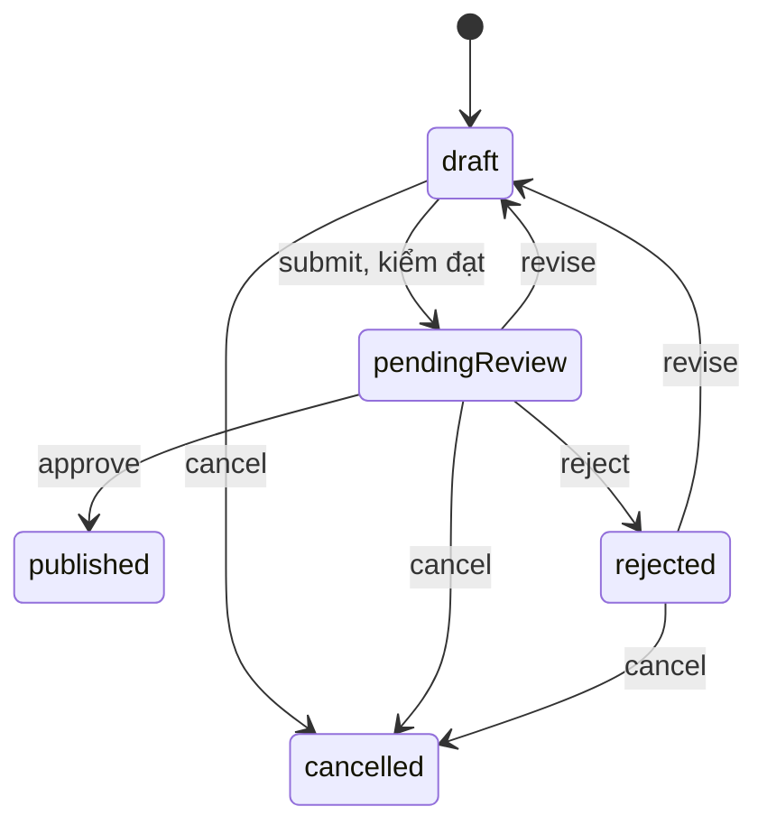

# Change request: đã làm gì, dùng thế nào

> **Trạng thái (2026-11-29): có backend và màn hình; màn hình chưa được kiểm trên trình duyệt.** Phục vụ UC-40, 42 đến 46 ([use case](01-use-cases.md)),
> theo [phân tích 3.2](../../requirements/03-business-analysis/02-policy-change.md). Mã: `m-management/zones/changes/`,
> `zones/guard/changecontrol.go`, `zones/entities/changerequest.go`.

## Cách hoạt động

- **Nháp là danh sách thao tác** (tạo, sửa, xoá rule, DDoS policy, IP list) trên **một zone**, tối đa 200. Bản đang chạy
  không bị đụng tới, nên control-plane và edge không đổi gì.
- **Kiểm = áp thử rồi rollback.** Thao tác chạy qua đúng chuỗi guard, bằng quyền của người gọi, trong một transaction
  rồi huỷ. Diff lưu lại là diff thật. Nháp lỗi vẫn được giữ, kèm thao tác nào lỗi và vì sao.
- **Duyệt = phát hành**, trong một transaction: áp thao tác, ghi một policy version (kèm change request và người
  duyệt), đánh dấu `published`. Nếu policy của zone đã khác lúc gửi thì trả `change_request_stale`; người soạn gửi lại
  để lấy diff mới. Hai lần duyệt cùng lúc trên một zone chạy lần lượt.
- **Người duyệt là người thực hiện thao tác**, nên cần quyền như khi sửa tay.
- Không ai sửa trực tiếp được dòng change request qua REST, kể cả admin.
- Chỉ người soạn được sửa và gửi nháp. Nhờ vậy người duyệt thứ hai không tự viết nội dung rồi tự duyệt.

## Trên portal

- **Không phải đổi cách làm.** Người dùng sửa rule, DDoS policy, IP list như cũ. Chỉ khi server trả
  `change_request_required`, hộp thoại **"Thay đổi này cần được duyệt"** mới hiện, mang đúng các thao tác vừa định ghi:
  đặt tiêu đề (hoặc thêm vào một yêu cầu của mình đang mở), rồi **Lưu nháp** hoặc **Gửi duyệt**. Áp dụng ở tab Rule,
  Whitelist/Blacklist, DDoS, trang rule và IP list cho mọi zone, thêm hàng loạt, đổi thứ tự rule, chặn IP từ incident và
  cho IP đi qua khi xử lý chặn nhầm (báo cáo vẫn mở cho tới khi thay đổi được phát hành).
- **Xem và quyết:** tab **Thay đổi** của zone, và trang **Thay đổi policy** (gồm cả thay đổi cho mọi zone): diff, kết quả
  kiểm, gửi, gửi lại, duyệt, tự xác nhận, từ chối, huỷ, bỏ bớt thao tác.
- **Bật kiểm soát:** trang Account, nút Sửa, mục **Kiểm soát thay đổi**.
- Chưa có: sửa nội dung một thao tác trong nháp (huỷ rồi soạn lại, hoặc bỏ thao tác đó rồi thêm lại); danh sách chỉ lấy
  50 yêu cầu.

## Rule cho cả tenant

Rule và IP list có `zoneId` trống áp dụng cho **mọi zone**. Chúng chịu mức **chặt nhất** trong các account đang mở: chỉ
cần một account bật kiểm soát là sửa chúng phải qua change request (kênh khẩn giữ như trên).

- Tạo nháp bằng `POST /api/waf.change_requests/actions/createTenantChangeRequest`, cùng body như trên. Người soạn cần
  quyền ghi các rule đó.
- **Chỉ admin của tenant** duyệt hoặc từ chối. Có account bật `fourEyes` thì admin đó phải khác người soạn, nên tenant
  chỉ có một admin sẽ kẹt cho tới khi có admin thứ hai.
- Không ghi policy version (version thuộc về zone), nên **không rollback được** thay đổi cho cả tenant bằng một nút;
  diff nằm trong change request.

## API

`POST /api/waf.zones/{zoneId}/actions/createChangeRequest`

```json
{
  "title": "Chặn một nguồn",
  "operations": [
    {"op": "create", "entity": "waf.ip_access_lists", "data": {"type": "blacklist", "value": "203.0.113.5", "enabled": true}},
    {"op": "delete", "entity": "waf.firewall_rules", "id": "…"}
  ]
}
```

Rồi `POST /api/waf.change_requests/{id}/actions/{revise|submit|approve|reject|cancel}`: `revise` nhận
`{"operations": [...]}`; `approve` nhận `{"comment": "…"}` (không bắt buộc); `reject` bắt buộc `comment`.



## Bật theo account

Trường `changeControl` của `waf.accounts` (chỉ người sửa được account, hiện là admin):

| Giá trị | Ghi thẳng | Duyệt |
|---|---|---|
| trống hoặc `off` (mặc định) | Được, như trước | Dùng change request cũng được |
| `review` | Không, trừ kênh khẩn | Người soạn tự xác nhận được |
| `fourEyes` | Không, trừ kênh khẩn | Phải là người khác |

**Kênh khẩn** (BR-6): được tạo thẳng rule **tạm, tối đa 72 giờ, chỉ siết chặt** (firewall rule `block`, `challenge`,
`log`; IP list `blacklist`) và được gỡ rule tạm. Sửa rule, kể cả gia hạn, phải qua change request. Bị từ chối thì API
trả `409 change_request_required`.

**Áp preset chưa đi qua change request được:** khi bật, áp preset bị từ chối bằng thông báo lỗi. Nên áp preset lúc
onboarding, trước khi bật.

## Cài đặt zone, rollback, kênh khẩn, 4-eyes

Với account đã bật:

- **Cài đặt zone đổi cách xử lý traffic** (`protectionMode`, `originAddress`, `originProtocol`, `originPort`,
  `originHostHeader`) phải qua change request: thao tác `{"op": "update", "entity": "waf.zones", "id": "<zone>",
  "data": {…}}`, chỉ nhận các trường đó. Gửi lại giá trị cũ, sửa tên hay tag thì không cần. Thay đổi chỉ có cài đặt
  zone **không ghi policy version**. Người soạn và duyệt cần quyền sửa zone (hiện là admin). Portal chưa có form sửa
  các cài đặt này sau onboarding, nên hiện chỉ soạn được qua API.
- **Tạm dừng zone không cần duyệt**: BR-6 xếp nó vào kênh khẩn.
- **Rollback** (BR-40) chỉ về được trạng thái **đã được duyệt**: nội dung một change request đã phát hành, hoặc nội
  dung ngay trước nó (người duyệt đã thấy ở phần "trước" của diff). So theo nội dung. Khác thì trả
  `rollback_not_approved`. Lúc mới bật, chưa phát hành change request nào, thì chưa rollback được.
- **Kênh khẩn không dùng để gia hạn:** không tạo thẳng được rule tạm **cùng tác dụng** (IP list: cùng loại và giá trị;
  rule: cùng hành động và điều kiện, tên khác vẫn tính) với một rule tạm đang có, hoặc zone đã có trong 72 giờ qua,
  kể cả đã gỡ. Rule cho cả tenant không có lịch sử, nên chỉ so với rule đang còn.
- **Bật `fourEyes`** chỉ được khi có ít nhất **hai người đang hoạt động** sửa được firewall rule (role toàn tenant, hoặc
  role trong chính account đó; không tính service account). Account tạo mới chỉ tính role toàn tenant.

## Chưa chặn

| Đường | Ghi chú |
|---|---|
| Tắt kiểm soát | Người sửa được account (hiện là admin) tắt được ngay, chỉ có audit. Đặc tả chưa yêu cầu duyệt việc này |
| Xoá zone, chuyển zone sang account khác | Cần quyền admin, có audit |
| Người duyệt rời đi sau khi đã bật `fourEyes` | Không theo dõi; change request kẹt cho tới khi có người thứ hai hoặc tắt |
| Kênh khẩn với tác dụng tương đương nhưng viết khác | Ví dụ thêm `/32` vào IP, hoặc viết lại điều kiện |
| Kênh khẩn chặn quá rộng | Một rule `block` tạm có điều kiện rất rộng có thể chặn cả website; BR-6 cho phép, chỉ giới hạn bằng quyền và thời hạn |

## Còn lại của S2

Theo dõi phát hành (UC-47, cần edge báo ngược);
Under Attack (UC-50, cần edge).

## Khi triển khai

1. `management-service migrate up` (migration `0002_change_requests`).
2. Chạy lại `waf-bootstrap` cho tenant đã có, để các role được đọc `waf.change_requests`.
