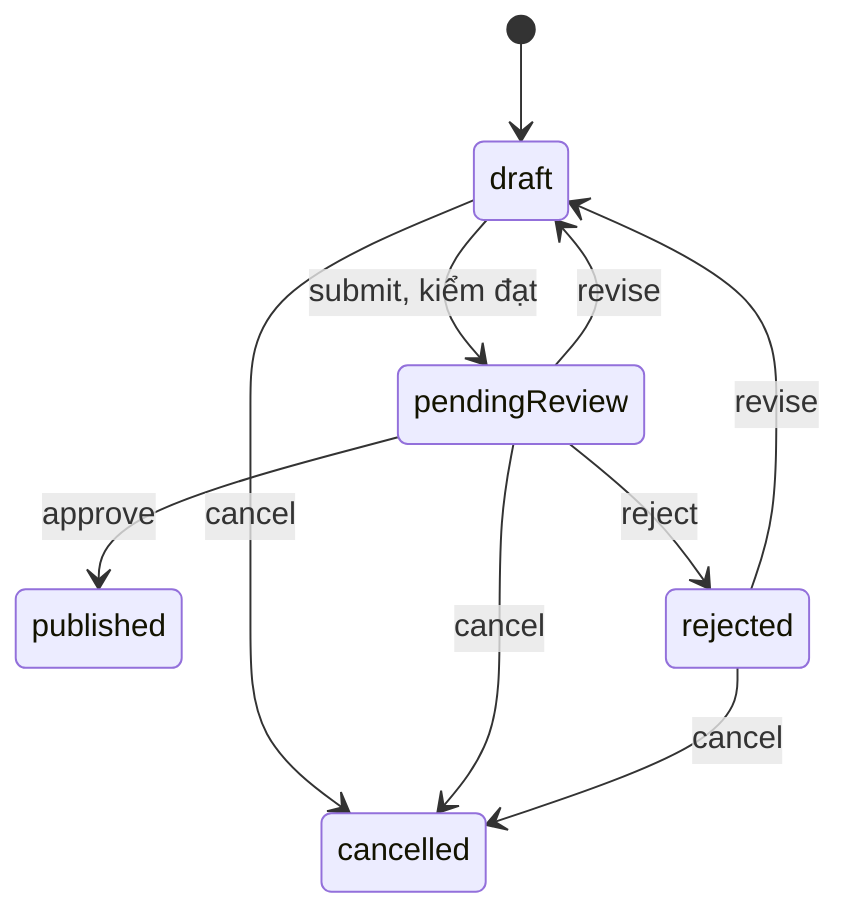

# Change request: đã làm gì, dùng thế nào

> **Trạng thái (2026-11-28): backend xong, chưa có màn hình.** Phục vụ UC-40, 42 đến 46 ([use case](01-use-cases.md)),
> theo [phân tích 3.2](../../requirements/03-business-analysis/02-policy-change.md). Mã: `m-management/zones/changes/`,
> `zones/guard/changecontrol.go`, `zones/entities/changerequest.go`.

## Cách hoạt động

- **Nháp là danh sách thao tác** (tạo, sửa, xoá rule, DDoS policy, IP list) trên **một zone**, tối đa 200. Bản đang chạy
  không bị đụng tới, nên control-plane và edge không đổi gì.
- **Kiểm = áp thử rồi rollback.** Thao tác chạy qua đúng chuỗi guard, bằng quyền của người gọi, trong một transaction
  rồi huỷ. Diff lưu lại là diff thật. Nháp lỗi vẫn được giữ, kèm thao tác nào lỗi và vì sao.
- **Duyệt = phát hành**, trong một transaction: áp thao tác, ghi một policy version (kèm change request và người
  duyệt), đánh dấu `published`. Nếu policy của zone đã khác lúc gửi thì trả `change_request_stale`; người soạn gửi lại
  để lấy diff mới. Hai lần duyệt cùng lúc trên một zone chạy lần lượt.
- **Người duyệt là người thực hiện thao tác**, nên cần quyền như khi sửa tay.
- Không ai sửa trực tiếp được dòng change request qua REST, kể cả admin.
- Chỉ người soạn được sửa và gửi nháp. Nhờ vậy người duyệt thứ hai không tự viết nội dung rồi tự duyệt.

## Rule cho cả tenant

Rule và IP list có `zoneId` trống áp dụng cho **mọi zone**. Chúng chịu mức **chặt nhất** trong các account đang mở: chỉ
cần một account bật kiểm soát là sửa chúng phải qua change request (kênh khẩn giữ như trên).

- Tạo nháp bằng `POST /api/waf.change_requests/actions/createTenantChangeRequest`, cùng body như trên. Người soạn cần
  quyền ghi các rule đó.
- **Chỉ admin của tenant** duyệt hoặc từ chối. Có account bật `fourEyes` thì admin đó phải khác người soạn, nên tenant
  chỉ có một admin sẽ kẹt cho tới khi có admin thứ hai.
- Không ghi policy version (version thuộc về zone), nên **không rollback được** thay đổi cho cả tenant bằng một nút;
  diff nằm trong change request.

## API

`POST /api/waf.zones/{zoneId}/actions/createChangeRequest`

```json
{
  "title": "Chặn một nguồn",
  "operations": [
    {"op": "create", "entity": "waf.ip_access_lists", "data": {"type": "blacklist", "value": "203.0.113.5", "enabled": true}},
    {"op": "delete", "entity": "waf.firewall_rules", "id": "…"}
  ]
}
```

Rồi `POST /api/waf.change_requests/{id}/actions/{revise|submit|approve|reject|cancel}`: `revise` nhận
`{"operations": [...]}`; `approve` nhận `{"comment": "…"}` (không bắt buộc); `reject` bắt buộc `comment`.



## Bật theo account

Trường `changeControl` của `waf.accounts` (chỉ người sửa được account, hiện là admin):

| Giá trị | Ghi thẳng | Duyệt |
|---|---|---|
| trống hoặc `off` (mặc định) | Được, như trước | Dùng change request cũng được |
| `review` | Không, trừ kênh khẩn | Người soạn tự xác nhận được |
| `fourEyes` | Không, trừ kênh khẩn | Phải là người khác |

**Kênh khẩn** (BR-6): được tạo thẳng rule **tạm, tối đa 72 giờ, chỉ siết chặt** (firewall rule `block`, `challenge`,
`log`; IP list `blacklist`) và được gỡ rule tạm. Sửa rule, kể cả gia hạn, phải qua change request. Bị từ chối thì API
trả `409 change_request_required`.

**Đừng bật cho account đang dùng portal hằng ngày cho tới khi có màn hình.** Khi bật, các thao tác sau trên portal sẽ
bị từ chối: sửa rule, áp preset, chặn IP từ incident quá 72 giờ, whitelist khi xử lý chặn nhầm.

## Chưa chặn

Với account đã bật, vẫn còn các đường đổi cách edge xử lý traffic mà không cần duyệt:

| Đường | Ghi chú |
|---|---|
| Cài đặt zone: `protectionMode`, origin, tạm dừng | Phân tích 3.2 yêu cầu đi cùng change request; chưa làm |
| Rollback | BR-40 cho phép rollback về version **đã từng được duyệt**; hiện cho rollback về mọi version đã ghi, kể cả version ghi lúc kiểm soát còn tắt |
| Kênh khẩn lặp lại | Hết 72 giờ có thể tạo lại rule mới; chưa chặn việc gia hạn kiểu này |
| Tắt kiểm soát | Người sửa được account tắt được ngay, chỉ có audit |
| 4-eyes khi chỉ có một người duyệt | Không bị từ chối lúc bật; change request sẽ kẹt cho tới khi có người thứ hai hoặc tắt |

## Còn lại của S2

Màn hình (soạn nháp, xem diff, duyệt); đóng các đường ở bảng trên; theo dõi phát hành (UC-47, cần edge báo ngược);
Under Attack (UC-50, cần edge).

## Khi triển khai

1. `management-service migrate up` (migration `0002_change_requests`).
2. Chạy lại `waf-bootstrap` cho tenant đã có, để các role được đọc `waf.change_requests`.
