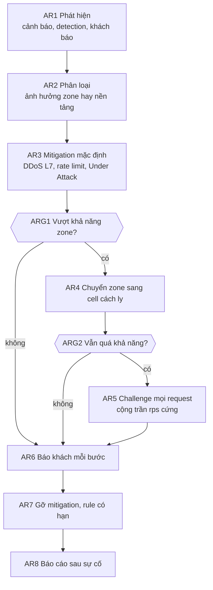

# 3.3 Phản ứng khi bị tấn công

> **Trạng thái (2026-11-17): chủ dự án đã duyệt các đề xuất của Claude** (OQ-41 (phần còn lại), OQ-42…OQ-47); ngoại lệ ghi ở mục phân tích bên dưới. Luồng (bước 2) đã viết và **đã duyệt 2026-11-17** ở mục 7. Quyết định ở [§3](#3-đã-quyết).

## 1. Phạm vi

Từ lúc một zone bắt đầu bị tấn công cho tới khi tấn công dừng, mitigation tạm được gỡ và khách có báo cáo.
Gồm cả tấn công làm ảnh hưởng khách khác hoặc chính nền tảng. Liên quan: F3.3, F5.5, F8 ở
[§1](../01-functional-decomposition.md).

## 2. Kịch bản theo từng trục

### A. Loại tấn công

| Mã | Kịch bản | Concern |
|---|---|---|
| KB3-A1 | Flood HTTP từ nhiều nguồn (botnet) | DDoS L7 tự động; ngưỡng theo baseline của zone |
| KB3-A2 | Flood từ ít nguồn | Pre-filter, rate limit theo IP đủ |
| KB3-A3 | Low-and-slow (Slowloris, giữ kết nối) | Giới hạn kết nối ở L7 |
| KB3-A4 | Tấn công vào endpoint đắt (tìm kiếm, đăng nhập, xuất báo cáo) với lượng nhỏ | Không vượt ngưỡng DDoS nhưng làm sập origin |
| KB3-A5 | Credential stuffing, dò mật khẩu | Bot, ATO (Nâng cao) |
| KB3-A6 | Khai thác CVE mới công bố | Rule khẩn của NCC, virtual patch |
| KB3-A7 | Volumetric L3/L4 | Ngoài edge HTTP; phụ thuộc hạ tầng hoặc đối tác |
| KB3-A8 | Đánh thẳng vào IP origin, bỏ qua edge | WAF không thấy gì; origin chưa khoá (3.1) |
| KB3-A9 | Tấn công vào DNS điều hướng, portal, API của NCC | Ảnh hưởng mọi khách |
| KB3-A10 | Tống tiền: đe doạ DDoS kèm đòi tiền | Khách cần hỗ trợ ngoài kỹ thuật |

### B. Ai phát hiện

| Mã | Kịch bản | Concern |
|---|---|---|
| KB3-B1 | Edge tự phát hiện và giảm thiểu | Khách biết qua cảnh báo; có thể không cần làm gì |
| KB3-B2 | Detection của Analytics cảnh báo | Trễ bao lâu |
| KB3-B3 | Khách thấy origin chậm hoặc chết trước khi hệ thống phát hiện | Khách cần nút "đang bị tấn công" |
| KB3-B4 | NOC thấy PoP hoặc cell quá tải | Tấn công nhắm một zone kéo theo zone khác |

### C. Ai phản ứng

| Mã | Kịch bản | Concern |
|---|---|---|
| KB3-C1 | Tự động hoàn toàn | Rủi ro chặn nhầm khi bật mạnh tay |
| KB3-C2 | Khách bật Under Attack mode, thêm rule tạm | Khách không rành thì không biết làm gì |
| KB3-C3 | NCC (NOC, SOC của NCC) bật thay khách | Có quyền không, theo gói nào, khách có đồng ý trước không |
| KB3-C4 | Tự bật Under Attack khi phát hiện (Enterprise) | Người dùng thật bị challenge |
| KB3-C5 | Tấn công ngoài giờ, không ai trực | Gói thấp không có người trực |

### D. Ảnh hưởng tới khách khác và nền tảng

| Mã | Kịch bản | Concern |
|---|---|---|
| KB3-D1 | Zone bị tấn công lớn được chuyển sang cell cách ly | Zone đó có chậm hơn không |
| KB3-D2 | Zone Free bị tấn công vượt mọi ngưỡng | Chặn toàn bộ traffic zone, rút khỏi edge, hay vẫn giữ |
| KB3-D3 | Nhiều zone cùng bị tấn công (chiến dịch) | Thứ tự hy sinh theo gói (8.18) |
| KB3-D4 | Tấn công làm tăng chi phí băng thông của NCC | Ai chịu |

### E. Chi phí cho khách

| Mã | Kịch bản | Concern |
|---|---|---|
| KB3-E1 | Traffic bị chặn không tính tiền | Đã có (BR-7) |
| KB3-E2 | Tấn công lọt qua (trông như traffic sạch) và bị tính phí vượt | Tranh chấp hoá đơn; có hoàn không |
| KB3-E3 | Gói có trần bị chạm trần vì tấn công | Website bị chuyển tiếp tối giản đúng lúc bị tấn công |

### F. Giao tiếp và kết thúc

| Mã | Kịch bản | Concern |
|---|---|---|
| KB3-F1 | Khách cần biết gì trong lúc tấn công | Lượng traffic, đã chặn bao nhiêu, origin còn sống không |
| KB3-F2 | Tắt Under Attack, gỡ rule tạm khi nào | Tự hết hạn hay khách tắt; tấn công quay lại |
| KB3-F3 | Báo cáo sau sự cố | Theo gói nào, ai viết |
| KB3-F4 | SLA bị vi phạm trong lúc tấn công | Credit |
| KB3-F5 | Cơ quan chức năng yêu cầu log để điều tra | Quy trình pháp lý, dữ liệu nào được giao |

## 3. Đã quyết

| Ngày | Câu hỏi | Quyết định | Hệ quả cần phân tích tiếp |
|---|---|---|---|
| 2026-11-07 | OQ-41 | **NCC bật được mitigation** (Under Attack mode, rule tạm) trên zone của khách. **Khách cũng có portal riêng** để tự bật | NCC bật từ portal vận hành của NCC (không đăng nhập vào portal của khách); mọi lần NCC bật hiện cho khách trên portal của khách và ghi audit; khách tắt được thứ NCC đã bật hay không; NCC có cần khách đồng ý trước không, theo gói nào (đề xuất ở §5); trùng với kênh khẩn của 3.2 (KB2-G3) |

## 4. Câu hỏi cần chủ dự án quyết

| ID | Câu hỏi | Kịch bản | Ghi chú ban đầu |
|---|---|---|---|
| ~~OQ-41~~ | NCC có được bật mitigation thay khách không, ở gói nào, có cần khách đồng ý trước không? | KB3-C3, KB3-C5 | **Đã quyết**: có (§3); phần đồng ý trước và theo gói ở §5 |
| OQ-42 | Zone gói thấp bị tấn công vượt khả năng: chặn toàn bộ, rút khỏi edge (trả DNS về origin), hay giữ và chịu? | KB3-D2 | |
| OQ-43 | Tấn công lọt và bị tính phí vượt: chính sách hoàn tiền thế nào? Trần cứng có tạm nới khi đang bị tấn công không? | KB3-E2, KB3-E3 | |
| OQ-44 | Báo cáo sau sự cố và SLA credit theo gói nào? | KB3-F3, KB3-F4 | |
| OQ-45 | Quy trình khi cơ quan chức năng yêu cầu log | KB3-F5 | Cần tư vấn pháp lý |
| OQ-46 | Có hỗ trợ khách bị tống tiền DDoS không (tư vấn, liên hệ cơ quan chức năng)? | KB3-A10 | |
| OQ-47 | Tấn công vào endpoint đắt mà không vượt ngưỡng DDoS: có sản phẩm cho việc này không (rate limit theo endpoint mặc định, bảo vệ origin theo độ trễ)? | KB3-A4 | |

## 5. Phân tích các câu còn mở (đã duyệt 2026-11-17)

> **Chủ dự án duyệt 2026-11-17:** mọi đề xuất ở bảng dưới được chốt thành quyết định

Chủ dự án giao tự phân tích các câu còn lại (2026-11-07). **Chưa câu nào được coi là quyết định** cho tới khi
chủ dự án duyệt.

| Câu | Phương án | Đánh đổi | Đề xuất |
|---|---|---|---|
| OQ-41 (phần còn lại) | (a) NCC bật không cần hỏi; (b) cần khách đồng ý trước trong điều khoản; (c) hỏi từng lần | (c) chậm đúng lúc cần nhanh | (b): điều khoản dịch vụ cho NCC bật mitigation khi tấn công ảnh hưởng zone hoặc nền tảng, mọi gói; khách được báo ngay và tắt được, trừ khi tấn công đang ảnh hưởng khách khác (khi đó chỉ NCC tắt) |
| OQ-42 | (a) Chặn hết traffic zone; (b) trả DNS về origin; (c) cell cách ly rồi giới hạn | (b) lộ IP origin và origin sập; (a) website chết hẳn | (c): chuyển zone sang cell cách ly; nếu vẫn quá khả năng, áp challenge cho mọi request và trần rps cứng cho zone. **Không bao giờ trả DNS về origin.** Báo khách ở mỗi bước |
| OQ-43 | (a) Không hoàn; (b) xem xét theo yêu cầu; (c) tự loại | (c) cần phân loại tấn công chính xác | (b): khách gửi yêu cầu trong 30 ngày, NCC đối chiếu với detection hậu kiểm; phần được xác nhận là tấn công thì ghi có. Trần chi tiêu (đã quyết ở 3.5) chặn hoá đơn bất ngờ. Gói có trần cứng: traffic bị gắn cờ "nghi tấn công" trong sự cố không tính vào trần |
| OQ-44 | Báo cáo và credit theo gói | Báo cáo viết tay tốn người | Mọi gói: báo cáo tự động sau sự cố (thời gian, khối lượng, nguồn, đã chặn, mitigation đã bật). Enterprise: báo cáo do NCC viết. SLA credit chỉ ở gói có SLA, tính theo thời gian edge không phục vụ được, không tính lỗi do origin |
| OQ-45 | Quy trình pháp lý | Cần luật sư | Chỉ nhận yêu cầu bằng văn bản chính thức qua đầu mối pháp chế; ghi sổ mọi yêu cầu; báo khách trừ khi văn bản cấm; chỉ cung cấp dữ liệu còn trong retention. Cần tư vấn pháp lý trước khi bán |
| OQ-46 | Hỗ trợ khách bị tống tiền | | Không đàm phán thay khách; NCC bật bảo vệ cao (OQ-41), cung cấp log để khách trình báo; Enterprise có kỹ sư hỗ trợ trực tiếp |
| OQ-47 | (a) Không có; (b) rate limit theo path trong preset; (c) bảo vệ origin theo độ trễ | (c) cần học baseline origin | MVP: (b), preset có rate limit mặc định cho đăng nhập, tìm kiếm. Mở rộng: (c), khi origin chậm hoặc lỗi tăng, edge giới hạn rps vào các path đắt (khách đánh dấu hoặc học tự động) |

## 6. Phụ thuộc

FR-3-04, FR-3-05, FR-5-15, FR-8-05…FR-8-07, BR-6, BR-7, BR-10 ở [§2](../02-requirements.md); thứ tự hy sinh và
cell cách ly ở kiến trúc 8.18, ADR-0041.

## 7. Luồng: phản ứng khi bị tấn công (bước 2, đã duyệt 2026-11-17)

> Dựa trên [§3](#3-đã-quyết) (NCC bật được mitigation, khách có portal riêng) và [§5](#5-phân-tích-các-câu-còn-mở-đã-duyệt-2026-11-17).

**Định nghĩa "xong":** tấn công đã dừng hoặc được giữ dưới mức khách chịu được, mitigation tạm đã gỡ hoặc chuyển thành rule có chủ, và khách
nhận báo cáo sau sự cố.

| Bước | Ai | Điều kiện hoặc cổng | Hỏng thì xử lý | Dữ liệu sinh ra |
|---|---|---|---|---|
| AR1 Phát hiện | Detection ở Analytics, hoặc khách báo | Cảnh báo theo ngưỡng của zone | Báo trễ: khách gọi support, vào AR2 thủ công | `AlertRaised`, `Case` |
| AR2 Phân loại | NCC hoặc khách | Tấn công ảnh hưởng **zone** hay **nền tảng** | Không rõ thì coi là ảnh hưởng nền tảng | `Case.scope` |
| AR3 Mitigation | **NCC bật được không cần hỏi** ([OQ-41](#5-phân-tích-các-câu-còn-mở-đã-duyệt-2026-11-17)), mọi gói; khách cũng bật được trên portal riêng | Điều khoản dịch vụ cho phép; khách được báo ngay và tắt được, **trừ khi** tấn công đang ảnh hưởng khách khác (khi đó chỉ NCC tắt) | Bật rule tạm lỗi: tự gỡ theo hạn tối đa 72 giờ ([OQ-5](../02-requirements.md#9-câu-hỏi-mở-cho-review)) | `Mitigation`, rule tạm có hạn |
| ARG1, AR4 | Hệ thống | Zone gói thấp vượt khả năng ([OQ-42](#5-phân-tích-các-câu-còn-mở-đã-duyệt-2026-11-17)) | Cell cách ly không đủ: sang AR5 | `ZonePlacementChanged` |
| AR5 | Hệ thống | Vẫn quá khả năng: challenge mọi request và trần rps cứng cho zone. **Không bao giờ trả DNS về origin** | | `Mitigation` mức cao nhất |
| AR6 Báo khách | Hệ thống | Mỗi bước đổi trạng thái đều thông báo | Kênh gửi lỗi: thử kênh khác, hiện trên portal | `Notification` |
| AR7 Gỡ | NCC, khách | Tấn công dừng; rule còn giữ thì chuyển thành rule có chủ qua change request ([3.2](02-policy-change.md)) | | `Mitigation.endedAt` |
| AR8 Báo cáo | Hệ thống; Enterprise do NCC viết ([OQ-44](#5-phân-tích-các-câu-còn-mở-đã-duyệt-2026-11-17)) | Thời gian, khối lượng, nguồn, đã chặn, mitigation đã bật | | `IncidentReport`, SLA credit nếu gói có SLA |

**Sau sự cố, nhánh thương mại và pháp lý:**

| Tình huống | Xử lý |
|---|---|
| Tấn công lọt và bị tính phí vượt ([OQ-43](#5-phân-tích-các-câu-còn-mở-đã-duyệt-2026-11-17)) | Khách gửi yêu cầu trong **30 ngày**; NCC đối chiếu với detection hậu kiểm; phần xác nhận là tấn công thì ghi có. Gói có trần cứng: traffic gắn cờ "nghi tấn công" trong sự cố **không tính vào trần** |
| SLA credit | Chỉ gói có SLA; tính theo thời gian edge không phục vụ được, **không tính lỗi do origin** |
| Cơ quan chức năng yêu cầu log ([OQ-45](#5-phân-tích-các-câu-còn-mở-đã-duyệt-2026-11-17)) | Chỉ nhận văn bản chính thức qua đầu mối pháp chế; ghi sổ; báo khách trừ khi văn bản cấm; chỉ đưa dữ liệu còn trong retention. **Cần tư vấn pháp lý trước khi bán** |
| Khách bị tống tiền DDoS ([OQ-46](#5-phân-tích-các-câu-còn-mở-đã-duyệt-2026-11-17)) | NCC không đàm phán thay; bật bảo vệ cao, cung cấp log để khách trình báo; Enterprise có kỹ sư hỗ trợ trực tiếp |
| Endpoint đắt bị đánh dưới ngưỡng DDoS ([OQ-47](#5-phân-tích-các-câu-còn-mở-đã-duyệt-2026-11-17)) | MVP: preset có rate limit mặc định cho đăng nhập, tìm kiếm. Mở rộng: edge giới hạn rps vào path đắt khi origin chậm hoặc lỗi tăng |

**Đã cập nhật ở [§1](../01-functional-decomposition.md) và [§2](../02-requirements.md) (2026-11-17, FR và BR mới):** F8 thêm bước phân loại phạm vi (zone hay nền tảng), chuyển cell cách ly,
báo cáo sau sự cố; BR cho "không bao giờ trả DNS về origin", cờ "nghi tấn công" không tính vào trần chi tiêu, thời hạn yêu cầu hoàn tiền 30 ngày.
