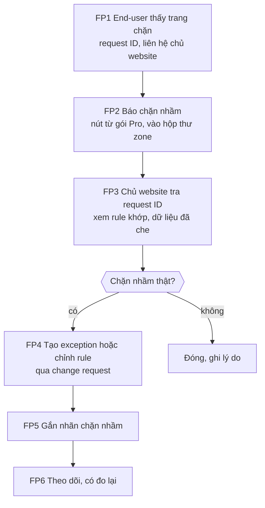

# 3.4 Xử lý chặn nhầm

> **Trạng thái (2026-11-17): chủ dự án đã duyệt các đề xuất của Claude** (OQ-48, 50, 51, 53); ngoại lệ ghi ở mục phân tích bên dưới. Luồng (bước 2) đã viết ở mục 7. Quyết định của chủ dự án ghi ở [§3](#3-đã-quyết); các
> câu hỏi còn lại vẫn mở.

## 1. Phạm vi

Từ lúc một người dùng thật hoặc client hợp lệ bị chặn hoặc bị challenge, cho tới khi nguyên nhân được sửa
và có bằng chứng không còn chặn nhầm. Đây là nguyên nhân chính làm khách mất niềm tin (R2). Liên quan: F7.5,
F5.1.4 ở [§1](../01-functional-decomposition.md).

## 2. Kịch bản theo từng trục

### A. Ai phát hiện

| Mã | Kịch bản | Concern |
|---|---|---|
| KB4-A1 | End-user bị chặn, gọi hotline hoặc nhắn cho chủ website | End-user không biết request ID là gì |
| KB4-A2 | Chủ website thấy doanh thu hoặc đơn hàng giảm | Không biết là do chặn |
| KB4-A3 | SOC thấy rule khớp bất thường | Tỉ lệ chặn nhầm theo rule |
| KB4-A4 | Hệ thống tự nghi (rule khớp nhiều trên người dùng đã đăng nhập, trên cùng path) | Mức tin cậy của tín hiệu |
| KB4-A5 | Đối tác (cổng thanh toán, webhook) báo bị từ chối | Client máy không đọc được trang chặn |

### B. End-user thấy gì

| Mã | Kịch bản | Concern |
|---|---|---|
| KB4-B1 | Trang chặn có request ID và hướng dẫn liên hệ | Không lộ rule nào chặn (kẻ tấn công cũng đọc được) |
| KB4-B2 | Trang chặn tuỳ biến theo thương hiệu, tiếng Việt và tiếng Anh | Theo gói |
| KB4-B3 | Nút "báo chặn nhầm" trên trang chặn, gửi thẳng cho chủ website | Bị lạm dụng để spam; dữ liệu end-user gửi lên |
| KB4-B4 | API client nhận lỗi dạng JSON thay vì trang HTML | Định dạng lỗi theo `Accept` |
| KB4-B5 | Challenge lặp vô hạn với trình duyệt chặn cookie, mạng chậm | Người dùng kẹt |

### C. Điều tra

| Mã | Kịch bản | Concern |
|---|---|---|
| KB4-C1 | Tra request ID: rule, phần request khớp, version | Phần request khớp có thể chứa mật khẩu, dữ liệu cá nhân |
| KB4-C2 | Không có request ID (end-user chỉ nhớ giờ và trang) | Tìm theo IP, giờ, path |
| KB4-C3 | Chặn nhầm ngoài retention của gói | Không còn bằng chứng |
| KB4-C4 | Chặn ở bước pre-filter hoặc DDoS, không phải rule WAF | Khách không có rule nào để sửa |

### D. Cách xử lý

| Mã | Kịch bản | Concern |
|---|---|---|
| KB4-D1 | Exception hẹp nhất (rule × path × tham số) | Khách thường chọn cách rộng nhất cho nhanh |
| KB4-D2 | Tắt cả rule, chuyển rule sang log-only | Mở lỗ cho cả zone |
| KB4-D3 | Allowlist IP | IP động, IP NAT của nhà mạng dùng chung cho hàng nghìn người |
| KB4-D4 | Exception có hạn, tự hết hạn | Hết hạn thì chặn nhầm quay lại |
| KB4-D5 | Đang mất tiền (thanh toán hỏng): cần sửa trong vài phút | Có đi kênh khẩn không duyệt không |
| KB4-D6 | Developer tạo exception | Có cần duyệt không |

### E. Chặn nhầm do NCC

| Mã | Kịch bản | Concern |
|---|---|---|
| KB4-E1 | Bản ruleset mới gây chặn nhầm ở nhiều khách cùng lúc | NCC rollback; khách có được báo không |
| KB4-E2 | Dữ liệu bot hoặc reputation sai (IP nhà mạng bị đánh dấu xấu) | Ảnh hưởng một vùng địa lý |
| KB4-E3 | Lỗi engine | Khách không tự sửa được |

### F. Học từ chặn nhầm

| Mã | Kịch bản | Concern |
|---|---|---|
| KB4-F1 | Nhãn chặn nhầm của khách dùng để cải thiện ruleset chung | Dữ liệu một tenant dùng cho tenant khác: quyền riêng tư, hợp đồng |
| KB4-F2 | Gợi ý exception từ nhãn của khách khác cùng ứng dụng (cùng CMS) | Như trên |

## 3. Đã quyết

| Ngày | Chủ đề | Quyết định | Hệ quả cần phân tích tiếp |
|---|---|---|---|
| 2026-11-06 | Cách xử lý (trục D) | Chặn nhầm được xử lý bằng **tuning rule** hoặc **whitelist**. Tuning rule gồm: tắt một rule, đổi ngưỡng anomaly hoặc paranoia, chuyển rule sang log-only, sửa custom rule của chính khách. Whitelist **chọn theo tình huống**: theo IP hoặc dải IP, theo path, theo tham số / header / cookie, theo client đã xác định (API key, JWT, mTLS, đối tác) | Portal gợi ý cách nào cho tình huống nào (ví dụ webhook đối tác → whitelist theo client hoặc IP; trình soạn bài viết → whitelist theo tham số); whitelist IP thuộc dải NAT dùng chung vẫn là OQ-53; phạm vi tắt rule (cả zone hay theo path) |
| 2026-11-06 | OQ-49, duyệt | Tuning rule và whitelist **đi qua change request như mọi thay đổi policy** (3.2), không có kênh khẩn riêng cho chặn nhầm | Khi đang mất tiền (KB4-D5) thời gian xử lý phụ thuộc tốc độ duyệt: cần người duyệt sẵn sàng, thông báo duyệt nhanh; account không bật 4-eyes thì phát hành ngay sau khi gửi |

## 4. Câu hỏi cần chủ dự án quyết

| ID | Câu hỏi | Kịch bản | Ghi chú ban đầu |
|---|---|---|---|
| OQ-48 | End-user bị chặn liên hệ ai? Có nút "báo chặn nhầm" gửi chủ website không? | KB4-A1, KB4-B3 | |
| ~~OQ-49~~ | Exception khẩn khi đang mất tiền: có đi kênh khẩn không cần duyệt không, giới hạn thế nào? | KB4-D5 | **Đã quyết**: không, đi qua change request như mọi thay đổi (§3) |
| OQ-50 | Ai được xem phần request đã khớp (có thể chứa dữ liệu cá nhân)? Che những gì mặc định? | KB4-C1 | Có thể cần quyền riêng |
| OQ-51 | Có dùng nhãn chặn nhầm chéo tenant không, với điều kiện gì? | KB4-F1, KB4-F2 | |
| OQ-52 | NCC cam kết gì khi chặn nhầm do ruleset của NCC (thời gian rollback, thông báo, credit)? | KB4-E1, KB4-E2 | |
| OQ-53 | Allowlist IP có cảnh báo khi IP thuộc dải NAT dùng chung của nhà mạng không? | KB4-D3 | |

## 5. Phân tích các câu còn mở (đã duyệt 2026-11-17)

> **Chủ dự án duyệt 2026-11-17:** mọi đề xuất ở bảng dưới được chốt thành quyết định, trừ:
> - **OQ-52**: hoãn (chưa quyết, để sau).

Chủ dự án giao tự phân tích các câu còn lại (2026-11-07). Mỗi đề xuất có phương án và đánh đổi; **chưa câu nào
được coi là quyết định** cho tới khi chủ dự án duyệt.

| Câu | Phương án | Đánh đổi | Đề xuất |
|---|---|---|---|
| OQ-48 | (a) Chỉ request ID trên trang chặn; (b) thêm nút "báo chặn nhầm" | (b) bị dùng để spam, end-user gửi dữ liệu cá nhân | Mọi gói: trang chặn có request ID và thông tin liên hệ do chủ website cấu hình. Từ Pro: nút "báo chặn nhầm" gửi vào hộp thư của zone trong portal (không gửi email trực tiếp), chỉ kèm request ID và mô tả ngắn, có giới hạn tần suất và challenge chống spam |
| OQ-50 | (a) Ai có quyền xem event cũng xem payload; (b) quyền riêng | (a) lộ mật khẩu, token cho người chỉ cần xem thống kê | (b): quyền riêng "xem dữ liệu request", mặc định chỉ security admin có. Luôn che: mật khẩu, header `Authorization`, cookie phiên, token, số thẻ; khách thêm được trường cần che |
| OQ-51 | (a) Không dùng chéo tenant; (b) dùng dạng gộp ẩn danh | (a) chậm cải thiện ruleset; (b) cần điều khoản | (b): chỉ dùng thống kê gộp (rule ID, đặc điểm request đã bỏ payload), ghi trong điều khoản dịch vụ; Enterprise được chọn không tham gia |
| OQ-52 | Cam kết khi ruleset của NCC gây chặn nhầm | Cam kết cao cần quy trình trực 24/7 | Rollback release ở toàn fleet trong ≤ 15 phút sau khi xác nhận; báo cho khách bị ảnh hưởng kèm danh sách request; không có credit riêng ngoài SLA của gói **Hoãn 2026-11-17.** |
| OQ-53 | (a) Không cảnh báo; (b) cảnh báo; (c) chặn | (c) chặn cả trường hợp hợp lệ | (b): cảnh báo khi IP hoặc dải thuộc CGNAT, dải di động của nhà mạng hoặc dải lớn hơn /24, ghi rõ số người có thể dùng chung; không chặn |

## 6. Phụ thuộc

FR-7-03, FR-7-07, FR-5-04, BR-21 ở [§2](../02-requirements.md).

## 7. Luồng: xử lý chặn nhầm (bước 2, 2026-11-17)

> Dựa trên [§3](#3-đã-quyết) (không có exception khẩn ngoài change request) và [§5](#5-phân-tích-các-câu-còn-mở-đã-duyệt-2026-11-17). OQ-52 (cam kết khi chặn nhầm do ruleset của NCC) đang **hoãn**, nên nhánh ruleset ở dưới chưa có cam kết.

**Định nghĩa "xong":** người dùng bị chặn nhầm truy cập lại được, nguyên nhân (rule nào, vì sao) đã rõ, có exception hoặc chỉnh rule
đã qua change request, và nhãn "chặn nhầm" đã ghi để cải thiện detection.

| Bước | Ai | Điều kiện hoặc cổng | Hỏng thì xử lý | Dữ liệu sinh ra |
|---|---|---|---|---|
| FP1 Trang chặn | Hệ thống | Mọi gói: có **request ID** và thông tin liên hệ do chủ website cấu hình ([OQ-48](#5-phân-tích-các-câu-còn-mở-đã-duyệt-2026-11-17)) | Chủ website chưa cấu hình liên hệ: nhắc ở onboarding | `SecurityEvent` có request ID |
| FP2 Báo | End-user | Từ **Pro**: nút "báo chặn nhầm" vào hộp thư zone trong portal, **không gửi email trực tiếp**; chỉ kèm request ID và mô tả ngắn; có giới hạn tần suất và challenge chống spam | Spam: giới hạn tần suất, challenge | `FalsePositiveReport` |
| FP3 Tra cứu | Chủ website, SOC | Cần quyền riêng "xem dữ liệu request", **mặc định chỉ security admin** ([OQ-50](#5-phân-tích-các-câu-còn-mở-đã-duyệt-2026-11-17), OQ-68). Luôn che mật khẩu, `Authorization`, cookie phiên, token, số thẻ; khách thêm được trường cần che | Người không có quyền chỉ thấy rule ID và hành động | Audit "đã xem payload" |
| FP4 Exception | Người có quyền sửa rule | **Luôn qua change request**, không có kênh khẩn riêng kể cả khi đang mất tiền ([OQ-49](#3-đã-quyết)); allowlist IP: cảnh báo khi IP thuộc CGNAT, dải di động của nhà mạng hoặc dải lớn hơn /24, ghi rõ số người có thể dùng chung, **không chặn** ([OQ-53](#5-phân-tích-các-câu-còn-mở-đã-duyệt-2026-11-17)) | Đang gấp: dùng mitigation tạm có hạn ([3.3](03-attack-response.md)) hoặc rollback về version đã duyệt ([3.2](02-policy-change.md)) | `ChangeRequest`, `Exception` |
| FP5 Nhãn | Hệ thống, SOC | Chỉ **thống kê gộp** (rule ID, đặc điểm request đã bỏ payload) dùng chéo tenant, ghi trong điều khoản; Enterprise chọn không tham gia ([OQ-51](#5-phân-tích-các-câu-còn-mở-đã-duyệt-2026-11-17)) | | `FalsePositiveLabel` |
| FP6 Theo dõi | Hệ thống | Đo lại tỉ lệ chặn của rule sau exception | Còn chặn nhầm: quay về FP3 | `RuleMetric` |

**Nhánh chặn nhầm do ruleset của NCC:** khi nhiều khách cùng báo chặn nhầm một rule của release, SOC của NCC rollback release (cơ chế ở
[3.2](02-policy-change.md)). Thời hạn rollback, cách báo khách và credit **chưa quyết** (OQ-52 hoãn); đề xuất cũ để lại: rollback toàn fleet ≤ 15 phút
sau xác nhận, báo khách kèm danh sách request, không credit riêng ngoài SLA.

**Cần cập nhật ở [§1](../01-functional-decomposition.md) và [§2](../02-requirements.md):** F5/F6 thêm nút báo chặn nhầm từ Pro và hộp thư zone; quyền riêng "xem dữ liệu request"; danh sách trường luôn che;
cảnh báo khi allowlist dải dùng chung; điều khoản về thống kê gộp chéo tenant.
