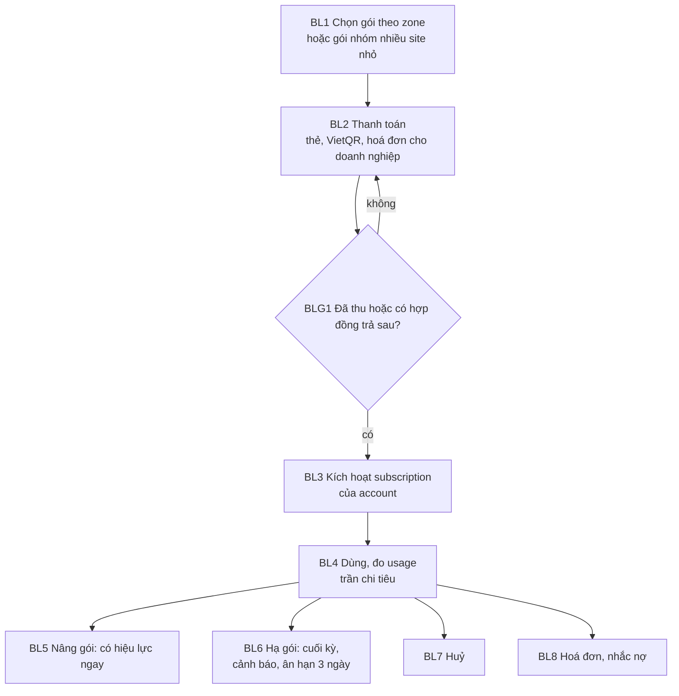

# 3.5 Mua, đổi gói, vượt hạn mức, thanh toán

> **Trạng thái (2026-11-17): chủ dự án đã duyệt các đề xuất của Claude** (OQ-54, 57…61); ngoại lệ ghi ở mục phân tích bên dưới. Luồng (bước 2) đã viết ở mục 7. Giá
> và hạn mức tham chiếu ở kiến trúc 8.18; trang này hỏi về cách mua và tính tiền, không hỏi lại giá.

## 1. Phạm vi

Từ dùng thử, mua, nâng, hạ gói, vượt hạn mức, thanh toán, hoá đơn tới thanh toán thất bại và huỷ. Liên quan:
F10 ở [§1](../01-functional-decomposition.md#f10-gói-và-billing).

## 2. Kịch bản theo từng trục

### A. Cách mua

| Mã | Kịch bản | Concern |
|---|---|---|
| KB5-A1 | Cá nhân, shop nhỏ trả bằng thẻ hoặc ví, QR ngân hàng | Thẻ nội địa, ví điện tử, thanh toán định kỳ có được hỗ trợ không |
| KB5-A2 | Doanh nghiệp trong nước cần hợp đồng, hoá đơn VAT, chuyển khoản sau khi nhận hoá đơn | Trả sau nghĩa là cấp dịch vụ trước khi thu tiền |
| KB5-A3 | Enterprise qua đấu thầu, PO, hợp đồng năm | Gói riêng, điều khoản riêng |
| KB5-A4 | Khách nước ngoài trả USD | Thuế, tỉ giá, cổng thanh toán quốc tế |
| KB5-A5 | Mua qua đối tác, reseller, nhà cung cấp hosting | Ai xuất hoá đơn cho khách cuối |

### B. Đơn vị tính

| Mã | Kịch bản | Concern |
|---|---|---|
| KB5-B1 | Theo zone | Một VPS chạy 5 domain nhỏ thành 5 zone |
| KB5-B2 | Theo account hoặc org, gộp nhiều zone | Một hoá đơn cho cả công ty |
| KB5-B3 | Zone phụ (staging, domain phụ) | Cái gì là zone phụ, ai xác định |
| KB5-B4 | Add-on lẻ (thêm rule, thêm retention, bot nâng cao) | Bán lẻ tính năng hay chỉ bán theo gói |

### C. Kỳ thanh toán

| Mã | Kịch bản | Concern |
|---|---|---|
| KB5-C1 | Tháng hay năm, giảm giá khi trả năm | |
| KB5-C2 | Nâng gói giữa kỳ | Tính theo ngày còn lại (proration) hay từ kỳ sau |
| KB5-C3 | Phí nền trả trước, phí vượt trả sau | Hai hoá đơn hay một |
| KB5-C4 | Chốt kỳ theo múi giờ nào | Usage lúc nửa đêm |

### D. Usage và vượt hạn mức

| Mã | Kịch bản | Concern |
|---|---|---|
| KB5-D1 | Cảnh báo 80% và 100% | Đã có |
| KB5-D2 | Khách đặt trần chi tiêu: vượt trần thì làm gì | Cắt traffic hay hạ cấp, hay chỉ báo |
| KB5-D3 | Khách không đồng ý số liệu usage | Bằng chứng: đối soát, số liệu theo giờ |
| KB5-D4 | Tăng đột biến hợp lệ (khuyến mãi, sự kiện) | Gợi ý nâng gói tạm thời |
| KB5-D5 | Traffic tấn công lọt bị tính phí | Xem 3.3 |

### E. Hạ gói và huỷ

| Mã | Kịch bản | Concern |
|---|---|---|
| KB5-E1 | Hạ gói khi đang dùng quá giới hạn gói thấp (số rule, đích export) | Chặn hạ gói, hay tự tắt bớt (tắt cái nào) |
| KB5-E2 | Hạ gói làm retention ngắn lại | Xoá log cũ ngay hay giữ tới hết hạn cũ |
| KB5-E3 | Huỷ giữa kỳ | Hoàn tiền phần còn lại không |
| KB5-E4 | Tạm ngừng dịch vụ (mùa vụ) | Có gói tạm ngừng không |

### F. Thanh toán thất bại

| Mã | Kịch bản | Concern |
|---|---|---|
| KB5-F1 | Thẻ hết hạn, không đủ tiền | Thử lại mấy lần, khi nào chuyển sang chuyển tiếp tối giản (BR-9) |
| KB5-F2 | Doanh nghiệp trả sau quá hạn | Quy trình nhắc nợ khác với thẻ |
| KB5-F3 | Khách trả lại tiền qua ngân hàng (chargeback) | Khoá org không |

### G. Thuế và hoá đơn

| Mã | Kịch bản | Concern |
|---|---|---|
| KB5-G1 | Hoá đơn điện tử VAT trong nước | Thuế suất, thông tin doanh nghiệp, sửa hoá đơn sai |
| KB5-G2 | Cá nhân không lấy hoá đơn VAT | Vẫn phải xuất theo quy định |
| KB5-G3 | Khách nước ngoài | Thuế nhà thầu, hoá đơn thương mại |

### H. Dùng thử, khuyến mãi, đối tác

| Mã | Kịch bản | Concern |
|---|---|---|
| KB5-H1 | Hết dùng thử, chuyển sang trả phí giữ nguyên cấu hình | Không mất gì khi chuyển |
| KB5-H2 | Lạm dụng dùng thử bằng nhiều org, nhiều domain | Định danh dùng thử (BR-8) |
| KB5-H3 | Mã giảm giá, chương trình khuyến mãi | |
| KB5-H4 | Reseller, hoa hồng đối tác, nhãn trắng | Mô hình đối tác |
| KB5-H5 | Enterprise cam kết sử dụng, vượt cam kết, bù trừ cuối năm | |
| KB5-H6 | On-prem: license theo node theo năm | Kiểm license khi không có mạng |

## 3. Đã quyết

| Ngày | Câu hỏi | Quyết định | Hệ quả cần phân tích tiếp |
|---|---|---|---|
| 2026-11-07 | OQ-55 | **Có trần chi tiêu do khách đặt, và có gói.** Có kiểu dùng quá quota rồi bị trừ sau | **Để phân tích sau theo yêu cầu chủ dự án**: dùng vượt quota bị trừ sau bao nhiêu, trừ vào đâu (số dư trả trước, hoá đơn kỳ sau), vượt trần chi tiêu thì làm gì |

## 4. Câu hỏi cần chủ dự án quyết

| ID | Câu hỏi | Kịch bản | Ghi chú ban đầu |
|---|---|---|---|
| OQ-54 | Đơn vị mua là zone, account hay org? Có gói theo nhóm domain cho khách nhỏ nhiều site không? | KB5-B1, KB5-B2 | Liên quan OQ-27 của onboarding |
| ~~OQ-55~~ | Có cho khách đặt trần chi tiêu không, vượt thì làm gì? | KB5-D2 | **Đã quyết một phần**: có trần chi tiêu, có gói (§3); cách trừ phần vượt để phân tích sau |
| OQ-56 | Nâng gói giữa kỳ có tính theo ngày còn lại không? | KB5-C2 | |
| OQ-57 | Doanh nghiệp trong nước trả sau bằng chuyển khoản: có hỗ trợ ngay từ MVP không, hạn mức nợ bao nhiêu? | KB5-A2, KB5-F2 | |
| OQ-58 | Hạ gói: log ngoài retention mới bị xoá ngay hay giữ tới hết hạn cũ? | KB5-E2 | |
| OQ-59 | Có bán qua reseller, nhà cung cấp hosting ở MVP không? | KB5-A5, KB5-H4 | |
| OQ-60 | Cổng thanh toán và phương thức nào ở MVP (thẻ quốc tế, thẻ nội địa, QR, ví)? | KB5-A1 | Trùng OQ-12 |
| OQ-61 | Huỷ giữa kỳ có hoàn tiền không? Có gói tạm ngừng không? | KB5-E3, KB5-E4 | |

## 5. Phân tích các câu còn mở (đã duyệt 2026-11-17)

> **Chủ dự án duyệt 2026-11-17:** mọi đề xuất ở bảng dưới được chốt thành quyết định, trừ:
> - **OQ-56**: sửa, xem dòng của câu đó.

Chủ dự án giao tự phân tích các câu còn lại (2026-11-07). **Chưa câu nào được coi là quyết định** cho tới khi
chủ dự án duyệt.

| Câu | Phương án | Đánh đổi | Đề xuất |
|---|---|---|---|
| OQ-54 | (a) Theo zone; (b) theo account; (c) gói nhóm cho khách nhỏ | (a) đắt cho người có nhiều site nhỏ; (b) khó so với chi phí phục vụ từng zone | Gói vẫn tính theo zone (như 8.18) để giá bám chi phí; thêm gói nhóm "nhiều site nhỏ" dùng chung một hạn mức cho N zone ít traffic. Subscription gắn với account; hoá đơn gộp theo account, gộp được ở cấp org |
| OQ-56 | (a) Tính theo ngày còn lại; (b) từ kỳ sau | (b) khách nâng gói khi bị tấn công sẽ chờ tới kỳ sau | **Đã sửa 2026-11-17:** Nâng: có hiệu lực ngay, tính theo ngày còn lại. Hệ thống tự tính phần giá trị còn lại của gói cũ kể từ ngày nâng, trừ vào gói mới, và cộng thêm một khoản bonus vào gói mới (**bonus 10% giá trị còn lại của gói cũ, tối đa một tháng phí chênh**, duyệt 2026-11-17; cần business xác nhận cùng bảng giá ADR-0043). Hạ: có hiệu lực cuối kỳ |
| OQ-57 | Trả sau bằng chuyển khoản ở MVP | Cấp dịch vụ trước khi thu tiền | Có, cho doanh nghiệp có hợp đồng (Business, Enterprise); hạn mức nợ theo hợp đồng; quy trình nhắc nợ riêng, quá hạn thì áp BR-9 |
| OQ-58 | (a) Xoá log ngay; (b) giữ tới hết hạn cũ | (b) tốn chi phí lưu trữ không được trả | Báo trước 7 ngày, sau đó áp retention mới; khách muốn giữ thì xuất trước |
| OQ-59 | Reseller ở MVP | | Không ở MVP. Một người thuộc nhiều org (đã quyết ở 3.6) đủ cho agency quản lý hộ; mô hình reseller, nhãn trắng để sau |
| OQ-60 | Phương thức thanh toán MVP | Mỗi cổng thêm một tích hợp | Thẻ quốc tế, chuyển khoản qua QR (VietQR), chuyển khoản theo hoá đơn cho doanh nghiệp; ví điện tử để sau |
| OQ-61 | Hoàn tiền khi huỷ, gói tạm ngừng | | Gói tháng không hoàn phần còn lại; gói năm hoàn theo tháng chưa dùng, trừ phần chiết khấu năm. Không có gói tạm ngừng: dùng tạm dừng zone và hạ gói |

## 6. Phụ thuộc

FR-10-01…FR-10-13, BR-7…BR-11, DT-8, IR-2, IR-3, OQ-10, OQ-12, OQ-14 ở [§2](../02-requirements.md).

## 7. Luồng: mua, đổi gói, vượt hạn mức, thanh toán (bước 2, 2026-11-17)

> Dựa trên [§3](#3-đã-quyết) (trần chi tiêu, OQ-55) và [§5](#5-phân-tích-các-câu-còn-mở-đã-duyệt-2026-11-17). Giá và hạn mức ở kiến trúc 8.18 / ADR-0043. Mức bonus đã chốt 10% (xem BL5); bảng giá do business chốt.

**Định nghĩa "xong":** subscription của account khớp với gói khách muốn, hoá đơn đúng, thanh toán đã ghi, giới hạn của zone phản ánh gói mới.

| Bước | Ai | Điều kiện hoặc cổng | Hỏng thì xử lý | Dữ liệu sinh ra |
|---|---|---|---|---|
| BL1 Chọn gói | Owner, billing | Gói tính **theo zone**; thêm gói nhóm "nhiều site nhỏ" dùng chung hạn mức cho N zone ít traffic; subscription gắn với **account** ([OQ-54](#5-phân-tích-các-câu-còn-mở-đã-duyệt-2026-11-17)) | Reseller, nhãn trắng chưa có ở MVP ([OQ-59](#5-phân-tích-các-câu-còn-mở-đã-duyệt-2026-11-17)) | `Subscription` nháp |
| BL2 Thanh toán | Owner, billing | MVP: thẻ quốc tế, chuyển khoản QR (VietQR), chuyển khoản theo hoá đơn cho doanh nghiệp; ví điện tử để sau ([OQ-60](#5-phân-tích-các-câu-còn-mở-đã-duyệt-2026-11-17)) | Thanh toán lỗi: giữ trạng thái chờ, nhắc; không kích hoạt | `Payment` |
| BLG1 | Hệ thống | Đã thu tiền, **hoặc** doanh nghiệp có hợp đồng (Business, Enterprise) được trả sau với hạn mức nợ theo hợp đồng ([OQ-57](#5-phân-tích-các-câu-còn-mở-đã-duyệt-2026-11-17)) | | `Subscription.active` |
| BL4 Dùng | Hệ thống | Đo usage; trần chi tiêu đã quyết ở OQ-55; traffic "nghi tấn công" không tính vào trần ([3.3](03-attack-response.md)) | Chạm trần: cảnh báo, rồi áp hành vi theo trần mềm hay cứng | `UsageReport` |
| BL5 Nâng | Owner, billing | **Hiệu lực ngay.** Hệ thống tự tính giá trị còn lại của gói cũ từ ngày nâng, trừ vào gói mới và **cộng thêm một khoản bonus** vào gói mới ([OQ-56](#5-phân-tích-các-câu-còn-mở-đã-duyệt-2026-11-17), bonus 10% giá trị còn lại của gói cũ, tối đa một tháng phí chênh, duyệt 2026-11-17) | Thanh toán phần chênh lỗi: giữ gói cũ, báo | `ProrationCredit`, giới hạn mới của zone |
| BL6 Hạ | Owner, billing | Hạ có hiệu lực **cuối kỳ**. Nếu lúc đó khách vượt giới hạn gói mới: cảnh báo sau 6 giờ, 12 giờ, 1 ngày và mỗi ngày trong **3 ngày ân hạn**, hết hạn thì chặn phần vượt: không cho tạo thêm vượt giới hạn và phần vượt (mới nhất trước) ngừng áp, không khoá tài khoản ([OQ-10](../02-requirements.md#9-câu-hỏi-mở-cho-review)). Log ngoài retention mới: **báo trước 7 ngày** rồi áp retention mới; khách muốn giữ thì xuất trước ([OQ-58](#5-phân-tích-các-câu-còn-mở-đã-duyệt-2026-11-17)) | Khách không giảm bớt: sau ân hạn chặn phần vượt, không xoá cấu hình | `DowngradeScheduled`, `QuotaWarning` |
| BL7 Huỷ | Owner | Gói tháng **không hoàn**; gói năm hoàn theo tháng chưa dùng, trừ phần chiết khấu năm; **không có gói tạm ngừng**, dùng tạm dừng zone và hạ gói ([OQ-61](#5-phân-tích-các-câu-còn-mở-đã-duyệt-2026-11-17)) | | `Cancellation` |
| BL8 Hoá đơn | Hệ thống | Hoá đơn gộp theo account, gộp được ở cấp org ([OQ-14](../02-requirements.md#9-câu-hỏi-mở-cho-review)); phí nền trả trước, phí vượt trả sau ([OQ-12](../02-requirements.md#9-câu-hỏi-mở-cho-review)); nợ quá hạn có quy trình nhắc riêng, quá hạn thì áp BR-9 | Thanh toán chậm: nhắc, rồi BR-9 | `Invoice`, `DunningStep` |

**Đã cập nhật ở [§1](../01-functional-decomposition.md) và [§2](../02-requirements.md) (2026-11-17, FR và BR mới):** F10 thêm gói nhóm nhiều site nhỏ, tính phần còn lại khi nâng gói, ân hạn 3 ngày khi hạ, xuất log trước khi áp retention mới, thanh toán VietQR và trả sau theo hợp đồng; DT cho `ProrationCredit`, `DowngradeScheduled`.
