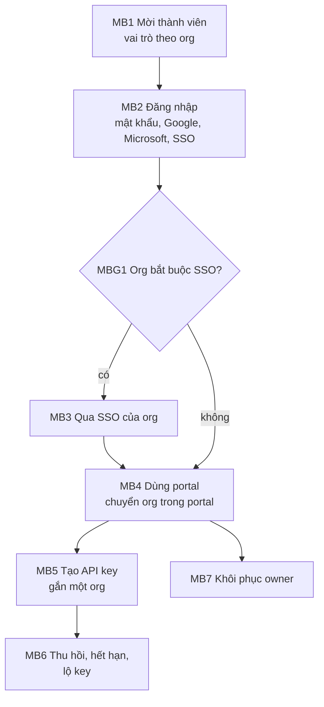

# 3.6 Quản lý thành viên, SSO, API key

> **Trạng thái (2026-11-17): chủ dự án đã duyệt các đề xuất của Claude** (OQ-63…OQ-68); ngoại lệ ghi ở mục phân tích bên dưới. Luồng (bước 2) đã viết ở mục 7. Quyết định ở [§3](#3-đã-quyết).

## 1. Phạm vi

Ai vào được tổ chức của khách, làm được gì, bằng danh tính nào, và mất quyền khi nào. Gồm cả máy (API key,
service account) và người của NCC. Liên quan: F1 ở [§1](../01-functional-decomposition.md#f1-tenant-và-danh-tính).

## 2. Kịch bản theo từng trục

### A. Cấu trúc tổ chức của khách

| Mã | Kịch bản | Concern |
|---|---|---|
| KB6-A1 | Một người làm tất cả | Mọi vai trò dồn vào owner |
| KB6-A2 | Công ty có nhiều dự án, mỗi dự án một nhóm | Account theo dự án hay nhóm zone |
| KB6-A3 | Agency quản lý website cho nhiều khách | Một org agency chứa khách, hay mỗi khách một org và agency là thành viên |
| KB6-A4 | Tập đoàn có công ty con, mỗi công ty con tự quản | Phân cấp nhiều tầng (OQ-1) |
| KB6-A5 | Nhà thầu bên ngoài cần quyền tạm thời | Quyền có hạn |

### B. Mời, nhận, rời

| Mã | Kịch bản | Concern |
|---|---|---|
| KB6-B1 | Mời người có email khác domain công ty | Có chặn theo domain không |
| KB6-B2 | Một người thuộc nhiều org (làm cho agency và công ty mình) | Một tài khoản nhiều org, hay mỗi org một tài khoản |
| KB6-B3 | Chuyển quyền owner | Cần xác nhận cả hai bên |
| KB6-B4 | Owner duy nhất nghỉ việc, mất email, mất MFA | Khôi phục quyền: NCC xác minh danh tính thế nào |
| KB6-B5 | Người rời công ty nhưng vẫn còn API key cá nhân đang chạy trong CI | Gỡ người thì CI hỏng |

### C. SSO và MFA

| Mã | Kịch bản | Concern |
|---|---|---|
| KB6-C1 | Bắt buộc SSO cho domain email | IdP sập thì ai vào được (tài khoản khẩn) |
| KB6-C2 | Tạo user tự động khi đăng nhập SSO lần đầu (JIT) | Vai trò mặc định là gì |
| KB6-C3 | Gỡ user qua SCIM | Phiên đang mở, key đang chạy |
| KB6-C4 | Nhiều IdP trong một org (sau sáp nhập) | |
| KB6-C5 | Mất thiết bị MFA | Mã khôi phục, khôi phục qua support |
| KB6-C6 | Đăng nhập bằng Google, Microsoft cho khách nhỏ | Không phải SSO doanh nghiệp nhưng tiện |

### D. Quyền

| Mã | Kịch bản | Concern |
|---|---|---|
| KB6-D1 | Vai trò mặc định có đủ không | |
| KB6-D2 | Quyền theo zone hoặc nhóm zone | Đã có (FR-1-05) |
| KB6-D3 | Quyền xem dữ liệu request (có thể chứa dữ liệu cá nhân) tách riêng | Liên quan OQ-50 |
| KB6-D4 | Quyền billing tách khỏi quyền kỹ thuật | Kế toán chỉ thấy hoá đơn |
| KB6-D5 | Quyền chỉ đọc cho kiểm toán viên bên ngoài, có hạn | |

### E. API key và máy

| Mã | Kịch bản | Concern |
|---|---|---|
| KB6-E1 | Key cá nhân hay key của service account | Gỡ người không làm hỏng máy |
| KB6-E2 | Key có hết hạn bắt buộc không | Key hết hạn làm hỏng CI vào nửa đêm |
| KB6-E3 | Key bị lộ lên GitHub công khai | Quét và tự thu hồi |
| KB6-E4 | Giới hạn IP nguồn cho key | |
| KB6-E5 | Terraform cần quyền rộng | Phạm vi tối thiểu |

### F. Truy cập của NCC và phiên

| Mã | Kịch bản | Concern |
|---|---|---|
| KB6-F1 | Support xin quyền vào tenant | Đã có (BR-20); khách thấy support đã làm gì |
| KB6-F2 | Phiên đăng nhập từ quốc gia lạ, nhiều thiết bị | Cảnh báo cho user |
| KB6-F3 | Thời gian phiên, đăng xuất khi nhàn rỗi | Theo org |

## 3. Đã quyết

| Ngày | Câu hỏi | Quyết định | Hệ quả cần phân tích tiếp |
|---|---|---|---|
| 2026-11-07 | OQ-62 | **Một người có thể thuộc nhiều org** | Chuyển org trong portal; SSO bắt buộc của org A áp khi người đó vào org A, không chặn họ vào org B bằng mật khẩu; MFA gắn với người, chính sách MFA bắt buộc áp theo org; API key luôn thuộc một org; audit ghi cả người và org; gỡ khỏi org A không ảnh hưởng org B; SCIM của org A chỉ quản lý membership trong org A, không xoá tài khoản người dùng |

## 4. Câu hỏi cần chủ dự án quyết

| ID | Câu hỏi | Kịch bản | Ghi chú ban đầu |
|---|---|---|---|
| ~~OQ-62~~ | Một tài khoản có thuộc nhiều org không? | KB6-B2, KB6-A3 | **Đã quyết**: có (§3) |
| OQ-63 | Agency quản lý nhiều khách: mô hình nào? | KB6-A3 | Liên quan OQ-59 (reseller) |
| OQ-64 | Khôi phục khi owner duy nhất mất truy cập: NCC xác minh danh tính bằng gì? | KB6-B4, KB6-C5 | |
| OQ-65 | Tài khoản khẩn khi bắt buộc SSO: có, ai giữ, kiểm soát thế nào? | KB6-C1 | |
| OQ-66 | API key có bắt buộc hạn không? Có quét key lộ công khai không? | KB6-E2, KB6-E3 | |
| OQ-67 | Đăng nhập Google, Microsoft cho khách nhỏ có ở MVP không? | KB6-C6 | |
| OQ-68 | Quyền xem dữ liệu request có tách thành quyền riêng không? | KB6-D3 | Gộp với OQ-50 |

## 5. Phân tích các câu còn mở (đã duyệt 2026-11-17)

> **Chủ dự án duyệt 2026-11-17:** mọi đề xuất ở bảng dưới được chốt thành quyết định

Chủ dự án giao tự phân tích các câu còn lại (2026-11-07). **Chưa câu nào được coi là quyết định** cho tới khi
chủ dự án duyệt.

| Câu | Phương án | Đánh đổi | Đề xuất |
|---|---|---|---|
| OQ-63 | (a) Agency là thành viên nhiều org; (b) org agency chứa org khách | (b) cần phân cấp org, phức tạp | (a): khách cuối là owner org của mình, agency là thành viên với vai trò được cấp; nhờ OQ-62 không cần mô hình riêng ở MVP |
| OQ-64 | Khôi phục owner | Quy trình lỏng là đường chiếm tài khoản | Hai bằng chứng trong ba: tạo bản ghi DNS trên domain của zone, giấy tờ doanh nghiệp khớp tên trên hoá đơn, xác nhận của chủ phương thức thanh toán. Chờ 72 giờ, báo mọi admin còn lại của org; ghi audit |
| OQ-65 | Tài khoản khẩn khi bắt buộc SSO | Không có thì IdP sập là mất quyền điều khiển | Có: tối đa hai owner được miễn SSO, dùng mật khẩu và khoá bảo mật phần cứng; mỗi lần đăng nhập báo mọi admin |
| OQ-66 | Hạn key, quét key lộ | Hạn bắt buộc làm hỏng CI | Không bắt buộc hạn, mặc định gợi ý 90 ngày; org bật được "bắt buộc hạn". Key có tiền tố nhận diện, đăng ký với chương trình quét secret của GitHub; key lộ bị thu hồi tự động và báo owner |
| OQ-67 | Đăng nhập Google, Microsoft | | Có ở MVP, dùng lại đường OIDC đã có |
| OQ-68 | Quyền xem dữ liệu request | | Như OQ-50 (3.4): quyền riêng, mặc định chỉ security admin |

## 6. Phụ thuộc

FR-1-01…FR-1-17, BR-13…BR-15, BR-20, DT-1, OQ-1 ở [§2](../02-requirements.md).

## 7. Luồng: thành viên, SSO, API key, khôi phục (bước 2, 2026-11-17)

> Dựa trên [§3](#3-đã-quyết) (một người thuộc nhiều org, OQ-62) và [§5](#5-phân-tích-các-câu-còn-mở-đã-duyệt-2026-11-17).

**Định nghĩa "xong":** người đúng đã vào đúng org với đúng vai trò, truy cập đúng cách xác thực mà org yêu cầu, mọi thao tác nhạy cảm có audit.

| Bước | Ai | Điều kiện hoặc cổng | Hỏng thì xử lý | Dữ liệu sinh ra |
|---|---|---|---|---|
| MB1 Mời | Owner, admin | Một người **thuộc nhiều org**; agency là thành viên của org khách với vai trò được cấp, khách cuối là owner org của mình ([OQ-62](#3-đã-quyết), [OQ-63](#5-phân-tích-các-câu-còn-mở-đã-duyệt-2026-11-17)) | Lời mời hết hạn: gửi lại | `Invitation`, `Membership` |
| MB2 Đăng nhập | Thành viên | Mật khẩu hoặc **Google, Microsoft (OIDC) có ở MVP** ([OQ-67](#5-phân-tích-các-câu-còn-mở-đã-duyệt-2026-11-17)); MFA gắn với người, chính sách MFA bắt buộc áp theo org | Sai nhiều lần: khoá tạm, báo | `LoginEvent` |
| MBG1, MB3 SSO | Hệ thống | SSO bắt buộc của org A áp khi vào org A, không chặn vào org B bằng mật khẩu. **Tài khoản khẩn:** tối đa **hai owner** được miễn SSO, dùng mật khẩu và khoá bảo mật phần cứng; mỗi lần đăng nhập báo mọi admin ([OQ-65](#5-phân-tích-các-câu-còn-mở-đã-duyệt-2026-11-17)) | IdP sập: owner miễn SSO vào được | `SsoSession`, thông báo cho admin |
| MB5 API key | Thành viên có quyền | Key thuộc **một org**. Không bắt buộc hạn, mặc định gợi ý **90 ngày**; org bật được "bắt buộc hạn". Key có tiền tố nhận diện, đăng ký với chương trình quét secret của GitHub ([OQ-66](#5-phân-tích-các-câu-còn-mở-đã-duyệt-2026-11-17)) | | `ApiKey` (chỉ lưu băm) |
| MB6 Thu hồi | Owner, hệ thống | Key lộ công khai: **thu hồi tự động** và báo owner | Không thu hồi được: báo sự cố | `ApiKeyRevoked`, audit |
| MB7 Khôi phục owner | NCC | Owner duy nhất mất truy cập: **hai bằng chứng trong ba**: tạo bản ghi DNS trên domain của zone, giấy tờ doanh nghiệp khớp tên trên hoá đơn, xác nhận của chủ phương thức thanh toán. **Chờ 72 giờ**, báo mọi admin còn lại của org; ghi audit ([OQ-64](#5-phân-tích-các-câu-còn-mở-đã-duyệt-2026-11-17)) | Thiếu bằng chứng: từ chối, không có đường tắt | `OwnerRecovery`, audit |
| Quyền xem dữ liệu request | Admin | Quyền riêng, mặc định chỉ security admin ([OQ-68](#5-phân-tích-các-câu-còn-mở-đã-duyệt-2026-11-17), [OQ-50](04-false-positive.md)) | | `Permission` |

**Cần cập nhật ở [§1](../01-functional-decomposition.md) và [§2](../02-requirements.md):** F1 thêm đăng nhập Google/Microsoft, tài khoản khẩn miễn SSO (tối đa hai), khôi phục owner với hai bằng chứng và chờ 72 giờ,
API key hạn tuỳ chọn và thu hồi tự động khi lộ; quyền riêng xem dữ liệu request.
