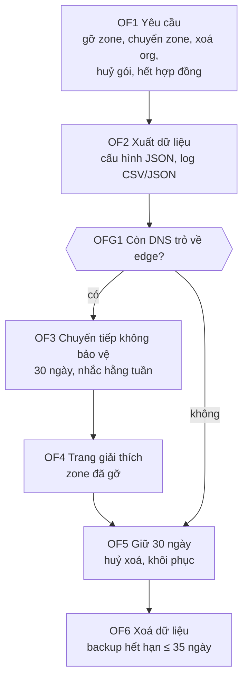

# 3.7 Rời dịch vụ: gỡ zone, xoá org, xoá dữ liệu

> **Trạng thái (2026-11-17): chủ dự án đã duyệt đề xuất cho các câu OQ của trang này** (trừ OQ-118 của 3.11 vẫn hoãn). Luồng (bước 2) ở mục 6. Bổ sung kịch bản F–M theo yêu cầu "nghĩ thêm kịch bản" (2026-11-07).

## 1. Phạm vi

Khách gỡ một zone, huỷ gói, xoá org, hoặc NCC chấm dứt dịch vụ. Gồm việc trả traffic về origin, xuất và xoá
dữ liệu. Liên quan: F2.4.3, F1.1.4, F9.3 ở [§1](../01-functional-decomposition.md).

## 2. Kịch bản theo từng trục

### A. Gỡ một zone

| Mã | Kịch bản | Concern |
|---|---|---|
| KB7-A1 | Khách gỡ zone sau khi đã trỏ DNS về origin | Bình thường |
| KB7-A2 | Khách gỡ zone khi DNS vẫn trỏ về edge | Edge trả gì: lỗi, trang thông báo, hay vẫn chuyển tiếp một thời gian |
| KB7-A3 | Origin đã khoá chỉ nhận edge | Trỏ DNS về origin xong thì origin từ chối người dùng; cần nhắc mở lại |
| KB7-A4 | Origin không có cert vì trước đây edge lo TLS | HTTPS lỗi sau khi rời |
| KB7-A5 | Gỡ nhầm zone | Khôi phục trong bao lâu |

### B. Huỷ gói, xoá org

| Mã | Kịch bản | Concern |
|---|---|---|
| KB7-B1 | Huỷ gói, giữ org và cấu hình | Zone về gói nào (Free, tạm dừng) |
| KB7-B2 | Xoá org | Thời hạn huỷ yêu cầu xoá; ai được yêu cầu (chỉ owner) |
| KB7-B3 | Xoá account trong org | Zone của account đi đâu |
| KB7-B4 | Org còn nợ | Có cho xoá không |

### C. Dữ liệu

| Mã | Kịch bản | Concern |
|---|---|---|
| KB7-C1 | Xuất trước khi xoá: cấu hình (dạng API hoặc Terraform), log, audit, hoá đơn | Định dạng, kích thước |
| KB7-C2 | Audit không được xoá nhưng có dữ liệu cá nhân | Ẩn danh (OQ-6) |
| KB7-C3 | Hoá đơn, chứng từ phải giữ theo luật kế toán | Giữ dù org đã xoá |
| KB7-C4 | Bản sao lưu vẫn chứa dữ liệu đã xoá | Xoá khỏi backup hay để hết hạn backup |
| KB7-C5 | Tenant Enterprise có database riêng | Huỷ database và khoá mã hoá |
| KB7-C6 | Log đã gửi sang SIEM của khách | Ngoài trách nhiệm của NCC |

### D. NCC chấm dứt

| Mã | Kịch bản | Concern |
|---|---|---|
| KB7-D1 | Vi phạm điều khoản, gian lận thanh toán | Khoá có báo trước không |
| KB7-D2 | Website lừa đảo, phishing, nội dung vi phạm pháp luật đứng sau edge | Xem 3.10; khoá ngay |
| KB7-D3 | Yêu cầu của cơ quan nhà nước | Quy trình, căn cứ pháp lý |
| KB7-D4 | NCC ngừng một gói hoặc một tính năng | Báo trước bao lâu |

### E. Domain

| Mã | Kịch bản | Concern |
|---|---|---|
| KB7-E1 | Domain hết hạn đăng ký khi zone còn hoạt động | Zone tiếp tục, hay tạm dừng |
| KB7-E2 | Domain đổi chủ (bán, chuyển nhượng) | Chủ mới không được thừa hưởng cấu hình và log của chủ cũ |

### F. Chuyển quyền sở hữu

| Mã | Kịch bản | Concern |
|---|---|---|
| KB7-F1 | Bán website: zone chuyển sang org của chủ mới | Policy đi theo zone; log, audit, hoá đơn cũ ở lại org cũ hay đi theo |
| KB7-F2 | Sáp nhập hai công ty: gộp hai org | Thành viên, vai trò, subscription, hoá đơn |
| KB7-F3 | Tách công ty: một org thành hai | Chia zone, chia lịch sử |
| KB7-F4 | Agency bàn giao website cho khách cuối | Agency đang là owner; chuyển owner (KB6-B3) |

### G. Khách biến mất

| Mã | Kịch bản | Concern |
|---|---|---|
| KB7-G1 | Không thanh toán, không phản hồi email, DNS vẫn trỏ về edge | Zone bỏ hoang vẫn nhận traffic; tạm dừng thì website của họ chết |
| KB7-G2 | Người liên hệ duy nhất nghỉ việc, không ai có quyền | Khôi phục quyền (OQ-64) hay coi như bỏ |
| KB7-G3 | Doanh nghiệp giải thể | Ai có quyền yêu cầu xoá, nhận dữ liệu |

### H. Chuyển mô hình triển khai

| Mã | Kịch bản | Concern |
|---|---|---|
| KB7-H1 | Từ SaaS sang hybrid hoặc on-prem | Chuyển cấu hình, log; giai đoạn chạy song song |
| KB7-H2 | Từ on-prem về SaaS | Ngược lại |
| KB7-H3 | Đổi region lưu dữ liệu | Log cũ di chuyển hay ở lại |
| KB7-H4 | Từ database chung sang database riêng (lên Enterprise) và ngược lại | Di chuyển không gián đoạn |

### I. Rời một phần

| Mã | Kịch bản | Concern |
|---|---|---|
| KB7-I1 | Tắt một tính năng (bot management, API security) | Cấu hình của tính năng đó giữ hay xoá |
| KB7-I2 | Hạ từ gói trả phí về Free khi đang vượt giới hạn Free | Tắt bớt cái gì (KB5-E1) |
| KB7-I3 | Bỏ một hostname, giữ zone | Cert, claim hostname |
| KB7-I4 | Tắt proxy nhưng vẫn giữ NCC làm DNS (nếu có DNS hosting, OQ-25) | Bản ghi chuyển sang trỏ thẳng origin |

### J. Hợp đồng Enterprise kết thúc

| Mã | Kịch bản | Concern |
|---|---|---|
| KB7-J1 | Hết hợp đồng, không gia hạn | Chuyển sang gói tự phục vụ, hay tạm dừng; thời gian chuyển tiếp |
| KB7-J2 | Hết hợp đồng khi đang có cell riêng, database riêng | Thu hồi tài nguyên riêng |
| KB7-J3 | Đàm phán gia hạn kéo dài quá ngày hết hạn | Dịch vụ có tiếp tục không |

### K. NCC rút lui

| Mã | Kịch bản | Concern |
|---|---|---|
| KB7-K1 | Đối tác hạ tầng chấm dứt hợp đồng, một PoP đóng | Khách ở PoP đó không cần làm gì; khách đã khoá firewall theo IP của PoP đó thì sao |
| KB7-K2 | NCC rút khỏi một thị trường, một region | Báo trước bao lâu, chuyển dữ liệu |
| KB7-K3 | NCC ngừng một gói, một tính năng | Đã có (KB7-D4) |
| KB7-K4 | NCC ngừng kinh doanh | Khách Enterprise có yêu cầu bảo đảm (xuất cấu hình, thời gian chuyển đổi) |

### L. Yêu cầu của người dùng cuối

| Mã | Kịch bản | Concern |
|---|---|---|
| KB7-L1 | Người dùng của website khách yêu cầu xem hoặc xoá dữ liệu về họ trong log | Khách là bên kiểm soát dữ liệu, NCC là bên xử lý; yêu cầu tới NCC thì chuyển cho khách |
| KB7-L2 | IP của người dùng cuối nằm trong nhiều tenant | Xoá theo một tenant hay mọi tenant |

### M. Sau khi rời

| Mã | Kịch bản | Concern |
|---|---|---|
| KB7-M1 | API key, Terraform, đích export, webhook vẫn gọi sau khi org bị xoá | Trả lỗi gì; có báo không |
| KB7-M2 | Khách quay lại sau 6 tháng | Khôi phục cấu hình cũ được không, trong bao lâu |
| KB7-M3 | Email thông báo, tiếp thị gửi tới người đã rời | Huỷ đăng ký |

## 3. Câu hỏi cần chủ dự án quyết

| ID | Câu hỏi | Kịch bản | Ghi chú ban đầu |
|---|---|---|---|
| OQ-69 | Zone đã gỡ mà DNS vẫn trỏ về edge: edge trả gì, trong bao lâu? | KB7-A2 | |
| OQ-70 | Thời hạn giữ dữ liệu sau khi xoá org, thời hạn khôi phục zone gỡ nhầm | KB7-A5, KB7-B2 | Gắn với OQ-6 |
| OQ-71 | Xoá khỏi bản sao lưu: xoá chủ động hay chờ backup hết hạn? | KB7-C4 | |
| OQ-72 | Xuất cấu hình dạng nào khi rời (JSON của API, Terraform)? | KB7-C1 | |
| OQ-73 | Quy trình khoá theo yêu cầu cơ quan nhà nước và khi phát hiện vi phạm | KB7-D2, KB7-D3 | Cần tư vấn pháp lý |
| OQ-74 | Domain hết hạn hoặc đổi chủ: phát hiện thế nào, làm gì? | KB7-E1, KB7-E2 | |
| OQ-94 | Chuyển zone sang org khác (bán website, sáp nhập, tách công ty): dữ liệu nào đi theo zone? | KB7-F1…KB7-F4 | Policy đi theo; log, audit, hoá đơn ở lại org cũ |
| OQ-95 | Zone bỏ hoang (không thanh toán, không liên lạc được) mà DNS vẫn trỏ: giữ bao lâu, rồi làm gì? | KB7-G1…KB7-G3 | Gắn với BR-9 |
| OQ-96 | Hợp đồng Enterprise kết thúc: chuyển về gói tự phục vụ hay tạm dừng, thời gian chuyển tiếp? | KB7-J1…KB7-J3 | |
| OQ-97 | Khách quay lại sau khi xoá: có khôi phục cấu hình không, trong bao lâu? | KB7-M2 | Gắn với OQ-70 |
| OQ-98 | Yêu cầu của người dùng cuối về dữ liệu trong log: NCC xử lý hay chuyển cho khách? | KB7-L1, KB7-L2 | Cần tư vấn pháp lý (Nghị định 13/2023) |
| OQ-99 | NCC đóng PoP, rút region, ngừng kinh doanh: báo trước bao lâu, cam kết gì? | KB7-K1…KB7-K4 | |

## 4. Phụ thuộc

FR-1-03, FR-2-13, FR-9-03…FR-9-05, BR-12, BR-16, DT-7, OQ-6 ở [§2](../02-requirements.md); `DataErasureRequested`
ở kiến trúc 5.5.

## 5. Đã quyết (duyệt 2026-11-17)

> Chủ dự án duyệt tất cả đề xuất dưới đây ngày 2026-11-17. Đề xuất do Claude viết (trang gốc chưa có mục phân tích); con số là ước lượng đã được duyệt.

| Câu | Quyết định |
|---|---|
| OQ-69 | (b): 30 ngày chuyển tiếp không bảo vệ, không cache, nhắc khách hằng tuần; sau đó trả trang giải thích "zone đã gỡ". Không bao giờ trả lỗi im lặng |
| OQ-70 | 30 ngày cho cả hai: huỷ được yêu cầu xoá org trong 30 ngày (chỉ owner); zone gỡ nhầm khôi phục được cấu hình trong 30 ngày; log không khôi phục |
| OQ-71 | (b): backup giữ tối đa 35 ngày; khi khôi phục từ backup phải áp lại danh sách xoá; ghi rõ trong điều khoản |
| OQ-72 | (a) JSON theo API cho mọi gói, đủ để dựng lại; Terraform ở Mở rộng. Log xuất CSV/JSON; mọi gói xuất được trước khi xoá |
| OQ-73 | Theo OQ-45: chỉ nhận văn bản chính thức qua đầu mối pháp chế, ghi sổ, báo khách trừ khi văn bản cấm. Vi phạm đã xác minh thì khoá zone ngay; khoá đảo ngược được khi vi phạm được gỡ. **Cần tư vấn pháp lý** |
| OQ-74 | Cả hai: kiểm lại bản ghi xác minh định kỳ (OQ-3: cảnh báo ngày 7, tạm dừng ngày 14) và RDAP khi có. Chủ mới phải xác minh lại; không thừa hưởng cấu hình và log của chủ cũ |
| OQ-94 | Policy và cấu hình đi theo; log, audit, hoá đơn ở lại org cũ. Cần owner của **cả hai** org xác nhận; bí mật (key API, webhook secret) bị xoá và phải tạo lại; hiệu lực ngay, subscription gán lại account mới |
| OQ-95 | Theo BR-9, rồi: 30 ngày chuyển tiếp tối giản; 30 ngày chuyển tiếp không bảo vệ (như OQ-69); sau đó gỡ zone và gửi thông báo cuối. Không bao giờ chặn traffic hợp pháp |
| OQ-96 | (a) có thẻ thì chuyển sang gói tự phục vụ phù hợp nhất, nếu không thì theo OQ-95; 30 ngày chuyển tiếp giữ nguyên dịch vụ; thu hồi cell, database riêng sau 30 ngày kèm xuất dữ liệu; gia hạn đang đàm phán: tiếp tục tối đa 15 ngày khi có xác nhận bằng văn bản |
| OQ-97 | Trong 30 ngày kể từ xoá: khôi phục cấu hình. Sau đó chỉ khôi phục từ bản xuất của chính khách; không giữ log |
| OQ-98 | NCC chuyển yêu cầu cho khách trong 72 giờ, không tự trả lời người dùng cuối. IP nằm trong nhiều tenant: xoá theo từng tenant yêu cầu, dữ liệu gộp ẩn danh không bị xoá. **Cần tư vấn pháp lý** |
| OQ-99 | Đóng PoP hoặc rút region: báo trước tối thiểu 90 ngày (Enterprise 180 ngày) kèm dải IP mới. Ngừng kinh doanh: Enterprise được bảo đảm xuất cấu hình và 180 ngày chuyển đổi |

## 6. Luồng: rời dịch vụ, chuyển zone, bỏ hoang (bước 2, 2026-11-17)

| Bước | Ai | Điều kiện hoặc cổng | Hỏng thì xử lý | Dữ liệu sinh ra |
|---|---|---|---|---|
| OF1 Yêu cầu | Owner (xoá org chỉ owner); NCC khi vi phạm hoặc theo yêu cầu cơ quan nhà nước | Gỡ nhầm khôi phục trong 30 ngày | Yêu cầu của cơ quan: theo OQ-45, ghi sổ | `OffboardingRequest` |
| OF2 Xuất | Khách | Cấu hình dạng JSON theo API cho mọi gói (đủ để dựng lại), log CSV hoặc JSON; Terraform ở Mở rộng | Log quá lớn: xuất theo đợt | `ExportJob` |
| OFG1, OF3 | Hệ thống | Zone đã gỡ mà DNS còn trỏ: **chuyển tiếp thẳng tới origin 30 ngày**, không bảo vệ, không cache, nhắc khách hằng tuần | Origin không phản hồi: trả trang lỗi có giải thích | `ZoneState.passthrough` |
| OF4 | Hệ thống | Sau 30 ngày trả **trang giải thích "zone đã gỡ"**, không lỗi im lặng | | — |
| OF5 Giữ | Hệ thống | **30 ngày** sau yêu cầu xoá org (huỷ được, chỉ owner) và 30 ngày khôi phục zone gỡ nhầm (cấu hình, không log) | Quay lại sau thời hạn: chỉ khôi phục từ bản xuất của khách | `RetentionHold` |
| OF6 Xoá | Hệ thống | Xoá dữ liệu sống; **bản sao lưu giữ tối đa 35 ngày**, khôi phục từ backup phải áp lại danh sách xoá | | `DeletionRecord` |

**Nhánh khác:**

| Tình huống | Xử lý |
|---|---|
| Chuyển zone sang org khác (OQ-94) | Cần owner **cả hai org** xác nhận; policy và cấu hình đi theo; log, audit, hoá đơn ở lại org cũ; bí mật (key API, webhook secret) bị xoá và phải tạo lại; hiệu lực ngay, subscription gán lại account mới |
| Zone bỏ hoang (OQ-95) | Theo BR-9, rồi 30 ngày chuyển tiếp tối giản, 30 ngày chuyển tiếp không bảo vệ, rồi gỡ và gửi thông báo cuối. Không bao giờ chặn traffic hợp pháp |
| Hợp đồng Enterprise kết thúc (OQ-96) | 30 ngày chuyển tiếp giữ nguyên dịch vụ; có thẻ thì chuyển gói tự phục vụ phù hợp nhất, không thì như zone bỏ hoang; cell và database riêng thu hồi sau 30 ngày kèm xuất dữ liệu; gia hạn đang đàm phán tiếp tục tối đa 15 ngày khi có xác nhận bằng văn bản |
| Domain hết hạn hoặc đổi chủ (OQ-74) | Kiểm lại bản ghi xác minh định kỳ (cảnh báo ngày 7, tạm dừng ngày 14, OQ-3) và RDAP khi có; chủ mới phải xác minh lại, không thừa hưởng cấu hình và log |
| Người dùng cuối yêu cầu dữ liệu log (OQ-98) | NCC là bên xử lý: chuyển cho khách trong 72 giờ; IP nằm trong nhiều tenant thì xoá theo từng tenant yêu cầu, dữ liệu gộp ẩn danh không xoá. Cần tư vấn pháp lý |
| NCC đóng PoP, rút region, ngừng kinh doanh (OQ-99) | Báo trước tối thiểu 90 ngày (Enterprise 180 ngày) kèm dải IP mới; Enterprise được bảo đảm xuất cấu hình và 180 ngày chuyển đổi |
