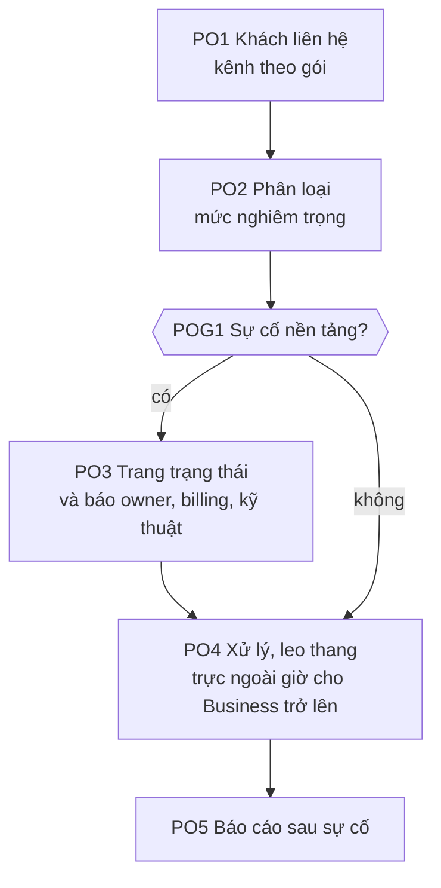

# 3.11 Vận hành của NCC

> **Trạng thái (2026-11-17): chủ dự án đã duyệt đề xuất cho các câu OQ của trang này** (trừ OQ-118 của 3.11 vẫn hoãn). Luồng (bước 2) ở mục 7. Mở rộng theo yêu cầu "vận hành thì suy nghĩ
> thêm": thêm các trục F–N. Trang này chỉ liệt kê kịch bản và câu hỏi. Vận hành kỹ thuật (runbook, giám sát) ở
> kiến trúc 8.12, 8.13.

## 1. Phạm vi

Các nghiệp vụ phía NCC: phát hành bảo vệ mới, hỗ trợ khách, xử lý sự cố của chính nền tảng, bán hàng và triển
khai Enterprise, làm việc với đối tác, kiểm soát nội bộ, tuân thủ của chính NCC, xử lý lạm dụng, tài chính.
Liên quan: F11, F12 ở [§1](../01-functional-decomposition.md).

Đã quyết ở 3.3: NCC bật được mitigation trên zone của khách. Việc đó cần một **portal vận hành của NCC** tách
khỏi portal của khách; các trục dưới đây là những gì portal và quy trình đó phải phục vụ.

## 2. Kịch bản theo từng trục

### A. Threat research

| Mã | Kịch bản | Concern |
|---|---|---|
| KB11-A1 | CVE nghiêm trọng mới, đang bị khai thác | Từ lúc biết tới lúc có rule khẩn: bao lâu, ai duyệt |
| KB11-A2 | Rule khẩn chặn nhầm | Rollback, thông báo (3.4) |
| KB11-A3 | Khách hỏi "tôi có được bảo vệ khỏi CVE X không" | Trang công bố theo CVE |
| KB11-A4 | Nguồn threat intel (feed thương mại, CERT trong nước) | Chi phí, điều khoản |
| KB11-A5 | Phát hành ruleset định kỳ | Lịch, ghi chú phát hành cho khách |

### B. Support

| Mã | Kịch bản | Concern |
|---|---|---|
| KB11-B1 | Kênh: email, chat, điện thoại, Zalo | Theo gói |
| KB11-B2 | Giờ hỗ trợ: giờ hành chính hay 24/7 | Theo gói |
| KB11-B3 | Thời gian phản hồi theo mức nghiêm trọng | SLA support |
| KB11-B4 | Support cần xem dữ liệu của khách | BR-20 |
| KB11-B5 | Tài liệu tự phục vụ, tiếng Việt | |
| KB11-B6 | Khách gọi lúc đang bị tấn công, không có tài khoản support | Ai nhận, xác minh người gọi thế nào |

### C. Sự cố của nền tảng

| Mã | Kịch bản | Concern |
|---|---|---|
| KB11-C1 | Một PoP hoặc region lỗi | Khách có được báo không |
| KB11-C2 | Lỗi do NCC làm sập traffic của khách | Thông báo, báo cáo sự cố, credit |
| KB11-C3 | Trang trạng thái công khai | Có không, mức chi tiết |
| KB11-C4 | Bảo trì có kế hoạch | Báo trước bao lâu |
| KB11-C5 | Portal hoặc API của NCC sập, khách không vào được để bật Under Attack | Kênh dự phòng (gọi support, NCC bật thay) |

### D. Bán hàng và Enterprise

| Mã | Kịch bản | Concern |
|---|---|---|
| KB11-D1 | Dùng thử có hỗ trợ (POC) cho Enterprise | Bao lâu, miễn phí không, tiêu chí thành công |
| KB11-D2 | Hợp đồng có điều khoản riêng (SLA cao hơn, phạt) | Ảnh hưởng thiết kế (cell riêng, database riêng) |
| KB11-D3 | Hybrid, on-prem | Ai vận hành, ai cập nhật |
| KB11-D4 | Khách lớn sắp onboard, traffic gấp nhiều lần bình thường | Cần chuẩn bị năng lực trước |

### E. Đối tác hạ tầng

| Mã | Kịch bản | Concern |
|---|---|---|
| KB11-E1 | PoP chạy trên hạ tầng của đối tác | SLA giữa hai bên, ai xử lý sự cố |
| KB11-E2 | Đối tác chống DDoS L3/L4 | Phạm vi, chi phí |
| KB11-E3 | Đối tác bán lại dịch vụ | Xem 3.5 |

### F. Portal vận hành của NCC

| Mã | Kịch bản | Concern |
|---|---|---|
| KB11-F1 | Tìm tenant, zone theo domain, IP, request ID | Tìm nhanh khi đang có sự cố |
| KB11-F2 | Bật mitigation, khoá zone, đóng băng phát hành | Hành động mạnh, cần phân quyền và duyệt |
| KB11-F3 | Xem cấu hình của khách mà không xem dữ liệu request | Tách quyền như BR-20 |
| KB11-F4 | Mọi thao tác của NCC hiện cho khách | Audit hai phía |
| KB11-F5 | Thao tác hàng loạt (bật rule khẩn cho mọi zone dùng WordPress) | |

### G. Kiểm soát nội bộ

| Mã | Kịch bản | Concern |
|---|---|---|
| KB11-G1 | Phân quyền nhân viên NCC: NOC, SOC, support, threat research, sales, tài chính | Quyền tối thiểu theo vai trò |
| KB11-G2 | Truy cập khẩn (break-glass) của kỹ sư vào hệ thống sản xuất | Ghi lại, duyệt sau |
| KB11-G3 | Nhân viên nghỉ việc | Thu hồi quyền ngay |
| KB11-G4 | Lộ khoá ký snapshot, khoá CA của node | Quy trình xoay khoá khẩn |
| KB11-G5 | Kiểm toán nội bộ định kỳ ai đã xem dữ liệu khách | |

### H. Tuân thủ của chính NCC

| Mã | Kịch bản | Concern |
|---|---|---|
| KB11-H1 | Khách hỏi chứng chỉ của NCC: ISO 27001, SOC 2, PCI DSS (nhà cung cấp dịch vụ) | Lộ trình đạt chứng chỉ |
| KB11-H2 | Khách gửi bảng câu hỏi bảo mật trước khi mua | Bộ trả lời chuẩn |
| KB11-H3 | Quy định trong nước về an toàn thông tin, phân loại hệ thống, lưu dữ liệu | Cần tư vấn pháp lý |

### I. Abuse desk

| Mã | Kịch bản | Concern |
|---|---|---|
| KB11-I1 | Báo cáo website lừa đảo, phishing đứng sau edge | Xem OQ-88 |
| KB11-I2 | Báo cáo tấn công xuất phát từ IP của NCC | Kẻ xấu dùng chính dịch vụ (ví dụ purge, webhook) làm công cụ |
| KB11-I3 | Yêu cầu từ cơ quan nhà nước | Xem OQ-45, OQ-73 |

### J. Quan hệ với cộng đồng bảo mật

| Mã | Kịch bản | Concern |
|---|---|---|
| KB11-J1 | Chia sẻ chỉ dấu tấn công với CERT, VNCERT | Dữ liệu của khách nào được chia sẻ |
| KB11-J2 | Nhận báo cáo lỗ hổng của chính sản phẩm (bug bounty) | Chính sách công bố |

### K. Năng lực và chi phí

| Mã | Kịch bản | Concern |
|---|---|---|
| KB11-K1 | Dự báo năng lực theo số zone, traffic | Kiến trúc 7.5 |
| KB11-K2 | Chi phí phục vụ một khách vượt doanh thu từ khách đó | Theo dõi theo gói (8.18) |
| KB11-K3 | Đợt tấn công lớn làm tăng chi phí băng thông | Ai chịu (KB3-D4) |

### L. Tài chính

| Mã | Kịch bản | Concern |
|---|---|---|
| KB11-L1 | Gian lận thanh toán (thẻ ăn cắp) để dùng dịch vụ | Phát hiện, khoá |
| KB11-L2 | Thu nợ khách trả sau | Quy trình nhắc nợ (OQ-57) |
| KB11-L3 | Đối soát với cổng thanh toán, với hoá đơn điện tử | |

### M. Liên tục kinh doanh

| Mã | Kịch bản | Concern |
|---|---|---|
| KB11-M1 | Mất cả một region của nền tảng trung tâm | Edge vẫn chạy (Q1); portal, billing thì sao |
| KB11-M2 | Mất nhà cung cấp hạ tầng chính | Kế hoạch chuyển |
| KB11-M3 | Người trực, lịch trực, leo thang | Đội nhỏ có trực 24/7 được không |

### N. Phân tích sản phẩm

| Mã | Kịch bản | Concern |
|---|---|---|
| KB11-N1 | Đo tỉ lệ hoàn tất onboarding, tính năng nào được dùng | Dữ liệu sử dụng portal của khách |
| KB11-N2 | Thu thập hành vi trên portal | Thông báo, quyền riêng tư |

## 3. Đã quyết

| Ngày | Chủ đề | Quyết định | Hệ quả cần phân tích tiếp |
|---|---|---|---|
| 2026-11-07 | Phân quyền của admin NCC | Admin của NCC có phân chia quyền và trách nhiệm rõ ràng, khác khách self-service | Dựng bằng cùng cơ chế workflow của `metap-go` ([Phase 104 của `metap-docs`](https://github.com/metap-org/metap-docs/blob/master/docs/roadmap/104-workflow-per-caller-flows-and-separation-of-duties.md)) trong tenant của NCC: thao tác mạnh tạo yêu cầu, người khác duyệt, `$workflow.actors` chặn tự duyệt. Danh sách thao tác cần hai người vẫn là OQ-118 |

## 4. Câu hỏi cần chủ dự án quyết

| ID | Câu hỏi | Kịch bản | Ghi chú ban đầu |
|---|---|---|---|
| OQ-89 | Kênh, giờ và thời gian phản hồi support theo gói | KB11-B1…KB11-B3 | |
| OQ-90 | Có trang trạng thái công khai không? Báo cáo sự cố nền tảng gửi cho ai? | KB11-C1…KB11-C3 | |
| OQ-91 | Mục tiêu thời gian từ CVE tới rule khẩn; có trang công bố theo CVE không? | KB11-A1, KB11-A3 | |
| OQ-92 | POC cho Enterprise: thời gian, chi phí, ai làm | KB11-D1 | |
| OQ-93 | On-prem: NCC vận hành hay khách tự vận hành? | KB11-D3 | |
| OQ-118 | Portal vận hành của NCC: thao tác nào cần hai người duyệt (khoá zone, bật mitigation hàng loạt, đóng băng fleet)? | KB11-F2, KB11-F5 | **Hoãn** (2026-11-07): thuộc nghiệp vụ phân quyền, làm khi có tính năng phân quyền; không chặn việc khác |
| OQ-119 | Khách không vào được portal (portal sập, mất tài khoản) khi đang bị tấn công: kênh dự phòng là gì? | KB11-B6, KB11-C5 | Gắn với OQ-41 đã quyết |
| OQ-120 | Lộ trình chứng chỉ của NCC (ISO 27001, SOC 2, PCI DSS)? | KB11-H1 | Ảnh hưởng việc bán cho ngân hàng, thương mại điện tử |
| OQ-121 | Có chia sẻ chỉ dấu tấn công với CERT, VNCERT không, với dữ liệu nào? | KB11-J1 | |
| OQ-122 | Đội vận hành ban đầu có trực 24/7 không? Nếu không, gói nào có cam kết ngoài giờ? | KB11-M3 | Ảnh hưởng SLA ở 3.3, 3.4 |
| OQ-123 | Có chương trình nhận báo cáo lỗ hổng (bug bounty) không? | KB11-J2 | |

## 5. Phụ thuộc

FR-11-01…FR-11-03, FR-12-01…FR-12-05 ở [§2](../02-requirements.md); runbook ở kiến trúc 8.13.

## 6. Đã quyết (duyệt 2026-11-17)

> Chủ dự án duyệt tất cả đề xuất dưới đây ngày 2026-11-17. Đề xuất do Claude viết (trang gốc chưa có mục phân tích); con số là ước lượng đã được duyệt.

| Câu | Quyết định |
|---|---|
| OQ-89 | Free, Pro: email, giờ hành chính, phản hồi 1 ngày làm việc. Business: thêm chat, phản hồi 4 giờ với sự cố nghiêm trọng trong giờ hành chính. Enterprise: điện thoại, 1 giờ với sự cố nghiêm trọng, kênh riêng |
| OQ-90 | (a): trạng thái tổng thể và theo region, lịch sử 90 ngày, đăng ký nhận. Sự cố nền tảng gửi owner, billing và liên hệ kỹ thuật qua email và portal; Enterprise có kênh riêng |
| OQ-91 | Rule khẩn trong 24 giờ với CVE nghiêm trọng đang bị khai thác, SOC hai người duyệt. Trang công bố theo CVE ở Mở rộng; MVP có trang cập nhật đơn giản |
| OQ-92 | 30 ngày, miễn phí, kỹ sư pre-sales vận hành cùng khách, tiêu chí thành công thoả thuận trước bằng văn bản; NCC chịu chi phí hạ tầng |
| OQ-93 | (a): NCC cấp license và cập nhật ruleset (online hoặc gói offline), hỗ trợ; NCC vận hành hộ là dịch vụ trả phí ở Nâng cao. Gắn với rủi ro ADR-0006 |
| OQ-119 | Hotline và email khẩn cho Business trở lên; xác minh bằng mã khẩn đặt trước và người liên hệ được uỷ quyền; NCC bật Under Attack thay. Free, Pro: email và trang trạng thái |
| OQ-120 | ISO 27001 trước, SOC 2 Type II sau, PCI DSS nhà cung cấp dịch vụ khi bán cho ngân hàng và thương mại điện tử có thẻ |
| OQ-121 | (b): chỉ IP, ASN nguồn tấn công và chữ ký; không có dữ liệu request hay khách; Enterprise chọn không tham gia |
| OQ-122 | Không ở MVP: lịch trực luân phiên ngoài giờ cho sự cố nghiêm trọng, chỉ cam kết cho Business trở lên; Enterprise 24/7 khi đội đủ |
| OQ-123 | Chính sách công bố lỗ hổng (security.txt, email) từ MVP; bug bounty trả tiền ở Nâng cao, sau chứng chỉ |
| OQ-118 | **Vẫn hoãn** (2026-11-07), làm cùng tính năng phân quyền |

## 7. Luồng: hỗ trợ, sự cố nền tảng, vận hành của NCC (bước 2, 2026-11-17)

| Bước | Ai | Điều kiện hoặc cổng | Hỏng thì xử lý | Dữ liệu sinh ra |
|---|---|---|---|---|
| PO1 Liên hệ | Khách | Free, Pro: email, giờ hành chính, phản hồi 1 ngày làm việc. Business: thêm chat, 4 giờ với sự cố nghiêm trọng trong giờ hành chính. Enterprise: điện thoại, 1 giờ, kênh riêng ([OQ-89](#6-đã-quyết-duyệt-2026-11-17)) | **Portal sập khi đang bị tấn công:** hotline và email khẩn cho Business trở lên, xác minh bằng mã khẩn đặt trước và người liên hệ được uỷ quyền, NCC bật Under Attack thay (OQ-119) | `SupportTicket` |
| PO2 Phân loại | Support | Mức nghiêm trọng theo ảnh hưởng | | `Severity` |
| POG1, PO3 | NCC | Sự cố nền tảng: **trang trạng thái công khai** (tổng thể và theo region, lịch sử 90 ngày, đăng ký nhận), báo owner, billing, liên hệ kỹ thuật qua email và portal; Enterprise kênh riêng (OQ-90) | | `StatusIncident` |
| PO4 Xử lý | Đội vận hành | **Không trực 24/7 ở MVP**: lịch trực luân phiên ngoài giờ cho sự cố nghiêm trọng, chỉ cam kết cho Business trở lên; Enterprise 24/7 khi đội đủ (OQ-122) | Không có người trực: leo thang theo lịch | `OnCallShift` |
| PO5 Báo cáo | NCC | Báo cáo sau sự cố ([3.3](03-attack-response.md)) | | `IncidentReport` |

**Các luồng riêng:**

| Việc | Quyết định |
|---|---|
| CVE nghiêm trọng đang bị khai thác (OQ-91) | **Rule khẩn trong 24 giờ**, SOC hai người duyệt; trang công bố theo CVE ở Mở rộng, MVP có trang cập nhật đơn giản |
| POC cho Enterprise (OQ-92) | 30 ngày, miễn phí, kỹ sư pre-sales vận hành cùng khách, tiêu chí thành công thoả thuận trước bằng văn bản; NCC chịu chi phí hạ tầng |
| On-prem (OQ-93) | Khách tự vận hành; NCC cấp license, cập nhật ruleset (online hoặc gói offline), hỗ trợ; NCC vận hành hộ là dịch vụ trả phí ở Nâng cao (rủi ro ADR-0006) |
| Chứng chỉ (OQ-120) | ISO 27001 trước, SOC 2 Type II sau, PCI DSS nhà cung cấp dịch vụ khi bán cho ngân hàng và thương mại điện tử có thẻ |
| Chia sẻ chỉ dấu tấn công (OQ-121) | Chỉ dạng gộp (IP, ASN nguồn, chữ ký) cho CERT, VNCERT; không có dữ liệu request hay khách; Enterprise chọn không tham gia |
| Báo cáo lỗ hổng (OQ-123) | Chính sách công bố lỗ hổng (security.txt, email) từ MVP; bug bounty trả tiền ở Nâng cao, sau chứng chỉ |
| Thao tác cần hai người duyệt trên portal NCC (OQ-118) | **Vẫn hoãn** (2026-11-07), làm cùng tính năng phân quyền |
