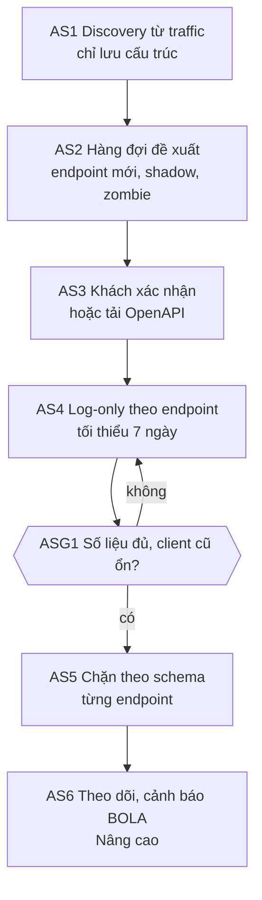

# 3.12 API security

> **Trạng thái (2026-11-17): chủ dự án đã duyệt đề xuất cho các câu OQ của trang này** (trừ OQ-118 của 3.11 vẫn hoãn). Luồng (bước 2) ở mục 6. Tách ra từ trang bot cũ để 3.9 chỉ còn bot và
> challenge. Trang này chỉ liệt kê kịch bản và câu hỏi. Thiết kế kỹ thuật ở kiến trúc 8.17.

## 1. Phạm vi

Bảo vệ API của khách: biết API có những endpoint nào, ai gọi, gọi có đúng hợp đồng không, và chặn lạm dụng
mà WAF thông thường không thấy. Liên quan: F3.7, F5.1.8 ở [§1](../01-functional-decomposition.md).

## 2. Kịch bản theo từng trục

### A. Loại API của khách

| Mã | Kịch bản | Concern |
|---|---|---|
| KB12-A1 | REST JSON cho web và mobile của chính khách | Trường hợp phổ biến |
| KB12-A2 | API công khai cho đối tác, có API key | Consumer rõ ràng |
| KB12-A3 | GraphQL | Một endpoint, nhiều thao tác; truy vấn lồng sâu |
| KB12-A4 | gRPC | Theo method |
| KB12-A5 | Webhook nhận vào từ bên ngoài (cổng thanh toán) | Không có xác thực người dùng, chỉ có chữ ký |
| KB12-A6 | API cũ, nhiều version chạy song song | Version cũ không ai bảo trì |

### B. Biết API có gì (discovery)

| Mã | Kịch bản | Concern |
|---|---|---|
| KB12-B1 | Tự phát hiện endpoint từ traffic | Endpoint do kẻ tấn công dò cũng xuất hiện; ai xác nhận |
| KB12-B2 | Endpoint không có trong tài liệu (shadow API) | Khách không biết mình có |
| KB12-B3 | Endpoint không còn dùng nhưng vẫn mở (zombie API) | Gỡ hay chặn |
| KB12-B4 | Path có tham số (`/users/123`) | Gom thành mẫu `/users/{id}` |
| KB12-B5 | Lưu mẫu request, response để mô tả endpoint | Dữ liệu cá nhân (OQ-84) |

### C. Hợp đồng (schema)

| Mã | Kịch bản | Concern |
|---|---|---|
| KB12-C1 | Khách tải OpenAPI lên | Tài liệu cũ, không khớp thực tế; chạy log-only bao lâu trước khi chặn |
| KB12-C2 | Sinh schema nháp từ traffic | Học cả request độc |
| KB12-C3 | API đổi version, deploy liên tục | Schema phải theo kịp CI/CD |
| KB12-C4 | Kích thước, độ sâu, số phần tử của body | Giới hạn theo gói |

### D. Xác thực và consumer

| Mã | Kịch bản | Concern |
|---|---|---|
| KB12-D1 | JWT, nhiều issuer, khoá xoay | QS-23 |
| KB12-D2 | API key trong header hoặc query | Key trong query lộ vào log |
| KB12-D3 | mTLS từ đối tác | CA của khách |
| KB12-D4 | Consumer là gì: API key, `sub` của JWT, IP | Rate limit theo consumer |
| KB12-D5 | Token bị đánh cắp dùng từ nơi khác | Edge có phát hiện không |

### E. Lạm dụng API

| Mã | Kịch bản | Concern |
|---|---|---|
| KB12-E1 | Truy cập dữ liệu của người khác bằng cách đổi ID (BOLA) | Cần hiểu quan hệ người dùng và đối tượng |
| KB12-E2 | Lấy dữ liệu hàng loạt bằng phân trang | Rate limit theo consumer |
| KB12-E3 | Response chứa dữ liệu nhạy cảm thừa (số CMND, số thẻ) | Edge có đọc response không, tốn CPU |
| KB12-E4 | GraphQL truy vấn đắt, introspection mở | |
| KB12-E5 | API OTP, đăng ký bị bot gọi | Giao với 3.9 (SMS pumping) |

### F. Vận hành

| Mã | Kịch bản | Concern |
|---|---|---|
| KB12-F1 | Client mobile cũ không cập nhật, gửi request sai schema mới | Chặn làm hỏng app đang chạy |
| KB12-F2 | Lỗi trả về theo định dạng API (JSON), không phải trang HTML | |
| KB12-F3 | Khách quản lý schema qua Git, Terraform | UI là nguồn sự thật (OQ-35) |

## 3. Câu hỏi cần chủ dự án quyết

| ID | Câu hỏi | Kịch bản | Ghi chú ban đầu |
|---|---|---|---|
| OQ-84 | API discovery có lưu mẫu request, response không (dữ liệu cá nhân)? | KB12-B5, KB12-E3 | Chuyển từ trang bot cũ |
| OQ-107 | Endpoint phát hiện mới: tự thêm vào danh sách, hay chờ khách xác nhận? Shadow, zombie API thì làm gì mặc định? | KB12-B1…KB12-B3 | |
| OQ-108 | Chặn theo schema: log-only tối thiểu bao lâu, chặn theo từng endpoint hay cả API? | KB12-C1, KB12-F1 | |
| OQ-109 | Edge có kiểm response (dữ liệu nhạy cảm, kích thước) không? | KB12-E3 | Tốn CPU, đang ở mức Nâng cao |
| OQ-110 | Phát hiện BOLA có trong lộ trình không, cần khách khai báo gì? | KB12-E1 | |
| OQ-111 | Consumer mặc định nhận diện bằng gì khi khách không khai báo? | KB12-D4 | |

## 4. Phụ thuộc

FR-3-09, FR-5-19 ở [§2](../02-requirements.md); kiến trúc 8.17, ADR-0039; QS-22, QS-23.

## 5. Đã quyết (duyệt 2026-11-17)

> Chủ dự án duyệt tất cả đề xuất dưới đây ngày 2026-11-17. Đề xuất do Claude viết (trang gốc chưa có mục phân tích); con số là ước lượng đã được duyệt.

| Câu | Quyết định |
|---|---|
| OQ-84 | (b): mặc định chỉ lưu cấu trúc (tên field, kiểu, độ dài) và cờ nhạy cảm. Lưu mẫu thật chỉ khi khách bật theo endpoint, che theo BR-44, giữ 7 ngày |
| OQ-107 | (b): vào hàng đợi "đề xuất"; shadow API hiện ở danh mục chưa xác nhận kèm cảnh báo; zombie không tự chặn, khách chọn gỡ hoặc chặn |
| OQ-108 | Tối thiểu 7 ngày log-only; chặn theo từng endpoint, không cả API; cho phép nhiều version schema song song cho client cũ |
| OQ-109 | Không ở MVP; Nâng cao: phát hiện dữ liệu nhạy cảm (số thẻ, CMND) và kích thước bất thường theo lấy mẫu |
| OQ-110 | Có ở Nâng cao, dạng cảnh báo theo baseline hành vi, không chặn; khách khai báo claim định danh và tham số ID |
| OQ-111 | Thứ tự: API key trong header, rồi `sub` của JWT (khách khai báo claim), cuối cùng IP kèm dấu vân tay TLS |

## 6. Luồng: API discovery và chặn theo schema (bước 2, đã duyệt 2026-11-17)

| Bước | Ai | Điều kiện hoặc cổng | Hỏng thì xử lý | Dữ liệu sinh ra |
|---|---|---|---|---|
| AS1 Discovery | Hệ thống | **Mặc định chỉ lưu cấu trúc** (tên field, kiểu, độ dài) và cờ nhạy cảm; lưu mẫu thật chỉ khi khách bật theo endpoint, che theo BR-44, giữ 7 ngày ([OQ-84](#5-đã-quyết-duyệt-2026-11-17)) | Lộ dữ liệu cá nhân: tắt lưu mẫu, xoá | `ApiEndpointShape` |
| AS2 Đề xuất | Hệ thống | Endpoint mới **vào hàng đợi "đề xuất"**, không tự thêm (endpoint do kẻ tấn công dò cũng xuất hiện); shadow API hiện ở danh mục chưa xác nhận kèm cảnh báo; zombie không tự chặn (OQ-107) | | `ApiEndpointProposal` |
| AS3 Xác nhận | Khách | Xác nhận endpoint, hoặc tải OpenAPI; schema cũ không khớp thực tế thì báo khác biệt | | `ApiSchema` |
| AS4 Log-only | Hệ thống | Tối thiểu 7 ngày, **theo từng endpoint, không cả API**; hỗ trợ nhiều version schema song song cho client cũ (OQ-108) | Client mobile cũ gửi sai schema: giữ version cũ, không chặn | `ApiSchemaEvent` |
| AS5 Chặn | Khách, qua change request ([3.2](02-policy-change.md)) | Kiểm schema chạy trước managed ruleset (BR-35) | | `ApiEnforce` |
| AS6 Theo dõi | Khách, SOC | **BOLA** ở Nâng cao: cảnh báo theo baseline hành vi, không chặn; khách khai báo claim định danh và tham số ID (OQ-110). Edge **không kiểm response** ở MVP; Nâng cao: phát hiện dữ liệu nhạy cảm và kích thước bất thường theo lấy mẫu (OQ-109) | | `ApiAlert` |

**Consumer mặc định (OQ-111):** theo thứ tự API key trong header, rồi `sub` của JWT (khách khai báo claim), cuối cùng IP kèm dấu vân tay TLS (IP là mức cuối vì NAT).
