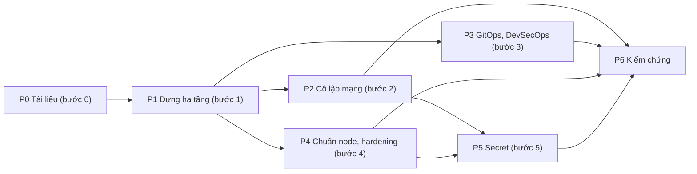

# Kế hoạch lab WAAP: dựng 4 plane, mạng cô lập, GitOps, hardening, secret

> **Trạng thái: đề xuất của Claude, chờ chủ dự án duyệt (2026-11-13).** Chưa có quyết định nào ở đây, trừ những
> điều đã nằm sẵn trong các ADR và được dẫn nguồn. **Cập nhật 2026-11-13:** chủ dự án chốt lab chạy trên máy ảo và yêu cầu chia vùng mạng hợp lý; thiết kế mạng
> (P0) đã viết ở [7.6](../docs/architecture/07-deployment/06-network-zones-and-flows.md) và [ADR-0047](../docs/architecture/09-adr/0047-network-zones-and-default-deny.md), chờ duyệt. Kế hoạch bám 6 bước trong [README.md](README.md). Phần
> [§1](#1-câu-hỏi-cần-chốt-trước-khi-chạy) liệt kê những gì cần chủ dự án chốt; mỗi câu có mặc định đề xuất để chốt nhanh.

## 0. Hiện trạng (đã kiểm trong repo)

| Có sẵn | Chưa có |
|---|---|
| Docker compose chạy dev: management-plane, analytics-api, ClickHouse, dns-mock | Hạ tầng lab nhiều máy; mọi thứ hiện chạy trên một máy |
| CI: Go build, vet, test, fmt, govulncheck, Semgrep, CodeQL, mỗi plane một job | Pipeline triển khai (GitOps); quét image, SBOM, ký artifact |
| Kiến trúc: 4 plane, mô hình SaaS, vùng chịu lỗi, môi trường (7.1 đến 7.4); mTLS nội bộ (8.19); OpenBao cho PKI và khoá ký (ADR-0017); Kubernetes cho plane trung tâm, edge ngoài K8s (ADR-0023) | **Network topology** (public, private, ma trận luồng), chuẩn hệ điều hành và hardening, thiết kế secret manager cho lab |
| Trust root JWKS một nơi cấp, xoay khoá không cần restart | Xoay secret theo từng loại hạ tầng ngoài JWKS |

Quy tắc đã chốt phải giữ: **edge không nói chuyện trực tiếp với management**; kết nối edge → Control đi từ trong ra
ngoài; mỗi plane một chu kỳ triển khai riêng ([ADR-0001](../docs/architecture/09-adr/0001-four-planes.md),
[ADR-0006](../docs/architecture/09-adr/0006-saas-first-on-prem-capable.md)).

## 1. Câu hỏi cần chốt trước khi chạy

| # | Câu hỏi | Mặc định đề xuất |
|---|---|---|
| L1 | Lab chạy trên nền nào? | **Đã chốt (chủ dự án, 2026-11-13): máy ảo.** Còn mở: hypervisor cụ thể (Proxmox, KVM) và `fw-1` dùng nftables hay VyOS |
| L2 | Tài nguyên tối đa: số máy, CPU, RAM, disk? | Bốn profile theo RAM (`core`, `min`, `compact`, `full`) ở [7.6 §5](../docs/architecture/07-deployment/06-network-zones-and-flows.md#5-bố-cục-máy-ảo-theo-vùng). Chủ dự án dự kiến máy 64 đến 128 GB RAM trong tương lai; lab viết theo biến `profile` để nâng lên không phải viết lại. Máy hiện tại: chờ anh cho biết cấu hình |
| L3 | Hệ điều hành cho node: một họ hay nhiều? | Ubuntu 24.04 LTS cho mọi node ở lab, một chuẩn hardening duy nhất ([ADR-0048](../docs/architecture/09-adr/0048-node-baseline-and-hardening-profiles.md)) |
| L4 | Công cụ GitOps và IaC? | Argo CD cho K8s; **OpenTofu** cho hạ tầng (Terraform và Packer là BSL, trái tinh thần ADR-0024); Ansible cho cấu hình node; image cloud gốc cộng cloud-init, chưa dùng golden image ([ADR-0049](../docs/architecture/09-adr/0049-gitops-and-devsecops-per-plane.md)) |
| L5 | Chuẩn hardening: CIS benchmark mức nào? | CIS Level 1 bắt buộc cho mọi node; Level 2 cho edge và bastion |
| L6 | Lab có nhận traffic thật từ Internet không (cần domain, IP public)? | Không ở giai đoạn đầu: dùng dns-mock, origin giả và bộ sinh traffic nội bộ; thêm một cổng public riêng ở giai đoạn cuối |
| L7 | OpenBao (đã chốt ở ADR-0017) chạy ở đâu, mở khoá (unseal) thế nào? | Cụm 3 node Raft trên máy ảo riêng, ngoài K8s; unseal bằng Shamir 5 phần, cần 3 (lab); tự mở khoá bằng transit hoặc KMS ở production ([ADR-0050](../docs/architecture/09-adr/0050-secret-management-and-rotation.md)) |
| L8 | Lab dùng cho gì ngoài trình diễn: có chạy benchmark, chaos, pentest không? | Có kiểm thử cô lập mạng và chaos nhẹ; benchmark để sau |

## 2. Thiết kế đề xuất

### 2.1 Bố cục lab đề xuất

Đã chuyển sang [7.6 §5](../docs/architecture/07-deployment/06-network-zones-and-flows.md#5-bố-cục-máy-ảo-theo-vùng) để chỉ có một nơi giữ danh sách máy: hai cấu hình, đầy đủ (khoảng 30 máy nhỏ) và thu gọn (khoảng 15), cùng một thiết kế mạng.

### 2.2 Vùng mạng (trust zone) đề xuất

Đã chuyển sang [7.6 §2](../docs/architecture/07-deployment/06-network-zones-and-flows.md#2-vùng-tin-cậy): tám vùng (Internet giả lập, Edge DMZ, Biên, Ứng dụng nội bộ, Dữ liệu, Secret, Vận hành, hypervisor), một bộ định tuyến L3 duy nhất, mặc định chặn tất cả. Ma trận luồng ở [7.6 §4](../docs/architecture/07-deployment/06-network-zones-and-flows.md#4-ma-trận-luồng); các test mạng ở [7.6 §6](../docs/architecture/07-deployment/06-network-zones-and-flows.md#6-kiểm-thử-mạng). Quyết định ở [ADR-0047](../docs/architecture/09-adr/0047-network-zones-and-default-deny.md).

## 3. Các giai đoạn

Kích thước: S (vài ngày), M (một đến hai tuần), L (nhiều tuần). Là ước lượng thô, chưa tính vào lịch.

### P0. Cập nhật tài liệu (bước 0) · S

Mục tiêu: có thiết kế mạng và triển khai được duyệt **trước khi** dựng, theo đúng ghi chú đầu tiên của chủ dự án.

- Viết thêm vào `7. Deployment View`: mục network topology (vùng mạng, sơ đồ), **ma trận luồng** (nguồn, đích, cổng, giao thức, xác thực, ai khởi tạo), môi trường lab trong 7.4. **Phần mạng đã viết (2026-11-13) ở [7.6](../docs/architecture/07-deployment/06-network-zones-and-flows.md) và [ADR-0047](../docs/architecture/09-adr/0047-network-zones-and-default-deny.md), chờ duyệt.** Ba ADR còn lại đã viết: [0048](../docs/architecture/09-adr/0048-node-baseline-and-hardening-profiles.md) (chuẩn node), [0049](../docs/architecture/09-adr/0049-gitops-and-devsecops-per-plane.md) (GitOps), [0050](../docs/architecture/09-adr/0050-secret-management-and-rotation.md) (secret), chờ duyệt.
- ADR mới: phân vùng mạng; chuẩn node (OS, partition, hardening); GitOps; quản lý secret và lịch xoay.
- Cập nhật 12 (glossary) nếu có thuật ngữ mới.
- **Đầu ra:** sơ đồ mạng, ma trận luồng (một bảng, mỗi dòng một luồng được phép), 4 ADR ở trạng thái đề xuất.
- **Cổng qua:** chủ dự án duyệt các ADR và ma trận luồng.

### P1. Dựng hạ tầng lab 4 plane (bước 1) · L

Phụ thuộc: P0 (bố cục và quyết định L1 đến L4).

1. Hạ tầng như mã (OpenTofu): máy ảo, đĩa, mạng ảo, theo [§2.1](#21-bố-cục-lab-đề-xuất).
2. Image cloud gốc cộng cloud-init và Ansible (role `baseline`): chưa áp đủ hardening ở bước này.
3. Cụm K8s, ingress, cert-manager; Postgres, RabbitMQ, Kafka, ClickHouse, Valkey.
4. Triển khai bốn plane bằng artifact hiện có: management-plane, control-plane, analytics-plane, edge-plane; dns-mock thay DNS thật.
5. `origin` giả và `loadgen`.
- **Đầu ra:** một luồng đầu cuối chạy được: tạo zone và rule ở management → control biên dịch, đẩy snapshot → edge chặn đúng request của `loadgen` → event về Analytics.
- **Cổng qua:** kịch bản đầu cuối chạy lại được từ mã (xoá lab, dựng lại, chạy lại) mà không cần thao tác tay.

### P2. Cô lập mạng và bảo mật liên plane (bước 2) · M

Phụ thuộc: P1.

- Áp vùng mạng ở [§2.2](#22-vùng-mạng-trust-zone-đề-xuất) bằng: VLAN hoặc mạng ảo tách; firewall máy chủ (nftables) default-deny; NetworkPolicy trong K8s; không route chéo.
- mTLS cho mọi liên kết nội bộ theo 8.19: cert ngắn hạn do OpenBao cấp, gia hạn tự động.
- Truy cập quản trị chỉ qua bastion (WireGuard + MFA); tắt SSH trực tiếp.
- **Kiểm thử âm** (phải có, chạy lại được trong CI):
  - từ `edge-*` không tới được Postgres, OpenBao, Management;
  - từ DMZ không tới được vùng dữ liệu;
  - lấy một cert node đã hết hạn thì bị từ chối ở mọi liên kết.
- **Cổng qua:** toàn bộ kiểm thử âm xanh; ma trận luồng khớp với luật firewall thực tế (kiểm tự động, không so bằng mắt).

### P3. GitOps và DevSecOps trong từng plane (bước 3) · M

Phụ thuộc: P1 (có thể song song với P2).

- **Một pipeline cho mỗi plane**, vì bốn plane có chu kỳ triển khai riêng (một thay đổi ở portal không được làm edge deploy lại).
- Các chặng bắt buộc: lint, unit test, SAST (Semgrep, đã có), SCA (govulncheck, đã có), quét secret, build container, SBOM, quét image, ký (cosign), kiểm chính sách (OPA hoặc Kyverno), triển khai.
- GitOps: Git là nguồn sự thật; Argo CD kéo; nhánh tách môi trường (dev, staging, canary, production theo 7.4); thay đổi qua pull request có duyệt.
- Phần mềm edge rollout qua canary PoP với cùng cơ chế gate như snapshot (7.4).
- Phát hiện trôi (drift): cấu hình trên cụm lệch Git thì báo và tự về lại Git.
- **Cổng qua:** một thay đổi từ commit đến chạy ở staging hoàn toàn tự động; image không ký hoặc có lỗ hổng mức cao bị chặn; thử cố ý sửa tay trên cụm và thấy nó bị hoàn lại.

### P4. Chuẩn cài đặt node và hardening (bước 4) · M

Phụ thuộc: P1; chuẩn do P0 duyệt.

Một **chuẩn chung** (một tài liệu, một tập vai trò Ansible) và các hồ sơ node theo vai trò:

| Hồ sơ | Dùng cho | Khác biệt chính |
|---|---|---|
| `k8s-node` | cp và worker K8s | Cấu hình kernel cho container, kubelet đã khoá |
| `edge-l7` | Pool L7 | Bare metal: NIC (RSS, IRQ affinity), NVMe cho cache, kernel network tuning, quyền tối thiểu cho listener 80/443 |
| `edge-waf` | Pool WAF | CPU và cgroup riêng; không có đường ra Internet |
| `data` | Postgres, ClickHouse, Kafka | Phân disk riêng cho dữ liệu, WAL, log; giới hạn I/O; backup |
| `secret` | OpenBao | Không swap; mã hoá disk; bộ nhớ khoá; chỉ nhận từ vùng secret |
| `bastion` | Cửa quản trị | Ghi phiên (session recording); MFA; không lưu khoá riêng của ai |

Mỗi hồ sơ khai rõ: hệ điều hành và phiên bản, phân vùng đĩa (mount `/`, `/var`, `/var/log`, `/tmp` với `noexec`, `/home`, đĩa dữ liệu), người dùng và nhóm, sudo, SSH (khoá, không mật khẩu, không root), dịch vụ được bật, kernel sysctl, auditd, kiểm tra tính toàn vẹn file, đồng bộ giờ, vá tự động, bộ khởi động an toàn.

- **Cổng qua:** quét CIS (OpenSCAP hoặc Lynis) đạt ngưỡng đã chốt ở L5 trên mọi hồ sơ; dựng lại node từ image và Ansible cho kết quả giống nhau (không trôi).

### P5. Secret manager và xoay secret tự động (bước 5) · M

Phụ thuộc: P2 (mTLS), P4 (hồ sơ `secret`).

- OpenBao HA (Raft, ba node), chính sách truy cập tối thiểu, audit bật; root CA nằm ngoài OpenBao (ngoại tuyến), CA trung gian trong OpenBao (đã định ở 8.19).
- Giao secret tới nơi dùng: K8s qua External Secrets hoặc CSI; node ngoài K8s qua agent; không để secret trong biến môi trường lâu dài, không nằm trong Git.
- **Bảng xoay theo loại**:

| Loại | Nguồn | Chu kỳ gợi ý | Cách xoay | Nơi dùng nạp lại thế nào |
|---|---|---|---|---|
| Khoá ký JWKS | thư mục khoá của issuer | Theo lịch + khi lộ | Thêm khoá, chuyển ký, gỡ khoá cũ (đã có, không restart) | Verifier tự lấy lại khi gặp kid lạ |
| Cert node và dịch vụ | OpenBao PKI | Ngắn hạn (ngày) | Tự gia hạn, không có bước tay (ADR-0045) | Agent tải lại |
| Mật khẩu DB của dịch vụ | OpenBao dynamic secret | Giờ đến ngày | Cấp tạm thời, thu hồi khi hết hạn | Connection pool xoay |
| Secret webhook, kênh thông báo của khách | Secret store theo tenant | Do khách chọn | Qua API, ghi nhận audit | Đọc lại mỗi lần gửi |
| Khoá ký manifest | OpenBao transit | Theo lịch | Phiên bản khoá, edge tin nhiều khoá song song | Edge cập nhật danh sách tin cậy |

- Quy trình khẩn: lộ khoá thì thu hồi và xoay trong một thao tác; có diễn tập.
- **Cổng qua:** xoay mỗi loại trong bảng khi hệ thống đang chạy tải mà không có lỗi; thu hồi một cert node và thấy node bị từ chối trong thời hạn đã chốt.

### P6. Kiểm chứng toàn lab · M

Phụ thuộc: P2 đến P5.

| Kịch bản | Kỳ vọng |
|---|---|
| Edge node bị chiếm | Không tới được dữ liệu hay secret; cert node thu hồi được |
| Core (Management, Control) sập | Traffic không ảnh hưởng (7.3) |
| Một Analytics ngưng | Edge giữ log trong buffer đĩa; không mất security event |
| Phát một policy từ portal | Tới edge trong thời hạn mục tiêu của kiến trúc; rollout có gate và rollback |
| Xoay khoá JWKS giữa lúc có tải | Không lỗi xác thực |
| Sửa tay một cấu hình trên cụm | GitOps hoàn lại |
| Dựng lại toàn bộ lab từ Git | Chạy đầu cuối lại như P1 |

## 4. Thứ tự và phụ thuộc

P2, P3, P4 chạy song song được sau P1. P0 chặn tất cả.

## 5. Rủi ro

| Rủi ro | Hướng xử lý |
|---|---|
| Dựng trước khi chốt mạng và chuẩn, rồi làm lại | P0 là cổng cứng: không dựng trước khi duyệt |
| Lab quá lớn so với máy hiện có | Thu về ba máy cho mỗi vai trò quan trọng, bỏ HA ở lab nhỏ (chốt ở L2) |
| Mất công duy trì hai chuẩn (lab và production) | Một chuẩn chung, lab chỉ khác quy mô |
| Hardening làm hỏng hiệu năng edge | Đo trước và sau từng hạng mục (benchmark nhẹ), không áp đồng loạt |
| Secret trôi ra Git hoặc log | Quét secret trong CI, chặn merge; mã hoá bằng SOPS nếu cần để trong Git |
| Edge "bare metal" thật khác máy ảo | Ghi rõ khác biệt; thử trên một máy vật lý khi có |

## 6. Ngoài phạm vi lab này

Mua IP, anycast, đối tác DDoS L3/L4, nhà cung cấp hạ tầng thật, đa vùng địa lý, chứng chỉ tuân thủ (ISO, SOC 2),
chi phí vận hành. Những mục này nằm ở 3.11 (Vận hành của NCC), không thuộc lab kỹ thuật.
